# BẢN NHÁP BÁO CÁO — CHƯƠNG 2 VÀ CHƯƠNG 3

**Đề tài:** Xây dựng nền tảng Data Lake tích hợp RAG và LLM hỗ trợ tra cứu, hỏi đáp văn bản pháp luật, chính sách và quy định về trí tuệ nhân tạo.

**Học phần:** Dữ liệu lớn — định hướng Data Engineering. **Phiên thực nghiệm:** 16/11/2026. **Corpus:** 63 tài liệu, 3.285 đoạn, catalog 85 mục.

Bản nháp này nối tiếp Chương 1 của nhóm, tập trung vào thiết kế và thực nghiệm. Nhóm bổ sung tên trường, giảng viên, thành viên và yêu cầu định dạng của cơ sở đào tạo khi ghép vào bản nộp. Số liệu là kết quả đã ghi nhận; tài nguyên đề xuất được phân biệt với cấu hình thực nghiệm, và các công nghệ chưa triển khai được ghi ở phần hướng phát triển.

[Mục lục đề xuất và dung lượng biên tập](01_MUC_LUC_DE_XUAT.md) · [Bộ biểu đồ riêng](03_BIEU_DO_THONG_KE.md) · [Danh mục dữ liệu và truy vấn](PHU_LUC_DANH_MUC_DU_LIEU.md) · [Hướng dẫn tái tạo](README.md).

---

# CHƯƠNG 2. PHÂN TÍCH VÀ THIẾT KẾ HỆ THỐNG

## 2.1. Bài toán và yêu cầu

Đề tài hướng tới một thư viện có khả năng tiếp nhận, lưu trữ và khai thác văn bản về quản trị trí tuệ nhân tạo. Đối tượng dữ liệu gồm văn bản pháp luật Việt Nam, quy định quốc tế, khung quản trị rủi ro, chiến lược và hướng dẫn thực hành AI. Người dùng cần tìm đúng tài liệu, đọc các đoạn liên quan và đặt câu hỏi bằng tiếng Việt, đồng thời có thể mở nguồn để kiểm tra câu trả lời.

Khó khăn của bài toán nằm ở vòng đời dữ liệu. Nguồn nằm ở nhiều website, có PDF và HTML, cách biểu diễn ngày ban hành và khu vực khác nhau, một nội dung có thể xuất hiện qua nhiều kênh. Dữ liệu mới phải đi qua quá trình kiểm tra, làm sạch và lập chỉ mục trước khi sử dụng. Vì vậy, thành phần trung tâm của đề tài là đường ống dữ liệu từ nguồn đến lớp phục vụ; chatbot là một ứng dụng khai thác lớp dữ liệu này.

**Bảng 2.1. Yêu cầu và tiêu chí kiểm tra**

| Mã | Yêu cầu | Cách hiện thực và kiểm tra |
|---|---|---|
| FR01 | Thu thập nhiều dạng tài liệu chính thức | Catalog URL, bộ tải và parser; lưu bản gốc trước khi xử lý |
| FR02 | Lấy văn bản mới qua API | Nút Cập nhật dữ liệu gọi worker; phân trang danh mục và lấy toàn văn JSON/HTML |
| FR03 | Người dùng bổ sung tệp | Upload PDF, DOCX, TXT, HTML, XML; xử lý cùng pipeline |
| FR04 | Chuẩn hóa và loại nội dung trùng | Spark DataFrame, SHA-256 và Window theo nội dung |
| FR05 | Lưu dữ liệu theo lớp và có thể truy vết | Raw, Parsed, Processed, Chunks, manifests; bản sao trên HDFS |
| FR06 | Tìm đoạn phù hợp | BGE-M3, Qdrant, lọc khu vực/tài liệu, top-k |
| FR07 | Hỏi đáp có dẫn chứng | Ngữ cảnh có ID nguồn, Qwen3 Instruct, kiểm tra nhãn trích dẫn |
| FR08 | Số đếm giao diện nhất quán | Tài liệu đang tra cứu được tính từ manifest của chỉ mục đang dùng |
| FR09 | Cập nhật có trạng thái và không công bố chỉ mục dở | Worker nền, khóa, snapshot mới, kiểm tra số point rồi đổi alias |
| FR10 | Có bằng chứng thực nghiệm | JSON/CSV, kiểm thử, thống kê dữ liệu, ảnh ứng dụng và hạ tầng đang chạy |
| FR11 | Nghe câu trả lời cùng người thuyết trình | TTS tiếng Việt, nhân vật nữ, phụ đề, phát/tạm dừng/đọc lại và tốc độ |

Yêu cầu phi chức năng gồm khả năng lặp lại pipeline, thông báo rõ lỗi theo nguồn, giữ provenance của tệp người dùng và tách trạng thái kỹ thuật khỏi trạng thái pháp lý. Ví dụ, `legal_status=unknown` có nghĩa là chưa xác minh được hiệu lực; việc có một vector trong Qdrant không làm văn bản trở thành văn bản còn hiệu lực.

Phạm vi hiện thực là bản mẫu chạy trên một máy bằng Docker Desktop/WSL2. Spark chạy `local[2]`, HDFS có một DataNode và hệ số nhân bản 1. Hệ thống thể hiện những thành phần của một nền tảng Data Lake và có đường nâng cấp về sau; kết quả thực nghiệm không được diễn giải thành năng lực của cụm Spark nhiều máy.

## 2.2. Cơ sở lựa chọn kiến trúc và công nghệ

Chương 1 đã trình bày lý thuyết; ở đây các tài liệu được dùng để giải thích quyết định thiết kế. Hệ thống tổ chức dữ liệu thành các lớp để tách bản gốc, nội dung đã chuẩn hóa và sản phẩm phục vụ truy vấn. Cách phân lớp tham khảo mẫu Bronze/Silver/Gold [5], nhưng hiện thực hiện tại sử dụng thư mục, JSON và Parquet, không có bảng Delta Lake hay giao dịch ACID của một lakehouse hoàn chỉnh.

**Bảng 2.2. Quyết định thiết kế và cơ sở tham khảo**

| Quyết định | Lý do trong dự án | Cơ sở |
|---|---|---|
| HDFS và WebHDFS | Minh họa lưu trữ phân lớp, tách metadata và block; thao tác từ Python qua HTTP | Kiến trúc HDFS và giao thức WebHDFS [1], [2] |
| Spark DataFrame | Chuẩn hóa nhiều trường, lọc, băm và khử trùng bằng phép biến đổi dữ liệu | Spark/RDD và tài liệu Spark SQL [3], [4] |
| Parquet nén Snappy | Lưu bảng có schema, đọc theo cột; thuận tiện trao đổi giữa Spark và PyArrow | Tài liệu Apache Parquet và Spark [4], [6] |
| BGE-M3 dense | Cùng không gian vector cho nội dung Việt/Anh; phù hợp tìm kiếm ngữ nghĩa | Công bố BGE-M3 [8] |
| Qdrant với alias | Tách tên truy vấn ổn định khỏi collection phiên bản | Tài liệu collection và alias của Qdrant [9] |
| RAG và Qwen3 Instruct | Đưa đoạn nguồn vào prompt thay vì chỉ dùng kiến thức có sẵn trong LLM | Lewis và cộng sự [7]; Qwen3 và model card thực dùng [10], [11] |
| Metadata provenance xuyên pipeline | Đối chiếu nguồn, phiên bản và hoạt động xử lý khi câu trả lời có sai lệch | Tham khảo khái niệm entity/activity của PROV [12] |
| Docker Compose và Streamlit | Triển khai được nhiều dịch vụ trên máy học tập; có giao diện upload và tra cứu | Tài liệu Docker và Streamlit [13], [14] |

Nghiên cứu BGE-M3 mô tả nhiều kiểu truy xuất; dự án hiện chỉ dùng **dense embedding 1.024 chiều**. Hệ thống chưa triển khai sparse retrieval, multi-vector hay cross-encoder reranker. Tương tự, metadata được thiết kế để truy nguyên nhưng chưa được xuất theo đầy đủ mô hình RDF/PROV-O. Việc nêu rõ mức sử dụng giúp đánh giá đúng phần công nghệ nhóm đã thực hiện.

## 2.3. Kiến trúc và flowchart toàn hệ thống

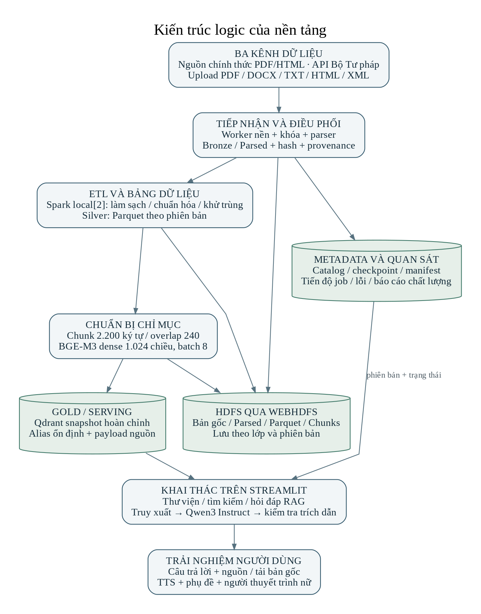

*Hình 2.1. Kiến trúc tổng thể, dựng từ các mô-đun và dịch vụ trong mã nguồn.*

Hệ thống có hai luồng chính. Luồng nạp dữ liệu tiếp nhận nguồn chính thức và tệp người dùng, tạo bản gốc, trích xuất nội dung, chạy Spark ETL, chia đoạn và tạo vector. Luồng khai thác tiếp nhận truy vấn, tìm các đoạn trong Qdrant và trả kết quả tìm kiếm hoặc sinh câu trả lời có nguồn. HDFS lưu các lớp và manifest phục vụ kiểm tra, khôi phục và nghiên cứu; Qdrant phục vụ truy xuất vector, không thay thế kho dữ liệu gốc.

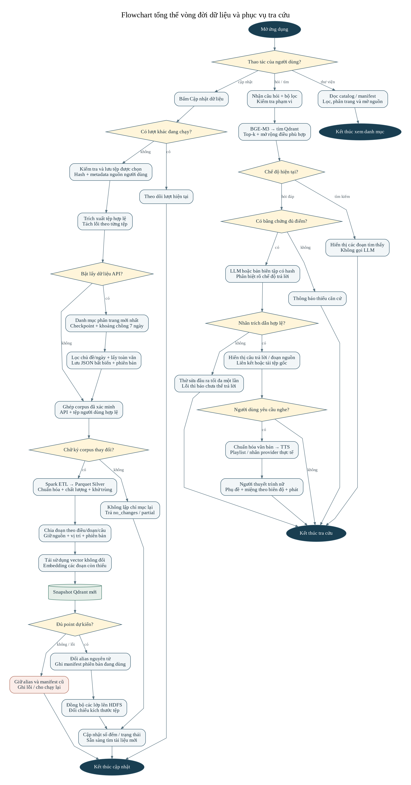

*Hình 2.2. Flowchart toàn hệ thống, gồm cập nhật, upload, ETL, công bố chỉ mục, tìm kiếm và hỏi đáp. [Mở SVG để phóng to](hinh_anh/hinh_2_02_flowchart_toan_bo.svg).*

Trong nhánh cập nhật, hệ thống kiểm tra khóa để tránh hai worker cùng ghi dữ liệu. Các đầu vào mới được lưu và ghép với corpus đã kiểm tra; nếu chữ ký corpus không đổi, lượt chạy kết thúc với `no_changes`. Khi dữ liệu thay đổi, worker tạo Processed/Chunks riêng cho job, xây collection mới và chỉ công bố sau kiểm tra số point. Nếu HDFS đồng bộ lỗi sau công bố, hệ thống báo trạng thái một phần vì lớp phục vụ đã cập nhật còn bản sao trên lake cần xử lý tiếp.

Trong nhánh khai thác, tìm kiếm chỉ trả các đoạn và đường dẫn nguồn. Hỏi đáp bổ sung kiểm tra phạm vi, bằng chứng và đầu ra LLM. Hai chức năng dùng chung kho vector nhưng có điều kiện hoàn tất khác nhau; không phải mọi thao tác tìm kiếm đều gọi LLM. Thư viện tài liệu đọc catalog kết hợp manifest để lọc, phân trang và chỉ rõ trạng thái lập chỉ mục.

**Bảng 2.3. Phân rã mã nguồn theo trách nhiệm**

| Thành phần | Mã nguồn chính | Trách nhiệm |
|---|---|---|
| Giao diện | [app.py](../../app.py) | Bộ lọc, tìm kiếm, hỏi đáp, upload, trạng thái cập nhật |
| Nguồn động | [dynamic_api.py](../../src/ingestion/dynamic_api.py) | Danh mục API, toàn văn, checkpoint, nguồn và phiên bản |
| Xử lý văn bản | [parser.py](../../src/ingestion/parser.py) | Trích xuất và kiểm tra nội dung đầu vào |
| ETL | [spark_etl.py](../../src/processing/spark_etl.py) | Làm sạch, chuẩn hóa, khử trùng và Parquet |
| Chia đoạn | [chunker.py](../../src/processing/chunker.py) | Ranh giới đoạn, chồng lấn và metadata vị trí |
| Chỉ mục | [indexer.py](../../src/rag/indexer.py) | Embedding, point ID, snapshot và alias |
| Truy xuất và trả lời | [retriever.py](../../src/rag/retriever.py), [answerer.py](../../src/rag/answerer.py) | Tìm vector, ngữ cảnh điều khoản, sinh và kiểm tra nguồn |
| Điều phối | [update_data.py](../../scripts/update_data.py) | Job nền, ghép dữ liệu, công bố và đồng bộ |
| Thống kê thư viện | [catalog.py](../../src/catalog.py) | Cùng một định nghĩa số tài liệu đang hoạt động |

## 2.4. Thiết kế dữ liệu

### 2.4.1. Phạm vi và tiêu chí chọn nguồn

Nguồn được ưu tiên theo cơ quan ban hành hoặc tổ chức xuất bản: Cơ sở dữ liệu quốc gia về pháp luật/Bộ Tư pháp, Công báo, EUR-Lex, NIST, OECD, UNESCO, ASEAN và cơ quan quản lý tại một số quốc gia. Dữ liệu phục vụ nghiên cứu chính sách AI gồm cả văn bản quy phạm pháp luật lẫn tài liệu hướng dẫn; hai nhóm có giá trị sử dụng khác nhau và cần giữ loại tài liệu trong metadata.

Các tiêu chí tiếp nhận gồm xác định được nguồn, lấy được nội dung thật, nội dung đủ dài và phù hợp chủ đề. Một trang HTTP 200 vẫn có thể là trang chặn truy cập; chỉ có metadata hay abstract cũng chưa đủ làm toàn văn hỏi đáp. Với nguồn API Việt Nam, bộ lọc còn kiểm tra ngày ban hành, tiêu đề/tóm tắt liên quan AI và không nhận ngày tương lai. Các tài liệu ngữ cảnh như bảo vệ dữ liệu, an ninh hoặc công nghiệp công nghệ số được lưu khi có ý nghĩa đối với quản trị AI; corpus không được tuyên bố bao phủ toàn bộ hệ thống pháp luật.

Tại thời điểm thực nghiệm, catalog có 85 mục, 63 tài liệu đang tra cứu và 22 mục chưa lập chỉ mục. Số này thay đổi khi cập nhật. Danh mục là tập ứng viên; tập đang tra cứu là tập ID được công bố trong manifest. Phân biệt này giải quyết tình trạng trước đây giao diện so sánh số tài liệu đã lập chỉ mục với tổng số dòng nguồn.

### 2.4.2. Các lớp dữ liệu và đường dẫn

**Bảng 2.4. Thiết kế các lớp Data Lake**

| Lớp logic | Nội dung và định dạng | Staging trong dự án | Đích HDFS |
|---|---|---|---|
| Bronze — Raw | PDF/HTML gốc, phản hồi JSON danh mục và toàn văn API, tệp upload | `data/verified_raw`, `data/dynamic/raw`, `data/uploads` | `/ai_docs/raw`, nhánh `api`, `uploads` |
| Parsed | Nội dung văn bản + nguồn + thông tin phiên bản | `data/verified_parsed`, `data/dynamic/parsed`, parsed của upload | `/ai_docs/parsed` và các nhánh tương ứng |
| Silver — Processed | Bảng tài liệu sạch, khử trùng, Parquet | `data/updates/{job_id}/processed` | `/ai_docs/processed/{job_id}` |
| Gold — Chunks | JSONL và Parquet các đoạn, metadata vị trí | `data/updates/{job_id}/chunks` | `/ai_docs/chunks/{job_id}` |
| Lớp phục vụ vector | Vector 1.024 chiều và payload từng đoạn | Collection Qdrant theo snapshot | Volume Qdrant; không phải tệp HDFS |
| Điều khiển và kiểm toán | Catalog, checkpoint, báo cáo ETL, manifest chỉ mục/lake, trạng thái job | `data/manifests`, `data/updates/{job_id}` | `/ai_docs/manifests` cùng phần được đồng bộ |

Các phép xử lý hiện diễn ra trên thư mục staging được bind mount vào container. Sau đó Python gửi các tệp lên HDFS qua WebHDFS. Spark ở phiên bản này **không trực tiếp chạy một tác vụ phân tán đọc/ghi trên HDFS**. Sự phân tách này phù hợp máy demo và phải được thể hiện đúng trong sơ đồ triển khai.

### 2.4.3. Schema, định danh và truy nguyên

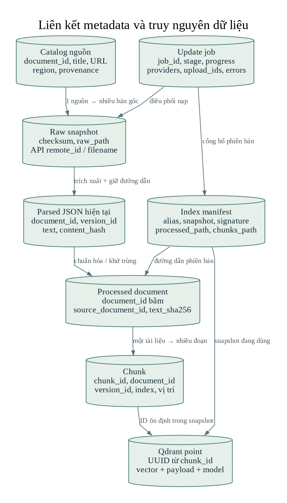

*Hình 2.9. Liên kết giữa catalog, bản gốc, tài liệu chuẩn hóa, đoạn, vector và job. Đây là quan hệ logic; các lớp được lưu trong JSON/Parquet, không có cơ sở dữ liệu quan hệ áp khóa ngoại.*

**Bảng 2.5. Từ điển dữ liệu quan trọng**

| Trường | Lớp | Ý nghĩa và quy tắc |
|---|---|---|
| `source_document_id` | Silver, chunk | ID ổn định của mục nguồn; dùng đếm tài liệu đang hoạt động |
| `document_id` | Silver | SHA-256 của ID nguồn, URL và hash nội dung sạch |
| `text`, `text_sha256` | Silver | Toàn văn chuẩn hóa và dấu vân tay nội dung |
| `source_url`, `source_org` | Xuyên lớp | URL/cơ quan nguồn để đối chiếu; upload dùng thông tin nguồn nội bộ |
| `region`, `jurisdiction`, `language` | Silver, chunk | Bộ lọc; `INTERNATIONAL` là nhãn gộp cho nhiều tổ chức/quốc gia |
| `published_date`, `effective_date`, `legal_status` | Silver, chunk | Metadata pháp lý từ nguồn; có thể thiếu hoặc chưa xác định |
| `provenance` | Xuyên lớp | `official_download`, `official_api`, `user_upload` |
| `version_id`, `content_hash`, `raw_path` | Xuyên lớp | Liên kết phiên bản nội dung tới bản gốc đã nhận |
| `original_filename` | Upload, chunk | Tên gốc phục vụ tải lại và nhãn nguồn |
| `chunk_id`, `chunk_index` | Gold | Hash ổn định và thứ tự đoạn trong tài liệu |
| `char_start`, `char_end` | Gold | Vị trí ký tự, phục vụ kiểm tra đoạn và mở rộng ngữ cảnh |
| `article`, `section`, `page_start/end` | Gold | Vị trí pháp lý/trang nếu parser nhận diện được |
| `snapshot`, `processed_path`, `chunks_path` | Manifest | Phiên bản collection và các tệp được RAG đọc cùng phiên bản |
| `job_id`, `stage`, `progress`, `errors` | Điều phối | Theo dõi hoạt động tạo ra sản phẩm dữ liệu |

Ba loại hash có nhiệm vụ khác nhau: checksum tệp để phát hiện cùng byte upload; hash toàn văn sau ETL để loại nội dung trùng dù tệp khác nhau; hash đoạn để tạo ID ổn định cho index. Chúng không phải chữ ký số xác thực của cơ quan ban hành. Metadata `legal_status` cũng không được suy ra từ hash.

Chuỗi truy vết bắt đầu từ câu trả lời → nhãn nguồn → payload đoạn → ID tài liệu/phiên bản → Processed → đường dẫn bản gốc. Thiết kế này lấy cảm hứng từ truy nguyên dữ liệu [12], giúp tìm vị trí phát sinh sai lệch: do nguồn, trích xuất, chia đoạn, truy xuất hay LLM.

## 2.5. Thiết kế nguồn API động

### 2.5.1. Hợp đồng và cấu hình

Adapter đang bật sử dụng endpoint công khai của Bộ Tư pháp [20] được kiểm tra bằng yêu cầu HTTP thật trong quá trình phát triển. Đây là hợp đồng thực tế quan sát được, không phải cam kết SLA của nhà cung cấp. Cấu hình tập trung tại [api_sources.json](../../data/api_sources.json), cho phép thay đổi giới hạn mà không sửa toàn bộ pipeline.

**Bảng 2.6. Hợp đồng nguồn API đang dùng**

| Thuộc tính | Giá trị/cách xử lý |
|---|---|
| Danh mục | `POST https://vbpl-bientap-gateway.moj.gov.vn/api/qtdc/public/doc/all` |
| Payload danh mục | `pageNumber`, `pageSize`, `keyword`, `sortBy=issueDate`, `sortDirection=DESC` |
| Kết quả danh mục | Kiểm tra `success=true`; đọc `data.items` và `data.total` |
| Toàn văn | `GET https://vbpl-bientap-gateway.moj.gov.vn/api/qtdc/public/doc/{id}` |
| Nội dung dùng cho RAG | HTML trong `data.documentContent.content`, sau kiểm tra và loại thẻ |
| Từ khóa | Cụm có dấu ngoặc kép `"trí tuệ nhân tạo"` |
| Giới hạn mặc định | 50 mục/trang, tối đa 10 trang; tối đa 20 tài liệu thay đổi/lượt cập nhật |
| Cửa sổ thời gian | Ban đầu 730 ngày; khi có checkpoint lấy chồng lấn 7 ngày và không vượt quá cửa sổ ban đầu |
| HTTP | Timeout kết nối/đọc 8/25 giây; retry tối đa 2 với một số mã lỗi tạm thời |

Ví dụ payload danh mục:

```json
{
  "pageNumber": 1,
  "pageSize": 50,
  "keyword": "\"trí tuệ nhân tạo\"",
  "sortBy": "issueDate",
  "sortDirection": "DESC"
}
```

Hệ thống lấy toàn văn trực tiếp qua JSON/HTML, do đó không yêu cầu người dùng tải từng PDF. Tuy nhiên, nội dung vẫn cần được lưu thành snapshot Raw để có bằng chứng và tái xử lý. “Nguồn động” có nghĩa là mỗi lượt kiểm tra có thể phát hiện dữ liệu mới; không có nghĩa là bỏ hoàn toàn việc lưu bản dữ liệu đã nhận.

### 2.5.2. Phân trang, checkpoint và phát hiện thay đổi

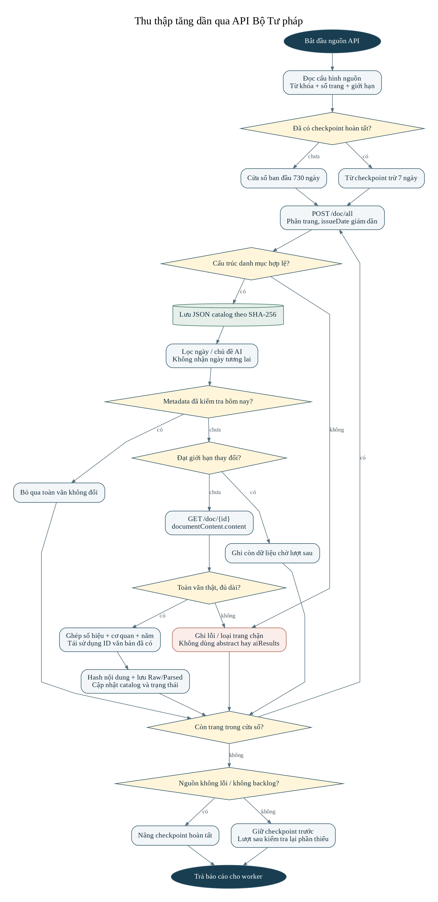

*Hình 2.3. Lưu đồ thu thập tăng dần và quản lý checkpoint.*

Adapter đọc danh mục theo ngày ban hành giảm dần, lưu JSON Raw theo digest và loại các mục không phù hợp. Metadata và nội dung được so sánh với trạng thái đã lưu; các mục đã kiểm tra cùng ngày có thể được bỏ qua để giảm yêu cầu mạng. Vì vậy, thay đổi ngay trong cùng ngày ở một mục có metadata không đổi có thể chưa được phát hiện tức thì. Cửa sổ chồng lấn giúp kiểm tra lại nhưng không bảo đảm phát hiện mọi sửa đổi toàn văn của văn bản rất cũ.

Checkpoint chỉ tiến khi nguồn kết thúc đầy đủ, không có lỗi hoặc backlog khiến việc quét bị thiếu. Khi đạt giới hạn thay đổi hoặc giới hạn trang, trạng thái được giữ để lượt sau còn cơ hội tiếp tục. Bộ ghép định danh dùng số hiệu, cơ quan và năm nhằm tránh biến cùng văn bản qua hai kênh thành hai ID nguồn. Sau đó Spark còn loại trùng theo nội dung sạch.

Lượt cập nhật tạo báo cáo riêng cho từng provider với số trang, số mục quét, thay đổi, lỗi và backlog. `scanned` là số mục đọc từ API, `changed` là số mục có dữ liệu cần xử lý, còn `active_documents` là số tài liệu duy nhất thực sự có trong chỉ mục. Ba số này không được dùng thay cho nhau.

### 2.5.3. Khả năng cập nhật và giới hạn

Nút trên giao diện kích hoạt một worker nền; chưa có lịch chạy định kỳ tự động bằng Airflow hay cron. Người vận hành có thể gọi cùng luồng qua CLI. Vì thế, mô tả chính xác là **cập nhật tự động toàn pipeline sau khi người dùng kích hoạt**, không phải nguồn streaming liên tục. Giới hạn cửa sổ ngày, số trang và từ khóa cũng có nghĩa là không thể khẳng định đã lấy tất cả văn bản AI mới trên Internet.

Adapter Federal Register đã có trong mã nguồn nhưng đang tắt vì URL toàn văn gặp trang yêu cầu truy cập. Dữ liệu metadata từ một API truy cập được không được dùng để che việc thiếu toàn văn. Đây là quyết định chất lượng dữ liệu, đồng thời là ví dụ về cách quản lý một nguồn chưa đáp ứng hợp đồng.

## 2.6. Thiết kế tải tệp lên và ETL tự động

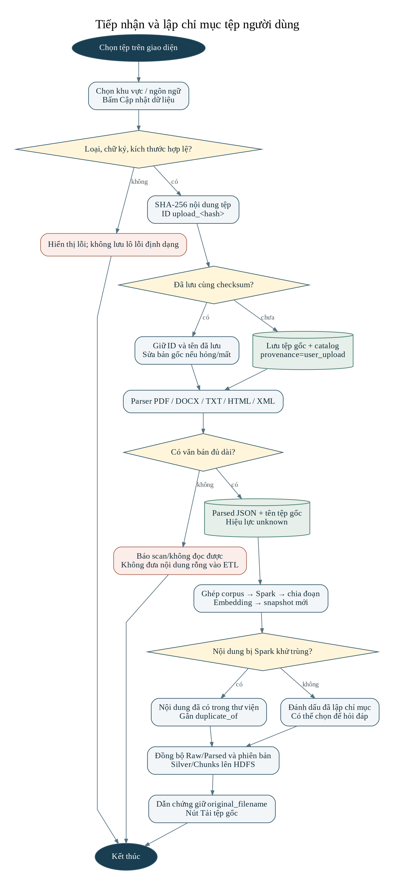

*Hình 2.4. Luồng từ tệp upload đến tài liệu có thể hỏi đáp và tải lại.*

Người dùng chọn tệp, khu vực và ngôn ngữ, sau đó bấm **Cập nhật dữ liệu**. Giao diện Streamlit dùng chức năng nhận nhiều tệp [14]; các giới hạn của dự án được kiểm tra thêm trong backend. Nếu chỉ xử lý tệp, người dùng bỏ chọn lấy thêm API. Khi có tệp hợp lệ mà API lỗi, pipeline có thể tiếp tục với tệp và ghi lỗi nguồn API riêng.

**Bảng 2.7. Quy tắc nhận tệp**

| Điều kiện | Hành vi |
|---|---|
| Định dạng | PDF, DOCX, TXT, HTML, XML; kiểm tra kiểu/đặc trưng tệp |
| Giới hạn lô | Tối đa 10 tệp; 50 MiB/tệp; tổng 100 MiB |
| PDF có văn bản | Trích xuất nội dung; giữ thông tin trang khi có |
| PDF scan ảnh | Báo cần OCR; phiên bản hiện tại chưa có OCR tự động |
| DOCX/TXT/HTML/XML | Đọc nội dung phù hợp, làm sạch thẻ/khoảng trắng |
| Cùng byte đã tải | Tái sử dụng ID `upload_` + SHA-256 đầy đủ; không tạo mục mới |
| Khác tệp nhưng cùng nội dung | Spark giữ một bản nội dung; upload có thể nhận `duplicate_of` |
| Nguồn và hiệu lực | `provenance=user_upload`, giữ tên gốc; không tự xác nhận là nguồn chính thức |

Sau khi parse thành công, tệp đi qua Spark, Parquet, chunking, embedding và snapshot giống dữ liệu API. Bản gốc được giữ để tải lại từ thư viện hoặc dẫn chứng. Một lô tệp được nhận không có nghĩa là mọi tệp đã được lập chỉ mục: cần xem kết quả parse, chống trùng và trạng thái công bố. Cách tách trạng thái này giúp người dùng hiểu trường hợp tệp đã lưu nhưng chưa đủ điều kiện hỏi đáp.

## 2.7. Thiết kế Spark ETL

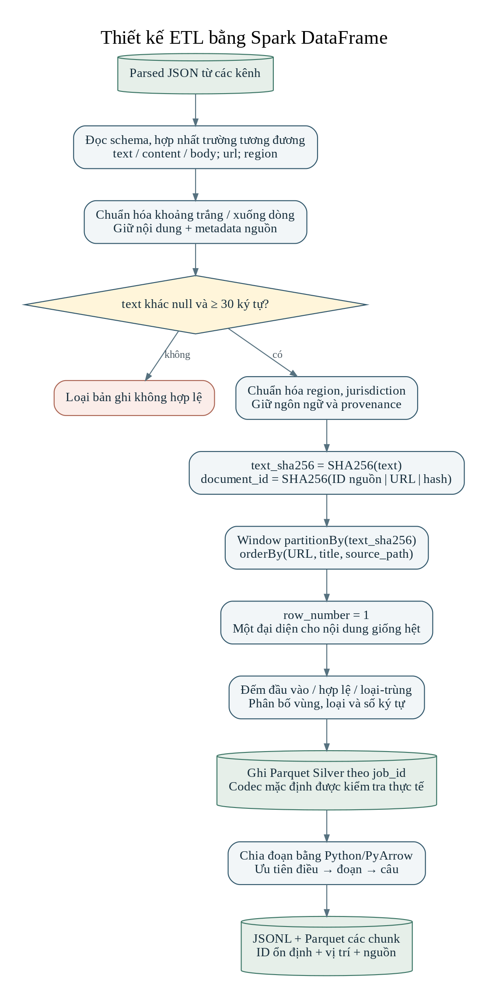

*Hình 2.5. Các phép biến đổi DataFrame và sản phẩm dữ liệu sau ETL.*

Spark nhận JSONL, JSON hoặc Parquet theo đơn vị một bản ghi/tài liệu. Những trường tương đương như `text/content/body/full_text` và `source_url/url/link` được hợp nhất trước khi biến đổi. Việc này cho phép các adapter tạo dữ liệu từ nhiều nguồn nhưng cùng đi vào một schema chuẩn.

**Bảng 2.8. Các quy tắc ETL đã hiện thực**

| Bước | Phép xử lý | Ý nghĩa |
|---|---|---|
| Chuẩn hóa schema | Coalesce trường tương đương; cast string | Giảm khác biệt đầu vào |
| Làm sạch | Thay tab/khoảng trắng đặc biệt, chuẩn hóa xuống dòng | Tạo nội dung ổn định trước băm và chia đoạn |
| Lọc kỹ thuật | Bỏ `text=null` hoặc dưới 30 ký tự | Không lập chỉ mục dữ liệu rỗng/quá ngắn; chưa phải bộ phân loại pháp lý |
| Chuẩn hóa khu vực | Quy về VN, EU, ASEAN, US, INTERNATIONAL; thiếu thành UNKNOWN | Bộ lọc có giá trị nhất quán |
| Tạo hash | `text_sha256=SHA256(text)` | Phát hiện trùng nội dung sau làm sạch |
| Khử trùng | Window partition theo hash, chọn một dòng theo thứ tự URL/tiêu đề/đường dẫn | Kết quả lựa chọn ổn định giữa các lần chạy |
| Tạo document ID | Hash ID nguồn + URL + hash text | Gắn danh tính sản phẩm xử lý với nội dung |
| Kiểm tra và thống kê | Đếm đầu vào/đầu ra, phân bố khu vực/loại, tổng ký tự | Có báo cáo ETL để quan sát chất lượng |
| Ghi Silver | Parquet, thực tế Snappy | Tái sử dụng cho chunking và phân tích thống kê |

Đầu ra hiện tại gồm bốn tệp Parquet; số tệp là đặc điểm lần chạy, không phải cam kết luôn chia thành bốn vùng nghiệp vụ. Cấu hình Spark có bốn shuffle partition và driver memory 512 MiB. Pipeline dùng `local[2]`, trong đó các tác vụ chạy trên hai luồng xử lý của một môi trường Spark. DataFrame và phép Window cho thấy kỹ thuật ETL có thể chuyển sang cụm; việc chuyển master riêng lẻ vẫn chưa đủ, vì cần thay cơ chế staging, quản lý tài nguyên và kiểm tra lỗi phân tán.

Ở bản demo, một số thao tác sau Spark đọc bảng về Python và giữ danh sách chunk trong bộ nhớ. Đây là giới hạn cần xử lý khi corpus lớn; không nên chỉ dựa vào việc sử dụng Spark để tuyên bố toàn pipeline đã mở rộng tuyến tính.

## 2.8. Chia đoạn, embedding và công bố chỉ mục

### 2.8.1. Thiết kế đoạn và vector

Chunker đọc Parquet bằng PyArrow và xử lý bằng Python. Kích thước tối đa là 2.200 **ký tự**, chồng lấn 240 ký tự. Nó ưu tiên ranh giới điều, mục, chương, đoạn và câu để giảm cắt ngang ngữ nghĩa. Marker `Điều/Article/Section`, `Chương/Chapter` và trang giúp bổ sung vị trí; không phải mọi tài liệu đều có đầy đủ marker.

ID đoạn được băm từ ID tài liệu, phiên bản, thứ tự và nội dung. Metadata nguồn, provenance và vị trí được sao chép vào payload. BGE-M3 tạo dense vector 1.024 chiều, gửi theo batch 8 vào Qdrant; collection dùng khoảng cách Cosine. Batch size được chọn theo tài nguyên máy, chưa có khảo sát tối ưu trên nhiều cấu hình.

**Bảng 2.9. Tham số lớp phục vụ**

| Tham số | Giá trị thực nghiệm |
|---|---|
| Chunk size / overlap | 2.200 / 240 ký tự |
| Embedding | `bge-m3`, dense, 1.024 chiều |
| Batch embedding | 8 đoạn |
| Qdrant distance | Cosine |
| Alias truy vấn | `ai_documents_verified_v2` |
| Top-k / ngưỡng điểm | 5 / 0,42 |
| LLM | `qwen3:4b-instruct-2507-q4_K_M` |
| Context LLM / sinh tối đa | 6.144 / 640 token |
| Temperature | 0 |

### 2.8.2. Snapshot và tính nhất quán

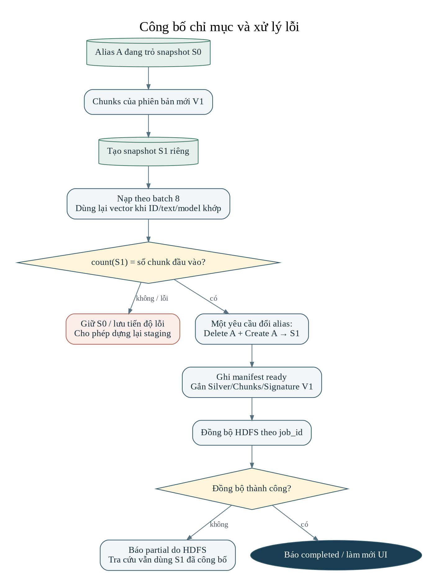

*Hình 2.7. Dựng phiên bản mới và chuyển alias sau kiểm tra.*

Mỗi job tạo collection riêng, nạp đủ vector và đối chiếu point count. Sau đó Qdrant đổi alias bằng thao tác alias hỗ trợ nguyên tử [9]. Tên truy vấn giữ nguyên, còn dữ liệu bên dưới chuyển sang snapshot mới. Manifest ghi cùng tên snapshot, chữ ký corpus và đường dẫn Processed/Chunks tương ứng để mở rộng điều khoản đúng phiên bản.

Tính nguyên tử ở đây áp dụng cho thao tác đổi alias trong Qdrant. Toàn bộ Qdrant, tệp manifest và HDFS không nằm trong một giao dịch phân tán chung. Nếu tiến trình dừng đúng giữa đổi alias và ghi manifest, cần kiểm tra và đối soát; nếu HDFS lỗi sau công bố thì trạng thái là `partial`. Thiết kế hiện tại cải thiện việc tránh phục vụ collection nạp dở, nhưng chưa bảo đảm exactly-once xuyên mọi thành phần.

## 2.9. Thiết kế luồng RAG và kiểm soát dẫn chứng

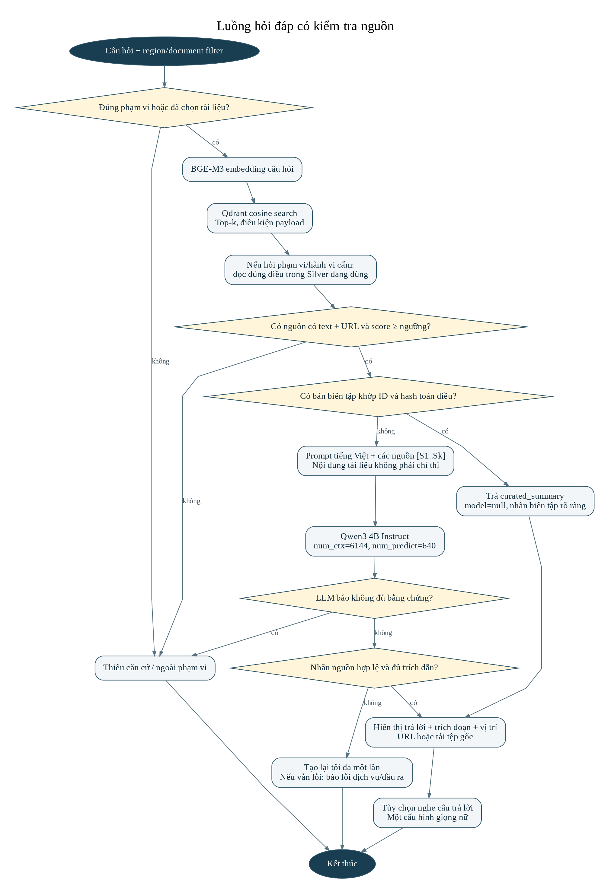

*Hình 2.6. Truy vấn, truy xuất, bổ sung ngữ cảnh và sinh đầu ra có nguồn.*

Truy vấn được kiểm tra phạm vi và có thể mở rộng một số cụm Việt–Anh trong retriever. Vector truy vấn được tìm trong Qdrant cùng bộ lọc khu vực hoặc tài liệu nếu người dùng chọn. Các hit vượt ngưỡng được đưa vào ngữ cảnh với nhãn `[S1]`, `[S2]`…; ngưỡng Cosine 0,42 là tham số kỹ thuật, không phải xác suất câu trả lời đúng.

Đối với một số câu hỏi khớp tiêu đề và chủ đề như phạm vi điều chỉnh hoặc hành vi bị cấm, retriever lấy toàn điều tương ứng từ Processed cùng phiên bản thay vì chỉ đưa một mảnh ngắn. Kết quả có `context_kind=article` và `anchor_chunk_id`. Điều này giúp giữ các mệnh đề ngoại lệ, giới hạn và phủ định thường quan trọng khi đọc văn bản pháp luật. Tuy nhiên, heuristic mở rộng không bao phủ mọi kiểu cấu trúc pháp lý.

Answerer yêu cầu LLM trả lời theo ngữ cảnh và gắn nhãn nguồn. Sau sinh, chương trình kiểm tra nhãn trích dẫn có tồn tại và có được sử dụng hợp lệ. Nhãn sai có thể kích hoạt một lần sửa đầu ra; nếu vẫn lỗi, kết quả báo không thể trả lời phù hợp. Kiểm tra này chặn lỗi kỹ thuật về ID nguồn, chưa đủ chứng minh mỗi mệnh đề được dẫn chứng hỗ trợ đúng về nghĩa.

Một số nội dung đã biên tập đối chiếu nguồn nằm trong `curated_summaries.json`. Chúng chỉ được sử dụng khi checksum của toàn điều khớp đúng và đầu ra được ghi `curated_summary`. Báo cáo tách các ca này khỏi ca LLM sinh trực tiếp, tránh dùng tốc độ của bản biên tập làm tốc độ suy luận LLM.

**Bảng 2.10. Trạng thái trả lời và cách diễn giải**

| Trường hợp | Đầu ra mong đợi |
|---|---|
| Ngoài phạm vi hoặc không đủ bằng chứng | `insufficient_evidence`, giải thích ngắn |
| Nguồn/dịch vụ truy xuất lỗi | Báo lỗi kết nối, không âm thầm thay bằng kiến thức tự do |
| LLM trả hợp lệ | Câu trả lời, nhãn nguồn đã dùng, đoạn đối chiếu và URL/tệp gốc |
| Nhãn trích dẫn không hợp lệ | Thử sửa có giới hạn hoặc báo lỗi đầu ra |
| Bản biên tập có checksum khớp | Hiển thị rõ chế độ biên tập, không gắn là LLM vừa sinh |

## 2.10. Thiết kế giao diện và trợ lý giọng nói

### 2.10.1. Giao diện phục vụ tra cứu

Giao diện có ba chức năng chính: hỏi đáp có dẫn chứng, tìm văn bản và thư viện tài liệu. Thanh bên chứa lọc khu vực, tài liệu cụ thể, cập nhật nguồn và upload. Phần nội dung sử dụng nền ngà, màu xanh đậm và điểm nhấn vàng, kiểu chữ Times New Roman. Các đoạn nguồn được thu gọn để ưu tiên câu trả lời, nhưng người dùng vẫn mở được nội dung đối chiếu và nguồn gốc.

Giao diện chỉ trình bày một lựa chọn giọng nữ Hoài My theo yêu cầu. Bộ phát có hình người thuyết trình minh họa; chuyển động dựa trên âm thanh. Tính năng đọc hỗ trợ tiếp cận nội dung, không tham gia ETL hay đánh giá độ đúng RAG. LLM và vector chạy local; các chức năng giọng trực tuyến có sử dụng dịch vụ ngoài và phải ghi đúng nhà cung cấp thực tế nếu có dự phòng.

### 2.10.2. Điểm nhấn: trợ lý giọng nói và người thuyết trình

Người thuyết trình đưa kết quả RAG tới người dùng bằng cả văn bản và âm thanh. Thay vì chỉ đặt một thanh phát tệp, giao diện cung cấp một nhân vật nữ trong trang phục công sở, vùng phụ đề và bộ điều khiển nghe. Người dùng có thể nghe thử mà chưa cần gọi LLM, hoặc tạo giọng sau khi đã có câu trả lời. Nhờ tạo âm thanh theo yêu cầu, thời gian chờ TTS không cộng vào bước nhận câu trả lời văn bản.

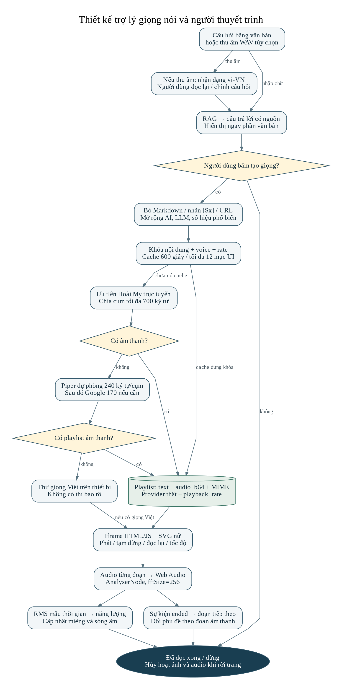

*Hình 2.10. Luồng chuẩn hóa nội dung, tổng hợp tiếng nói, phát playlist, phụ đề và điều khiển nhân vật.*

**Bảng 2.11. Thành phần của chức năng người nói**

| Thành phần | Thiết kế thực tế |
|---|---|
| Nội dung đưa đi đọc | Bỏ Markdown, URL và nhãn Sx; mở rộng một số từ AI, LLM và số hiệu phổ biến; giữ câu trả lời có nguồn trên giao diện |
| Giọng yêu cầu trên UI | Một giọng nữ Hoài My; không còn menu chọn nam hoặc lựa chọn “Việt cục bộ” |
| TTS | Ưu tiên `vi-VN-HoaiMyNeural` qua `edge-tts`; khi chưa đáp ứng có provider dự phòng, được ghi đúng nhãn |
| Playlist | Mỗi phần tử có `text`, `audio_b64`, MIME; WAV/MP3 được phát riêng theo thứ tự |
| Cache/phiên | Khóa theo nội dung + voice + rate; cache UI TTL 600 giây, tối đa 12 mục; đổi tốc độ cấu hình thì không dùng lại bản âm thanh cũ |
| Nhân vật | SVG minh họa nữ, bố cục responsive; chớp mắt, nhịp thở và chuyển động miệng |
| Đồng bộ hình | Web Audio AnalyserNode → năng lượng RMS → độ mở miệng và chiều cao sóng âm |
| Phụ đề | Đổi theo đoạn âm thanh thực tế qua sự kiện kết thúc, có chỉ báo Đoạn i/n |
| Điều khiển | Phát, tạm dừng/tiếp tục, đọc lại, tua trong đoạn và tốc độ 0,85×–1,30× |
| Nhập giọng nói tùy chọn | Nhận âm thanh WAV, nhận dạng tiếng Việt qua Google Speech Recognition; người dùng xem lại câu hỏi trước khi tra cứu |

Mã [tts.py](../../src/rag/tts.py) chuẩn hóa câu trả lời và tạo playlist. Với dịch vụ Edge, cụm đọc được giới hạn 700 ký tự; nhánh Piper dùng 240, nhánh Google dự phòng dùng 170. Các độ dài này phục vụ TTS, **khác với chunk 2.200 ký tự dùng cho RAG**. `edge-tts` là thư viện truy cập dịch vụ đọc trực tuyến của Edge [17], không phải một Azure Speech API thương mại do nhóm triển khai. Piper và model tiếng Việt được sử dụng ở nhánh dự phòng [18], [19]. Hình và nhãn nguồn âm thanh phải phản ánh provider thực tế, không gắn tên Hoài My cho mọi âm thanh dự phòng.

[avatar_component.py](../../src/rag/avatar_component.py) đóng gói dữ liệu vào [presenter.html](../../src/rag/presenter.html). Văn bản được JSON-encode và escape các ký tự có thể đóng thẻ script để nội dung câu trả lời được xử lý như dữ liệu. Trình duyệt dùng HTML audio phát từng đoạn, không ghép nối byte nhiều MP3 — cách ghép đó dễ làm sai thời lượng và thao tác tua. Tốc độ tổng hợp và tốc độ phát cũng được tách để tránh nhân tốc độ hai lần.

Nhân vật dùng SVG, không tải ảnh người thật từ nguồn ngoài. `AnalyserNode` cung cấp mẫu âm thanh theo miền thời gian [16]; chương trình chuẩn hóa mẫu, tính RMS và ánh xạ vào bán kính miệng. Với đường phát audio, thay đổi hình dựa trên tín hiệu đang phát; khi không có audio mà dùng giọng trình duyệt, chuyển động chỉ mang tính minh họa. Đây là **hoạt ảnh theo nhịp âm thanh**, chưa phải mô hình lip-sync theo âm vị hoặc video người thật. Phụ đề đồng bộ ở cấp đoạn, chưa có timestamp từng từ.

Điểm đóng góp của chức năng là tăng khả năng tiếp cận kết quả, giúp người xem theo dõi nội dung trong buổi trình bày và tạo trải nghiệm hỏi–đọc–nghe có cùng nguồn dữ liệu. Nhân vật không tạo lập hoặc xác thực kết luận pháp lý; câu trả lời văn bản và nguồn gốc vẫn là căn cứ đối chiếu. Phần thử nghiệm ở mục 3.10 tách kiểm tra bộ phát, âm thanh và hoạt ảnh khỏi đánh giá chất lượng RAG.

## 2.11. Thiết kế triển khai và vận hành

### 2.11.1. Triển khai Docker và HDFS

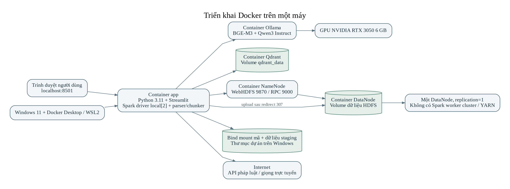

*Hình 2.8. Mô hình triển khai thật trên Docker Desktop/WSL2.*

**Bảng 2.12. Dịch vụ và dữ liệu bền vững**

| Dịch vụ | Vai trò | Cổng localhost | Dữ liệu giữ lại |
|---|---|---|---|
| app | Streamlit, điều phối, parser, Spark local và chunker | 8501 | Bind mount mã nguồn và thư mục dữ liệu |
| Qdrant 1.12.6 | Chỉ mục vector/payload | 6333 | `qdrant_data` |
| Ollama | BGE-M3 và Qwen3 Instruct, dùng GPU | 11434 | `ollama_models` |
| NameNode Hadoop 3.4.1 | Namespace, metadata HDFS, WebHDFS | 9870 | `namenode_data` |
| DataNode Hadoop 3.4.1 | Block dữ liệu HDFS | Nội bộ Docker | `datanode_data` |

Docker Compose quản lý dịch vụ, mạng và volume theo khai báo [13]. Ứng dụng gọi các container bằng tên dịch vụ; WebHDFS có thể chuyển hướng ghi tới DataNode. Bộ đồng bộ ghi manifest đường dẫn, kích thước và SHA-256 phía nguồn; kiểm tra kích thước tệp phía HDFS giúp phát hiện bản sao thiếu. Kiểm tra này chưa tương đương đối chiếu lại toàn bộ checksum nội dung từ HDFS.

### 2.11.2. Trạng thái, lỗi và hướng mở rộng

**Bảng 2.13. Thiết kế xử lý tình huống lỗi**

| Tình huống | Xử lý hiện tại |
|---|---|
| Một worker đang cập nhật | Từ chối tạo job chồng; hiển thị tiến độ job đang có |
| API timeout/429/5xx | Retry có giới hạn; ghi lỗi; không nâng checkpoint thiếu |
| API đổi schema/trả trang chặn | Báo lỗi nguồn; không dùng trang chặn làm toàn văn |
| Upload sai định dạng/scan | Báo lỗi tệp; không đưa nội dung rỗng vào index |
| Spark/embedding lỗi trước công bố | Giữ chỉ mục trước; lưu job lỗi để xử lý lại |
| Không có thay đổi | `no_changes`; giữ nguyên snapshot |
| HDFS lỗi sau công bố | `partial`; cần đồng bộ lại, không coi mọi lớp đã hoàn tất |
| Văn bản chưa rõ hiệu lực | Giữ metadata chưa xác định; yêu cầu đối chiếu nguồn khi sử dụng |

Ở góc độ Data Engineering, sản phẩm chính là pipeline có hợp đồng đầu vào, schema chuẩn, khử trùng, metadata xuyên lớp, kho lưu trữ và bản công bố có phiên bản. Khi mở rộng, cần chuyển Spark sang cụm và I/O HDFS/S3 trực tiếp, chia đoạn/embedding theo partition, có hàng đợi và scheduler, theo dõi tài nguyên liên tục và cơ chế khôi phục công bố. Kafka, Airflow, Delta/Iceberg, xác thực nhiều người dùng và OCR là hướng phát triển; chúng chưa được tính là công nghệ đã triển khai trong bản báo cáo này.


# CHƯƠNG 3. TRIỂN KHAI, THỬ NGHIỆM VÀ ĐÁNH GIÁ

## 3.1. Mục tiêu và phương pháp thực nghiệm

Thực nghiệm được thực hiện trên hệ thống đang chạy ngày **16/11/2026**, nhằm kiểm tra cả đường ống dữ liệu lẫn ứng dụng khai thác. Các nhóm thử nghiệm gồm kiểm thử tự động, cập nhật qua API, upload xuyên suốt pipeline, thống kê chất lượng corpus, đo Spark ETL, đánh giá truy xuất và kiểm tra hỏi đáp đầu cuối. Bằng chứng được lưu dưới dạng JSON, CSV, JUnit và ảnh chụp trình duyệt thật tại [evidence](evidence/).

Số liệu được cố định theo snapshot `ai_documents_verified_v2__api_20261116_093406_aaf12a03`, công bố lúc 09:35 UTC ngày 16/11/2026, tương ứng 16:35 giờ Việt Nam. Snapshot gồm 63 tài liệu và 3.285 đoạn. Phần thu thập cấu hình được đọc lại lúc 10:21 UTC, còn từng ảnh/ca chạy có timestamp trong manifest hoặc log tương ứng. Các nguồn và số đếm trên môi trường vận hành có thể thay đổi sau thời điểm báo cáo.

Các thí nghiệm không cùng đo một khái niệm: kiểm thử xác nhận hành vi chương trình; Hit@k xác nhận tìm được ID tài liệu kỳ vọng; kiểm tra trích dẫn xác nhận định danh nguồn; đánh giá độ chính xác pháp lý cần thêm người thẩm định và bộ câu hỏi có đáp án được đối chiếu. Báo cáo giữ riêng các kết quả này để tránh kết luận quá mức.

**Bảng 3.1. Ma trận thực nghiệm**

| Nhóm | Đầu vào | Đầu ra/tiêu chí |
|---|---|---|
| Hồi quy Python | 86 ca kiểm thử trong dự án | Tất cả pass; lưu JUnit và log |
| API thực tế | Nguồn Bộ Tư pháp, từ khóa AI | Có tài liệu API trong index; lượt lặp không đổi snapshot |
| Upload đầu cuối | Một PDF thật trong bộ thử tách biệt | Parse → Spark → chunk → vector → HDFS → tìm và tải bản gốc |
| Chất lượng dữ liệu | 63 tài liệu, 3.285 đoạn | Hash duy nhất, nguồn, phiên bản, phân bố dữ liệu |
| Spark ETL | 63/315/630 bản ghi lặp, mỗi mức 3 lần | Thời gian và tập 63 nội dung duy nhất sau khử trùng |
| Truy xuất | 15 câu hỏi chọn thủ công, lặp 3 lần | Hit@1, Hit@5, MRR@5 và thời gian truy xuất |
| Hỏi đáp | 2 ca LLM, 1 ca biên tập; 10 câu ngoài phạm vi | Trạng thái, nguồn và thời gian chức năng |

## 3.2. Yêu cầu tài nguyên và cấu hình thực nghiệm

### 3.2.1. Yêu cầu triển khai

Hệ thống cần Docker Desktop với Linux containers/WSL2 hoặc môi trường Docker Linux tương đương, quyền ghi vào thư mục dữ liệu và kết nối Internet để lấy nguồn/mô hình. Cấu hình Compose mặc định yêu cầu NVIDIA GPU cho Ollama; dự án có cấu hình CPU riêng. Phương án CPU được hỗ trợ về cấu hình nhưng chưa được đo trong loạt thử nghiệm này.

**Bảng 3.2. Cấu hình tham chiếu để tái lập demo**

| Tài nguyên | Mức đề xuất cho bản demo | Cơ sở và phạm vi |
|---|---|---|
| CPU | CPU hiện đại, ít nhất 4 luồng có thể cấp cho Docker | Spark thực nghiệm local[2]; cần phần tài nguyên cho các dịch vụ khác |
| RAM máy | Khoảng 16 GiB hoặc cao hơn | Cấu hình đã chạy thành công; chưa đo ngưỡng tối thiểu |
| RAM Docker/WSL | Khoảng 8 GiB | Môi trường đo cấp 7,62 GiB |
| GPU | NVIDIA VRAM 6 GiB cho chế độ GPU đã thử | BGE-M3 và Qwen3 4B quantized cùng được dùng; cần dự phòng cho context |
| Lưu trữ trống | Nên dành ít nhất 30 GiB cho môi trường demo | Dự phòng image, model, staging, snapshot; là ước lượng vận hành, không phải ngưỡng đã benchmark |
| Mạng | Tải model lần đầu và truy cập nguồn API/website | Hỏi đáp sau nạp model có thể dùng các dịch vụ local |

Không nên ghi cấu hình này là “cấu hình tối thiểu chính thức”: chưa có thử nghiệm giảm dần RAM, VRAM và ổ đĩa. Khi tăng corpus hoặc số snapshot, dung lượng cần tính theo chính sách lưu lịch sử; khi tăng người dùng đồng thời, cần đo lại độ trễ và hàng đợi.

### 3.2.2. Máy và phần mềm đã sử dụng

**Bảng 3.3. Phần cứng và hệ điều hành quan sát được**

| Thành phần | Cấu hình thực tế |
|---|---|
| CPU | Intel Core i5-13420H thế hệ 13, 8 nhân, 12 luồng logic |
| RAM vật lý | 16.890.519.552 byte, khoảng 15,73 GiB |
| GPU | NVIDIA GeForce RTX 3050 Laptop, 6.144 MiB VRAM |
| Driver NVIDIA | 595.97 |
| Windows | Windows 11 Home, version 10.0.26200, build 26200 |
| Docker Engine | 27.2.0; Linux x86_64 trên Docker Desktop |
| Tài nguyên Docker thấy được | 12 CPU logic; 8.185.978.880 byte RAM, khoảng 7,62 GiB |
| WSL kernel | 6.18.58.1-microsoft-standard-WSL2 |
| Dung lượng trống ổ C khi chụp | 49.530.503.168 byte, khoảng 46,13 GiB; chỉ là giá trị tại thời điểm đo |

Nguồn: [host_resources.json](evidence/host_resources.json) và [docker_resources.json](evidence/docker_resources.json). Thống kê container một thời điểm nằm trong [docker_stats_idle.jsonl](evidence/docker_stats_idle.jsonl); không dùng bản chụp này như mức sử dụng RAM/CPU cực đại.

**Bảng 3.4. Phiên bản phần mềm trong môi trường chạy ứng dụng**

| Thành phần | Phiên bản/đặc điểm |
|---|---|
| Python | 3.11.18 trong container app |
| Apache Spark/PySpark | 3.5.3, master `local[2]` |
| Java | 17 |
| Hadoop/HDFS | 3.4.1, một NameNode và một DataNode, replication 1 |
| PyArrow | 18.0.0 |
| Streamlit | 1.41.1 |
| Qdrant server / Python client | 1.12.6 / 1.12.1 |
| PyMuPDF / python-docx | 1.24.14 / 1.1.2 |
| requests / pytest | 2.32.3 / 8.3.4 |
| BGE-M3 qua Ollama | Dense 1.024 chiều; model tag khoảng 1,16 GB |
| Qwen3 Instruct qua Ollama | `qwen3:4b-instruct-2507-q4_K_M`, model tag khoảng 2,50 GB |

Model card và tên tag là căn cứ nhận diện mô hình [8], [10], [11]. Kích thước tệp model khác dung lượng bộ nhớ trong lúc chạy; số đo tài nguyên phụ thuộc context và thời điểm. Tham số thực nghiệm dùng top-k 5, ngưỡng điểm 0,42, chunk tối đa 2.200 ký tự, overlap 240, embedding batch 8, LLM context 6.144 token, sinh tối đa 640 token và temperature 0. Chưa khảo sát hệ thống các cấu hình để kết luận đây là bộ tham số tối ưu.

## 3.3. Bộ dữ liệu và các biểu đồ thống kê

### 3.3.1. Đối chiếu catalog, tài liệu và đoạn

**Bảng 3.5. Quy mô và tính nhất quán của snapshot**

| Chỉ tiêu | Kết quả | Nguồn kiểm tra |
|---|---:|---|
| Mục nguồn trong catalog | 85 | Catalog kết hợp nguồn cố định/API/upload |
| Tài liệu đang tra cứu | 63 | `source_document_ids` trong index manifest |
| Mục chưa lập chỉ mục | 22 | Catalog trừ tập ID hoạt động |
| Bản ghi Processed | 63 | Đọc Parquet |
| Nội dung sạch duy nhất | 63 | `text_sha256` |
| Đoạn trong JSONL | 3.285 | Tệp Chunks đúng snapshot |
| Point Qdrant chính xác | 3.285 | Qdrant count `exact=true` |
| Vector/point | 1.024 chiều, Cosine | Cấu hình collection |

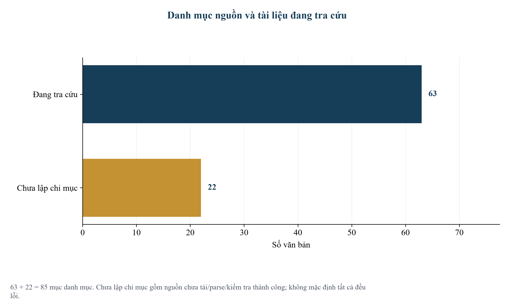

*Hình 3.21. Phân biệt danh mục 85 mục với 63 văn bản thực sự đang tra cứu.*

Kết quả xác nhận số đếm phải được tính theo đúng đối tượng. Catalog là tập nguồn có thể khai thác, còn index là sản phẩm đã được công bố. 22 mục chưa lập chỉ mục có thể chưa tải được, thiếu toàn văn hoặc chưa hoàn tất kiểm tra; không thể chỉ từ số đếm kết luận cả 22 mục đều là lỗi parser. Hai vị trí số liệu trên giao diện dùng cùng manifest để không tạo ra cặp số gây hiểu nhầm như trước đây.

### 3.3.2. Khu vực, ngôn ngữ và loại văn bản

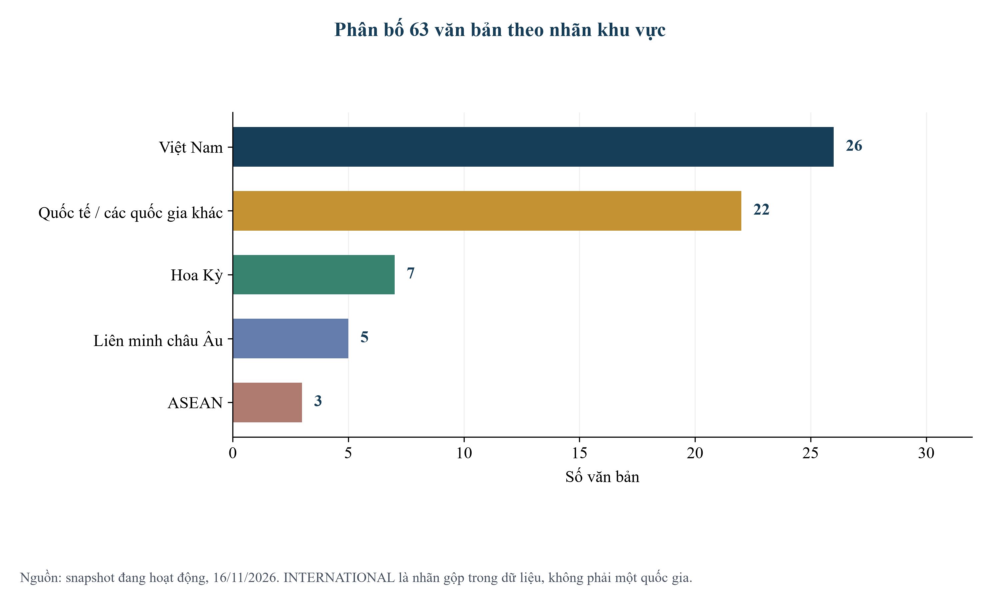

*Hình 3.12. Phân bố theo nhãn khu vực của 63 tài liệu.*

Việt Nam có 26 tài liệu; nhóm INTERNATIONAL có 22; Hoa Kỳ có 7; EU có 5; ASEAN có 3. INTERNATIONAL gộp nhiều nguồn như tổ chức quốc tế, Anh, Singapore, Úc và Canada theo metadata hiện tại. Vì vậy, biểu đồ phản ánh cách tổ chức dữ liệu trong hệ thống, không phải một bảng thống kê số quốc gia. Khi cần phân tích chi tiết hơn, schema nên bổ sung quốc gia và cơ quan thành các chiều riêng.

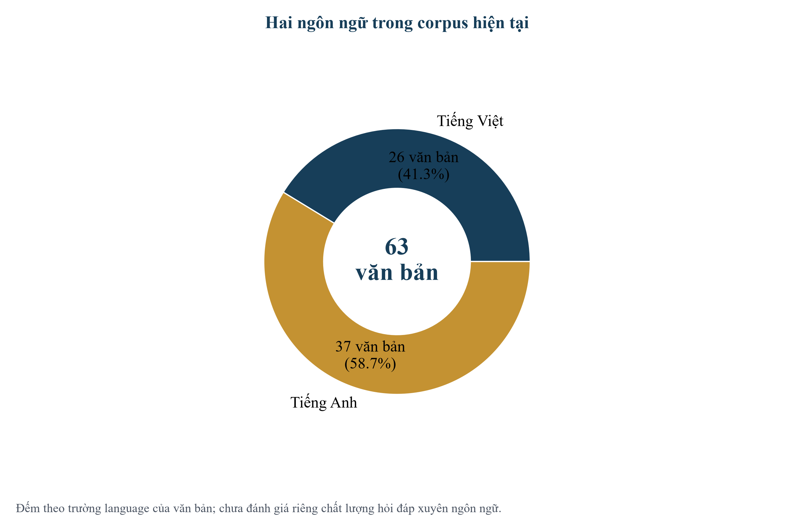

*Hình 3.13. Corpus gồm 26 văn bản tiếng Việt và 37 văn bản tiếng Anh.*

Tài liệu tiếng Anh chiếm khoảng 58,7%. Đây là lý do cần embedding đa ngôn ngữ và cơ chế truy vấn có thể tiếp cận tài liệu quốc tế từ câu hỏi tiếng Việt. Tỷ lệ này chỉ mô tả dữ liệu; chưa chứng minh chất lượng truy xuất xuyên ngôn ngữ ngang với truy xuất cùng ngôn ngữ.

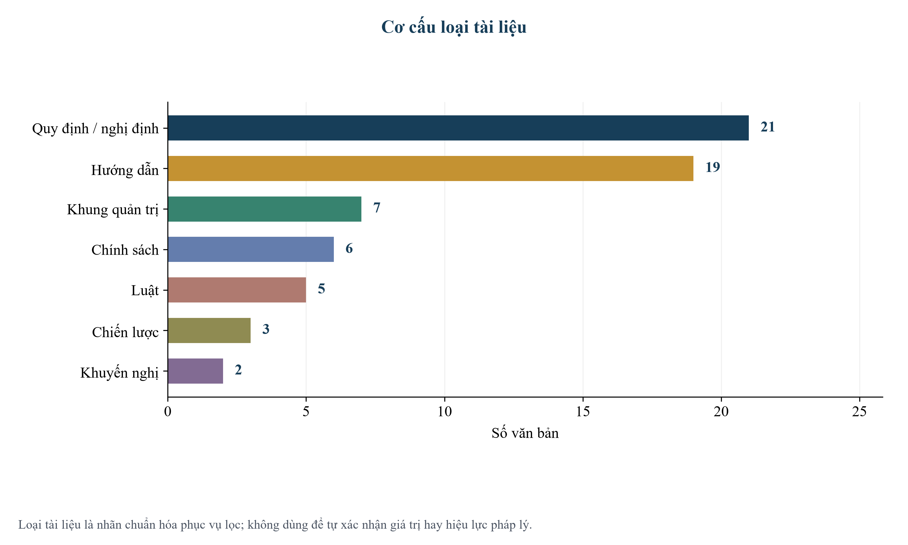

*Hình 3.14. Cơ cấu loại tài liệu sau chuẩn hóa.*

Corpus có 21 mục regulation, 19 guideline, 7 framework, 6 policy, 5 law, 3 strategy và 2 recommendation. Nhóm hướng dẫn và khung quản trị chiếm phần đáng kể, phản ánh phạm vi chính sách AI rộng hơn văn bản quy phạm. Khi hỏi về nghĩa vụ bắt buộc, người dùng cần đối chiếu loại tài liệu, cơ quan và hiệu lực thay vì mặc định mọi nội dung đều có tính ràng buộc pháp luật.

### 3.3.3. Nguồn thu thập và thời gian ban hành

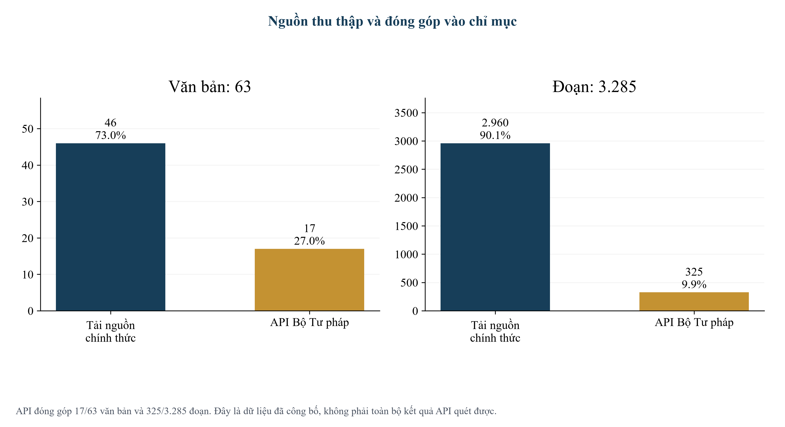

*Hình 3.15. Đóng góp của nguồn tải chính thức và nguồn API vào tập tài liệu/đoạn đang hoạt động.*

Nguồn tải chính thức đóng góp 46 tài liệu và 2.960 đoạn; nguồn API đóng góp 17 tài liệu và 325 đoạn. Tỷ lệ theo văn bản và tỷ lệ theo đoạn khác nhau vì độ dài tài liệu khác nhau. Một lượt API có thể cập nhật tài liệu đã có ID, sau đó Spark khử trùng; số mục API nhận được không cộng thẳng vào số tài liệu đang hoạt động. Corpus sản xuất hiện không có `user_upload`; phép thử upload dùng bộ dữ liệu tách biệt để không đưa tài liệu kiểm thử vào thư viện chính.

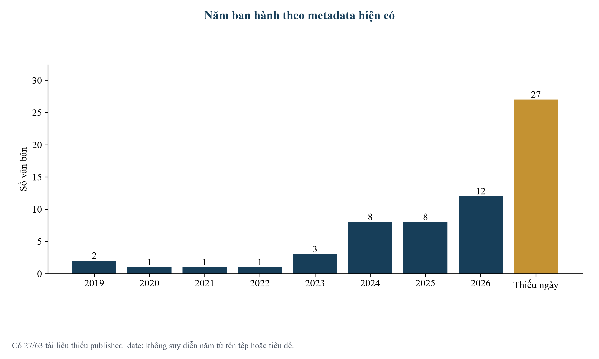

*Hình 3.16. Phân bố năm theo trường published_date; mục thiếu được giữ riêng.*

Có 36/63 tài liệu có năm nhận diện được trong metadata và 27 mục thiếu ngày. Trong nhóm có ngày, năm 2026 có 12 tài liệu, 2025 và 2024 mỗi năm có 8, 2023 có 3; các năm còn lại có ít hơn. Biểu đồ không suy diễn năm từ tên tệp hoặc tiêu đề. Đây là hạn chế metadata cần ưu tiên khi mở rộng bộ lọc thời gian và theo dõi văn bản mới.

## 3.4. Độ dài, chất lượng dữ liệu và lưu trữ

### 3.4.1. Độ dài tài liệu và phân bố đoạn

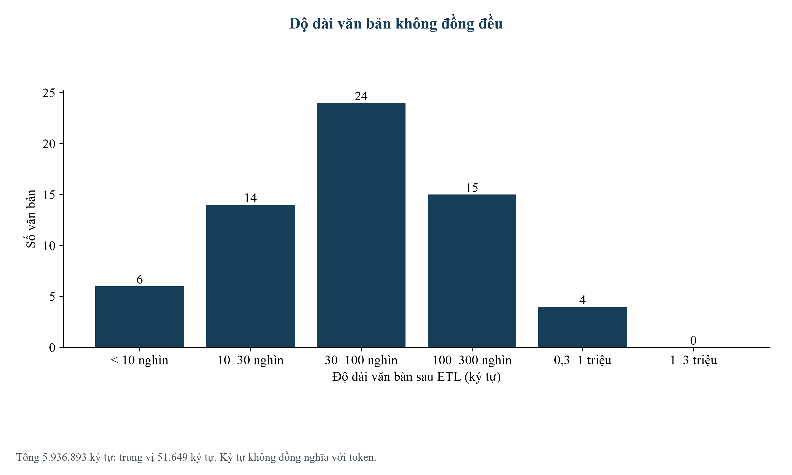

*Hình 3.17. Độ dài văn bản sau ETL theo khoảng ký tự.*

Tổng corpus có 5.936.893 ký tự, trung vị 51.649 ký tự/tài liệu; tài liệu ngắn nhất 2.992 và dài nhất 585.247 ký tự. Chênh lệch này ảnh hưởng tới số chunk, thời gian embedding và khả năng một nguồn dài xuất hiện nhiều lần trong kết quả tìm kiếm. Đơn vị ký tự được tách khỏi token của mô hình; không quy đổi cố định giữa hai đơn vị.

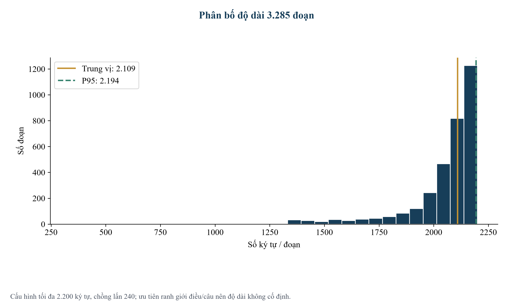

*Hình 3.18. Histogram độ dài 3.285 đoạn trong snapshot.*

Độ dài đoạn nhỏ nhất 339, trung vị 2.109, P95 là 2.194 và lớn nhất 2.200 ký tự. Nhiều đoạn gần giới hạn trên phù hợp cấu hình chunking, nhưng số lượng không tập trung chính xác tại một độ dài vì thuật toán ưu tiên ranh giới văn bản. Chồng lấn làm tổng ký tự các chunk lớn hơn tổng ký tự toàn văn; đó không phải phát sinh thêm văn bản nguồn.

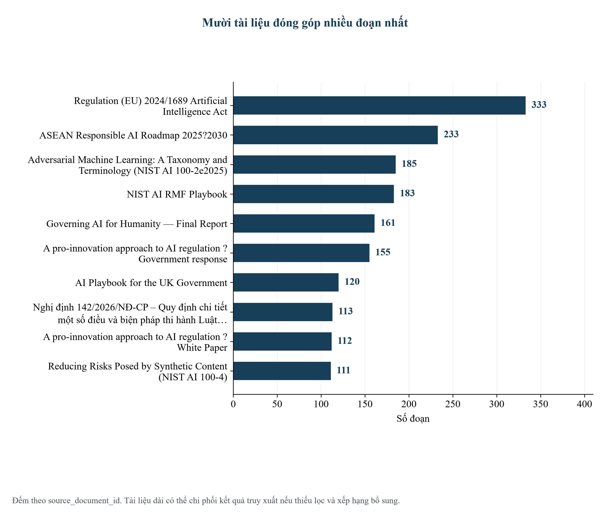

*Hình 3.19. Mười tài liệu có nhiều đoạn nhất; tên đầy đủ và URL nằm trong phụ lục dữ liệu.*

EU AI Act có 333 đoạn, ASEAN Responsible AI Roadmap có 233, tài liệu NIST Adversarial Machine Learning có 185 và NIST AI RMF Playbook có 183. Chỉ bốn tài liệu này đã tạo ra 934/3.285 đoạn, khoảng 28,4%. Vì vậy, một bộ đo chỉ xét số chunk tìm được có thể bị ảnh hưởng bởi tài liệu dài; đánh giá ở mục 3.7 chọn ID tài liệu kỳ vọng thay vì đếm mọi đoạn là các tài liệu độc lập.

### 3.4.2. Kiểm tra chất lượng metadata

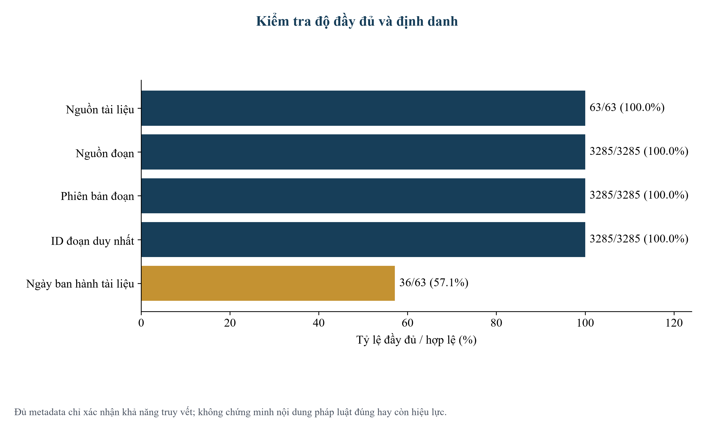

*Hình 3.20. Độ đầy đủ nguồn, phiên bản và tính duy nhất định danh.*

**Bảng 3.6. Kết quả kiểm tra chất lượng kỹ thuật**

| Kiểm tra | Kết quả |
|---|---:|
| Tài liệu thiếu thông tin nguồn | 0/63 |
| Chunk thiếu thông tin nguồn | 0/3.285 |
| Chunk thiếu version_id | 0/3.285 |
| ID chunk bị trùng | 0 |
| Hash toàn văn duy nhất | 63/63 |
| Tài liệu thiếu published_date | 27/63 |

Các chỉ tiêu tốt về nguồn và ID cho thấy pipeline giữ được khả năng truy vết. Chúng không kiểm tra mọi lỗi OCR, lỗi mất bảng biểu hay sự phù hợp pháp lý của câu trả lời. Ngày thiếu và `legal_status` chưa xác minh vẫn là những khoảng trống quan trọng. Trong metadata hiện có, 43 tài liệu mang `unknown`, một mang “Chưa xác định”, 13 mang “Còn hiệu lực”, ba mang “Hết hiệu lực toàn bộ”, một `withdrawn` và hai `historical_snapshot`. Các nhãn này được báo cáo theo dữ liệu đã lưu, chưa phải kết luận thẩm định hiệu lực lại tất cả nguồn vào ngày thực nghiệm.

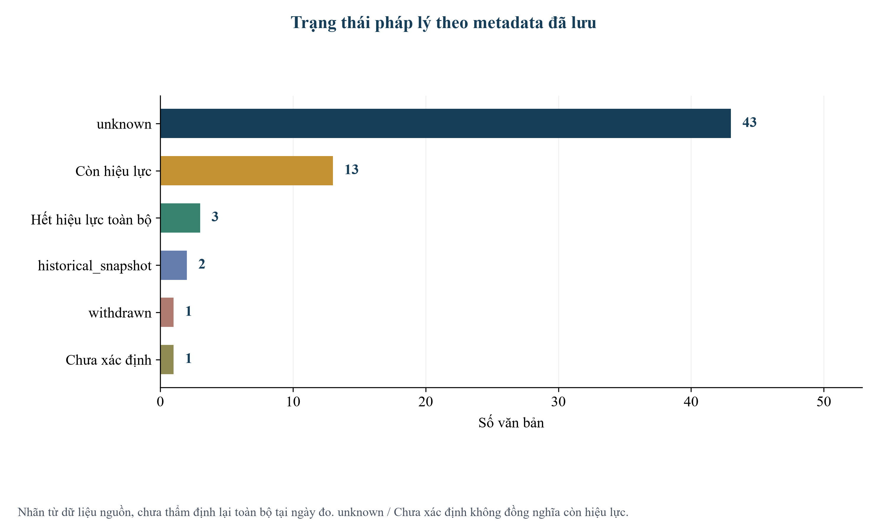

*Hình 3.26. Phân bố nhãn trạng thái pháp lý trong metadata; không thay việc xác minh hiệu lực tại nguồn.*

### 3.4.3. Dung lượng các lớp

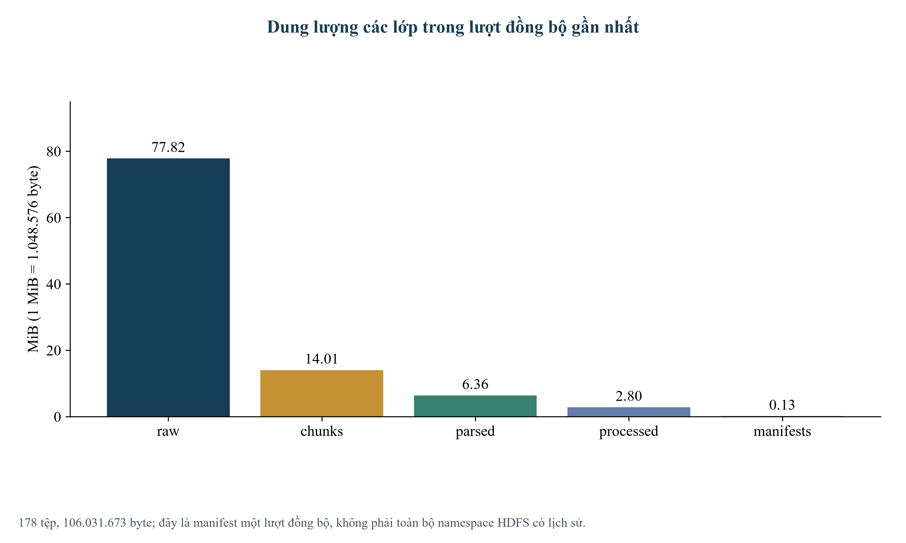

*Hình 3.25. Dung lượng theo lớp của lượt đồng bộ gần nhất, lấy từ lake manifest.*

**Bảng 3.7. Dung lượng trong manifest đồng bộ**

| Lớp | Byte | MiB xấp xỉ |
|---|---:|---:|
| Raw | 81.602.387 | 77,82 |
| Parsed | 6.667.397 | 6,36 |
| Processed | 2.934.181 | 2,80 |
| Chunks | 14.691.944 | 14,01 |
| Manifests | 135.764 | 0,13 |
| **Tổng của lượt đồng bộ** | **106.031.673** | **101,12** |

Lượt đồng bộ gồm 178 tệp. Toàn bộ namespace `/ai_docs` khi kiểm tra chứa 221 tệp và 157.987.547 byte vì còn có lịch sử phiên bản và dữ liệu kiểm toán/thử nghiệm. Hai tổng này có phạm vi khác nhau. Hệ số nhân bản 1 không tạo ra ba bản sao như nhiều sơ đồ HDFS minh họa phổ biến.

Processed hiện có bốn tệp Parquet với 15, 14, 13 và 21 dòng, nén Snappy. Không được dùng trực tiếp tỷ lệ JSONL/Parquet để kết luận tỷ lệ nén thuần túy, vì schema, cách biểu diễn, metadata và quá trình khử trùng có thể khác nhau.

## 3.5. Kiểm thử chức năng, API và upload

### 3.5.1. Kiểm thử tự động

Bộ kiểm thử Python được chạy lại trong container: **86 passed**, năm cảnh báo, thời gian 28,38 giây. Bằng chứng: [python_tests.log](evidence/python_tests.log) và [python_tests.xml](evidence/python_tests.xml). Các ca bao phủ Spark ETL, chunking, API tăng dần, catalog, worker, snapshot, upload và các ràng buộc grounding. Thành công của bộ test có nghĩa là các điều kiện đã mã hóa được thỏa mãn; không suy rộng thành mọi kiểu tệp hoặc mọi câu hỏi đều đã kiểm tra.

**Bảng 3.8. Một số tình huống nghiệm thu**

| Tình huống | Kết quả quan sát |
|---|---|
| Đối chiếu Processed/Chunks/Qdrant | 63 tài liệu; 3.285 chunk và 3.285 point khớp |
| API bổ sung toàn văn AI | Có 17 tài liệu provenance API trong snapshot |
| Cập nhật lại không có thay đổi | `no_changes`, không xây lại collection |
| Tệp upload có văn bản | Hoàn tất toàn pipeline trong tập thử tách biệt |
| Upload lại cùng tệp | Không tạo tài liệu mới |
| Nội dung trùng nguồn có sẵn | Được kiểm tra trong test hồi quy và gắn quan hệ trùng |
| Câu hỏi ngoài phạm vi mẫu | 10/10 bị từ chối theo gate |
| Nhãn nguồn không hợp lệ | Được kiểm tra bằng test, không coi là nguồn hợp lệ |

### 3.5.2. Nguồn API động và cập nhật lặp

Bằng chứng lần nạp thực tế trong [previous_api_verification.json](evidence/previous_api_verification.json) xác nhận snapshot kết hợp có 63 tài liệu và 325 chunk từ API. Một ví dụ tài liệu mới là Thông tư 53/2026/TT-NHNN về an toàn và quản lý rủi ro ứng dụng AI trong ngân hàng; kết quả tìm kiếm giữ URL nguồn và provider `vbpl`. Đây là kiểm tra hoạt động của pipeline, không thay thế đối chiếu nội dung pháp lý với bản gốc.


*Hình 3.7. Ảnh chụp thật lượt cập nhật API được kích hoạt từ giao diện.*

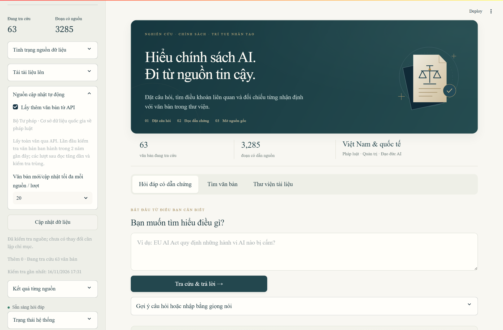

*Hình 3.8. Kết quả lượt kiểm tra lại; số liệu chi tiết trong trạng thái job và manifest ảnh.*

Lượt kiểm tra lặp được lưu trước khi viết báo cáo quét hai trang, 100 mục danh mục, không có thay đổi cần lập chỉ mục và trả `no_changes`. Đây là kết quả đúng khi nguồn không có toàn văn mới phù hợp trong cửa sổ kiểm tra. Nút cập nhật không phải thao tác làm tăng số văn bản bằng mọi giá. Lượt giao diện được chụp bổ sung có trạng thái riêng trong [capture_update_status.json](evidence/capture_update_status.json).

### 3.5.3. Upload và xử lý xuyên suốt

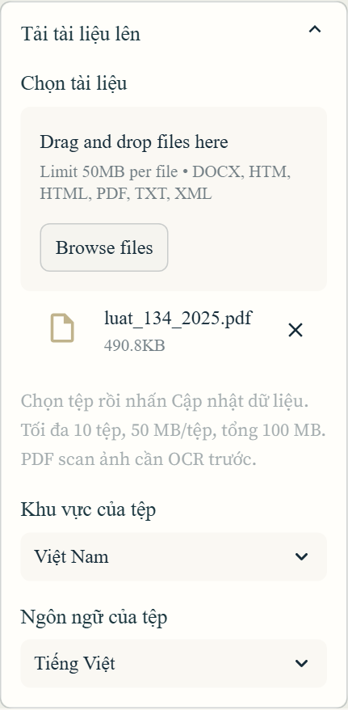

*Hình 3.6. Giao diện chọn PDF trước khi bấm cập nhật. Hình này minh họa nhận tệp, không dùng riêng nó làm bằng chứng đã chạy ETL.*

Kiểm tra tích hợp dùng PDF thật “Luật Trí tuệ nhân tạo 134-2025.pdf” trong bộ dữ liệu tách biệt, kết quả lưu ở [upload_verification.json](evidence/upload_verification.json). Các giai đoạn parse, Spark ETL, chunking, embedding, Qdrant, HDFS, truy xuất và tải bản gốc đều hoàn tất. Tập thử có một tài liệu, 30 đoạn và provenance `user_upload`. HDFS của bộ thử đồng bộ 13 tệp, 784.274 byte.

Tải lại cùng tệp trả `no_changes`. Manifest chỉ mục chính không thay đổi; do đó 63 văn bản sản xuất không bị cộng thêm bản thử nghiệm. Cách tách biệt này cho phép trình bày bằng chứng upload đầy đủ mà không làm sai các biểu đồ corpus. PDF scan chưa có OCR tự động; các test kiểm tra từ chối/báo lỗi không đồng nghĩa đã hỗ trợ OCR.

## 3.6. Thực nghiệm Spark ETL theo mức dữ liệu lặp

### 3.6.1. Thiết kế phép đo

Để kiểm tra tác động của lượng bản ghi và tính đúng của chống trùng, corpus sạch 63 tài liệu được phát lại 1, 5 và 10 lần, tạo 63, 315 và 630 bản ghi. Đây là **dữ liệu lặp có kiểm soát**, không phải 630 văn bản pháp luật khác nhau. Đầu vào tăng theo số lần lặp, còn tập nội dung duy nhất kỳ vọng giữ nguyên 63 tài liệu.

Mỗi mức chạy ba lần trên Spark `local[2]`, cùng schema và logic ETL. Có một lượt warmup riêng không tính vào kết quả; cache hệ điều hành và trạng thái môi trường không được đưa về lạnh giữa các lần chạy. Đồng hồ đo bao quanh hàm ETL, gồm khởi tạo/thực thi, đọc, biến đổi, thống kê, ghi Parquet và dừng Spark. Đọc đối chiếu hash đầu ra được thực hiện sau khoảng đo. Không đo mạng nguồn, chunking, embedding hoặc LLM trong phép đo này.

### 3.6.2. Kết quả

**Bảng 3.9. Kết quả Spark ETL, đơn vị giây**

| Mức | Bản ghi vào | Dung lượng JSONL (byte) | Lần 1 | Lần 2 | Lần 3 | Trung bình | Duy nhất sau ETL | Trùng loại bỏ |
|---|---:|---:|---:|---:|---:|---:|---:|---:|
| 1× | 63 | 6.586.007 | 5,598 | 5,087 | 5,079 | 5,255 | 63 | 0 |
| 5× | 315 | 32.930.035 | 9,115 | 6,599 | 6,066 | 7,260 | 63 | 252 |
| 10× | 630 | 65.860.070 | 9,586 | 10,576 | 13,074 | 11,079 | 63 | 567 |

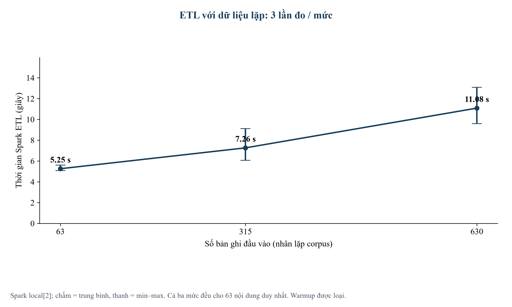

*Hình 3.22. Trung bình và khoảng min–max của ba lần đo; kết quả đầy đủ ở [etl_scaling.csv](evidence/etl_scaling.csv).*

Đầu vào tăng 10 lần nhưng thời gian trung bình tăng khoảng 2,11 lần trong thí nghiệm nhỏ này. Chi phí cố định của Spark, cache và việc đầu ra vẫn chỉ có 63 nội dung góp phần vào kết quả. Không thể suy ra hệ thống sẽ xử lý gấp 10 lần tài liệu độc lập với cùng hệ số tăng thời gian. Để đánh giá mở rộng cần nhiều nội dung duy nhất, dữ liệu lớn hơn, số executor khác nhau và đo trên cụm thực.

Cả chín lần đều cho cùng tập `(source_document_id, text_sha256)` với corpus chuẩn. Đầu ra Parquet thử nghiệm khoảng 2.935.134 byte mỗi lần; chênh lệch nhỏ với snapshot chính 2.934.181 byte không được diễn giải là nội dung mới, vì kiểm tra hash đã xác nhận cùng nội dung. Chỉ mục chính giữ nguyên trong suốt phép thử.

## 3.7. Đánh giá truy xuất

### 3.7.1. Bộ câu hỏi và cách tính

Bộ đo gồm 15 câu hỏi chọn thủ công, mỗi câu gắn một ID tài liệu kỳ vọng đã tồn tại trong snapshot. Các câu thường chứa tên/số hiệu tài liệu, phù hợp kiểm tra định danh tài liệu nhưng dễ hơn nhiều câu hỏi pháp lý mở. Cho phép lọc khu vực ở các ca được khai báo; **không truyền bộ lọc document_id** vì như vậy sẽ tiết lộ đáp án cho retriever. Bộ câu hỏi nằm trong [retrieval_cases.csv](evidence/retrieval_cases.csv).

Với mỗi câu, xác định vị trí xuất hiện đầu tiên của ID tài liệu kỳ vọng trong danh sách hit trả về. Hit@1 bằng tỷ lệ câu có tài liệu đó ở vị trí đầu; Hit@5 bằng tỷ lệ xuất hiện trong năm vị trí đầu. MRR@5 là trung bình nghịch đảo vị trí, bằng 0 nếu không có trong top 5. Đây là các vị trí **hit/đoạn trả về**, chưa có bước gộp mọi hit về một danh sách tài liệu duy nhất trước khi chấm. Một số ca mở rộng điều khoản chỉ trả một ngữ cảnh.

Mỗi câu chạy ba lần để đo độ trễ, tạo 45 lượt gọi. Có 15 câu độc lập, không phải 45 câu mới. Lượt warmup 16,92 giây được loại khỏi thống kê; chưa có phép đo cold start được kiểm soát. Không gọi LLM trong khoảng đo truy xuất.

### 3.7.2. Kết quả và phân tích lỗi

**Bảng 3.10. Chỉ số truy xuất**

| Chỉ số | Kết quả |
|---|---:|
| Số câu / số lượt gọi | 15 / 45 |
| Hit@1 | 73,33% — 11/15 câu |
| Hit@5 | 93,33% — 14/15 câu |
| MRR@5 | 0,8333 |
| Thời gian trung bình | 0,1347 giây |
| Trung vị | 0,0870 giây |
| P95 mẫu | 0,1863 giây |

P95 được lấy theo phần tử thứ `int(0,95 × (n−1))` của dãy 45 thời gian đã sắp xếp; bộ đo nhỏ nên không dùng để cam kết SLA. Độ trễ bao gồm embedding truy vấn, yêu cầu Qdrant và xử lý ngữ cảnh của retriever, không phải thời gian toàn bộ giao diện trả lời.

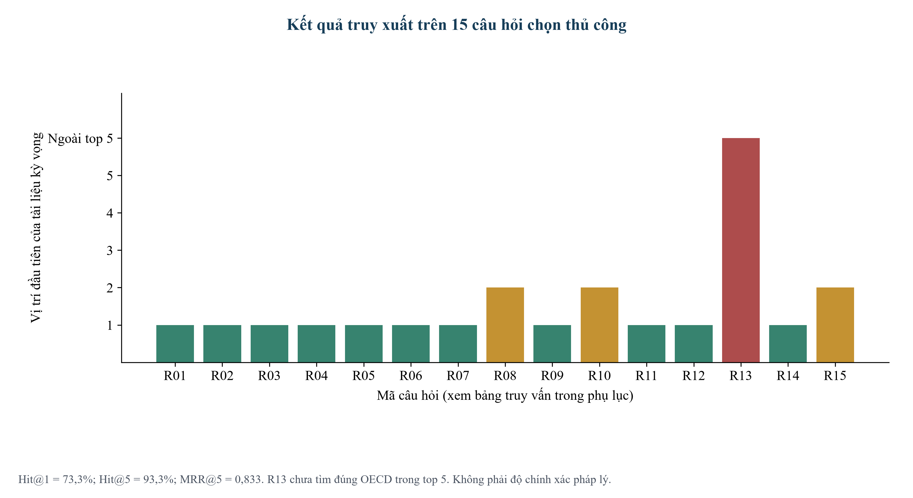

*Hình 3.23. Vị trí đầu tiên của tài liệu kỳ vọng; ba lượt cho cùng kết quả thứ hạng trên các ca này.*

**Bảng 3.11. Kết quả theo câu hỏi**

| Mã | Tài liệu/chủ đề kỳ vọng | Vị trí |
|---|---|---:|
| R01 | Luật AI 134/2025 — phạm vi | 1 |
| R02 | Quyết định 127 — chiến lược AI | 1 |
| R03 | Quyết định 1671/2026 | 1 |
| R04 | Nghị định 142/2026 | 1 |
| R05 | Quyết định 102/2026 Hà Nội | 1 |
| R06 | Thông tư 53/2026 ngân hàng | 1 |
| R07 | EU AI Act — rủi ro cao | 1 |
| R08 | Hướng dẫn EU AI literacy | 2 |
| R09 | NIST AI RMF | 1 |
| R10 | NIST Generative AI Profile | 2 |
| R11 | NIST SP 800-218A | 1 |
| R12 | UNESCO — đạo đức AI | 1 |
| R13 | OECD AI Principles | Không có trong top 5 |
| R14 | ASEAN Governance and Ethics | 1 |
| R15 | Singapore Model AI Governance | 2 |

R13 trả các nội dung gần chủ đề từ Singapore, Úc, UNESCO và Anh nhưng không tìm đúng OECD trong top 5. Corpus có tài liệu OECD nên đây là lỗi truy xuất/xếp hạng, không phải thiếu tài liệu trong index. R08 đặt EU AI Act trước hướng dẫn AI literacy; R10 đặt ASEAN Roadmap trước NIST GenAI Profile. Các trường hợp cho thấy dense similarity có thể ưu tiên nội dung gần nghĩa thay vì đúng cơ quan hoặc tên tài liệu. Hướng cải thiện là kết hợp từ khóa/số hiệu, metadata và reranker, sau đó đánh giá trên một bộ kiểm thử độc lập; chưa áp dụng các bước đó chỉ để nâng điểm của bộ 15 câu này.

Kết quả 93,33% không được viết thành “LLM trả lời đúng pháp luật 93,33%”. Bộ đo chưa chấm tính đầy đủ, mâu thuẫn, thời điểm hiệu lực, phủ định hay mức hỗ trợ của từng nhận định. Thêm 10 câu ngoài phạm vi đều bị từ chối, nhưng chỉ phản ánh hoạt động gate trên những mẫu đã chọn, chưa đo false refusal trên câu AI hợp lệ khó.

## 3.8. Kiểm tra hỏi đáp đầu cuối và dẫn chứng

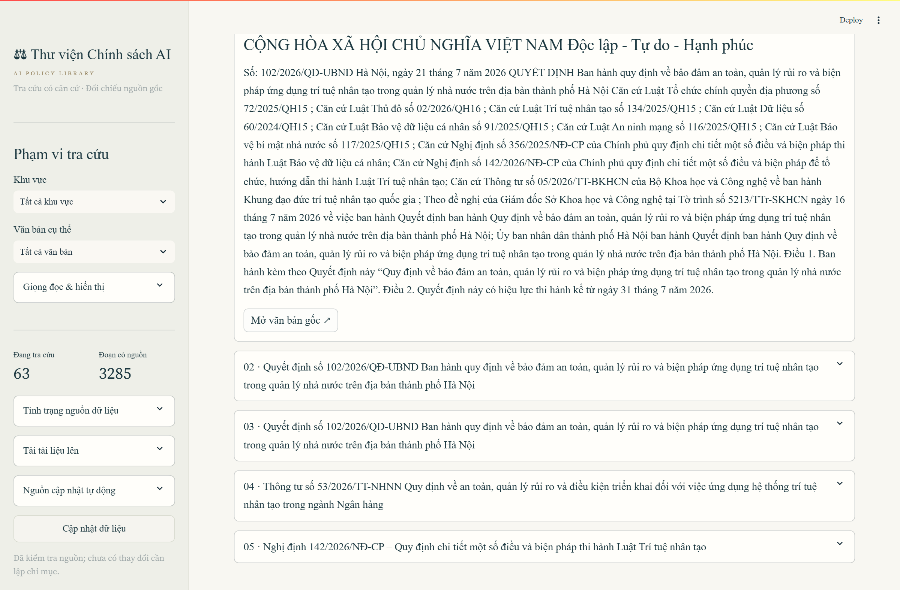

*Hình 3.3. Tìm kiếm văn bản và đoạn nguồn trên ứng dụng thật.*

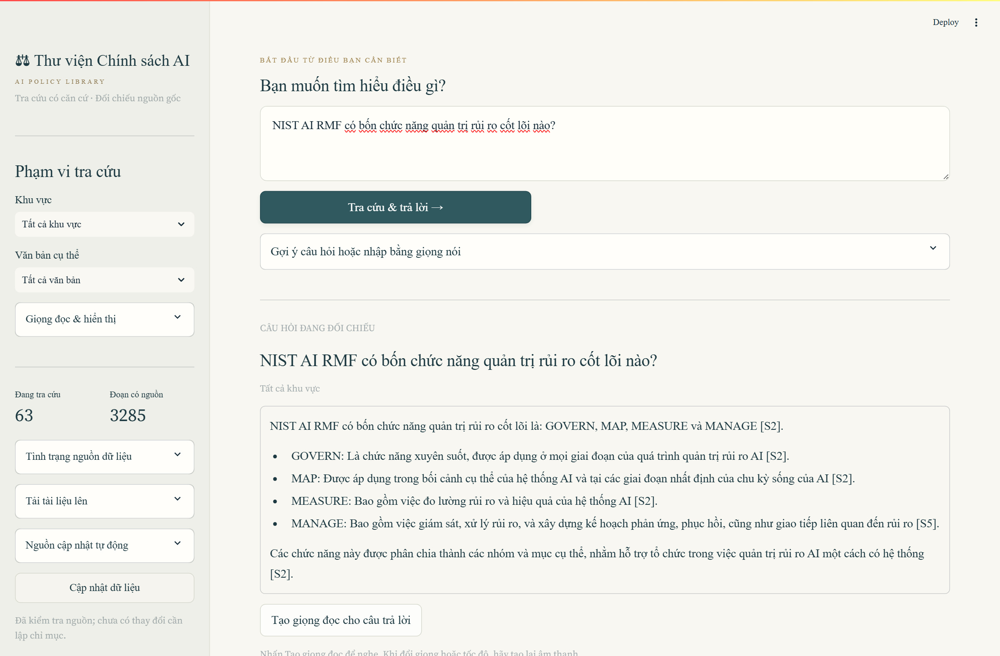

*Hình 3.4. Câu trả lời có nhãn nguồn từ giao diện đang chạy; đây là ca giao diện riêng, không thay số đo benchmark.*

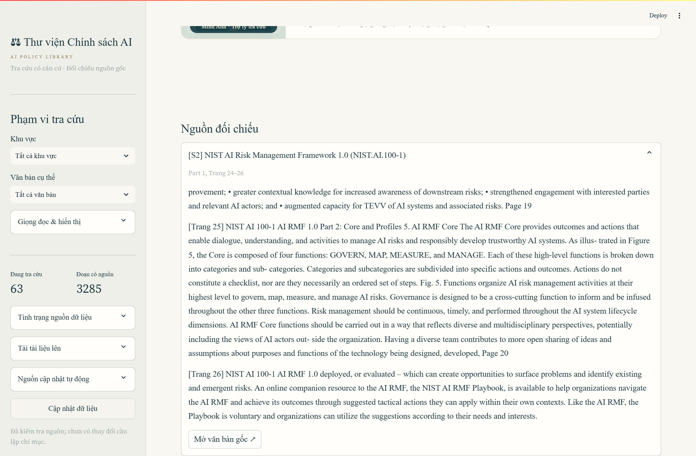

*Hình 3.5. Mở đoạn đối chiếu và liên kết nguồn.*

Loạt smoke test gọi ba câu hỏi chức năng và lưu toàn bộ kết quả ở [llm_smoke.json](evidence/llm_smoke.json). Hai câu dùng LLM sinh trực tiếp; câu EU dùng bản tóm tắt biên tập với điều kiện checksum. Kết quả được trình bày riêng trong bảng sau.

**Bảng 3.12. Ca hỏi đáp và thời gian quan sát**

| Ca | Chế độ | Kết quả cần quan sát | Thời gian |
|---|---|---|---:|
| Phạm vi Luật Trí tuệ nhân tạo | LLM, Qwen3 Instruct | Có nguồn S1; giữ mệnh đề loại trừ quốc phòng/an ninh/cơ yếu | 42,54 giây |
| Bốn chức năng NIST AI RMF | LLM, Qwen3 Instruct | Trả lời có nhãn S2/S4 và nguồn đối chiếu | 7,70 giây |
| Hành vi bị cấm theo EU AI Act | `curated_summary`, model null | Tám nhóm từ bản biên tập đúng checksum | 0,39 giây |

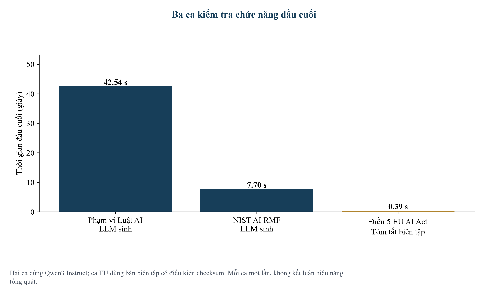

*Hình 3.24. So sánh mô tả ba ca chức năng; màu khác để phân biệt bản biên tập với LLM.*

Ở ca Luật AI, đầu ra giữ nội dung loại trừ hoạt động chỉ phục vụ quốc phòng, an ninh, cơ yếu, cho thấy lợi ích của lấy đủ điều thay vì một mảnh thiếu ngoại lệ. Đây là quan sát trên một ca và nguồn cụ thể; chưa đủ để kết luận mô hình luôn xử lý đúng các phủ định. Chênh lệch 42,54 và 7,70 giây có thể chịu ảnh hưởng trạng thái model, ngữ cảnh và độ dài sinh; mỗi ca chỉ chạy một lần nên không tách được tác động từng yếu tố. Thời gian 0,39 giây của bản biên tập không được tính vào trung bình suy luận LLM.

Việc có S1 hoặc S2 không tự bảo đảm nguồn hỗ trợ đúng câu. Bước đánh giá tiếp theo cần người đọc đối chiếu từng nhận định với nguyên văn và đánh dấu hỗ trợ đầy đủ/một phần/không hỗ trợ, đặc biệt với thời hạn, ngoại lệ và hiệu lực. Báo cáo hiện tại cung cấp đường truy vết và ví dụ, chưa có một bộ điểm chất lượng pháp lý được thẩm định độc lập.

## 3.9. Minh chứng ứng dụng và hạ tầng

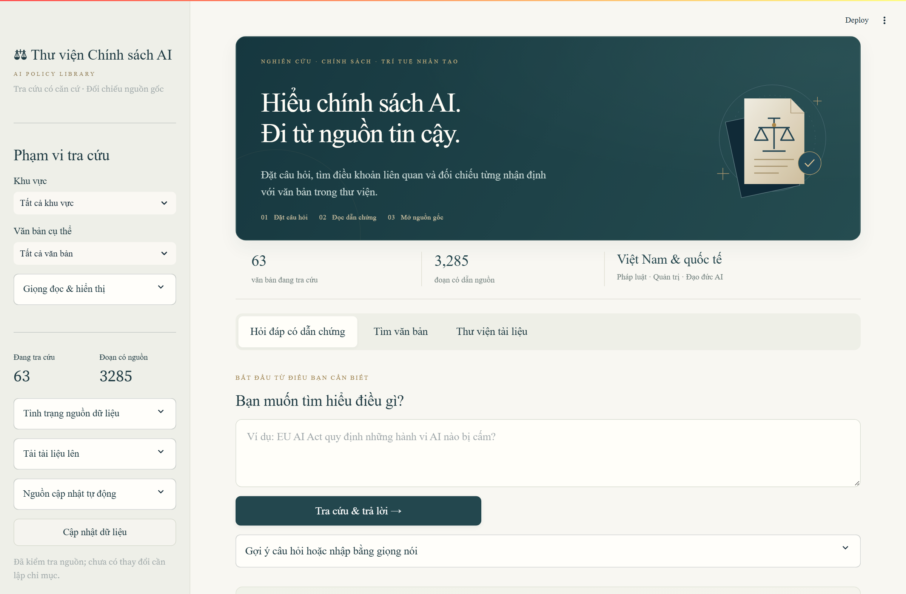

*Hình 3.1. Giao diện chính và số tài liệu đang hoạt động.*

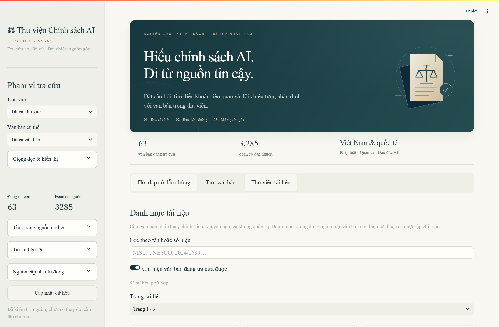

*Hình 3.2. Thư viện tài liệu có trạng thái và điều khiển lọc/phân trang.*

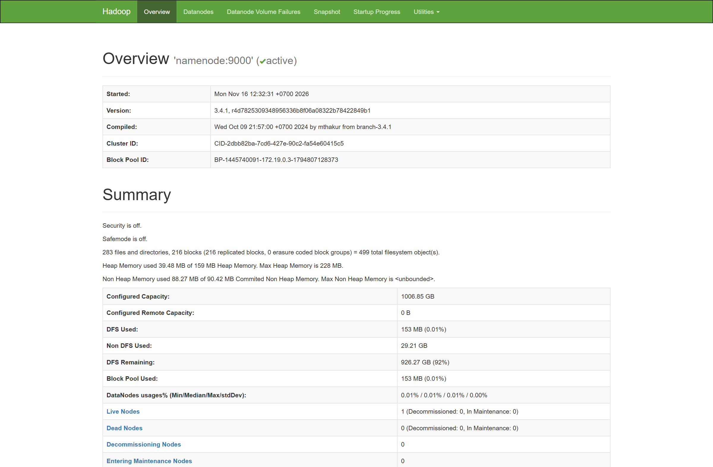

*Hình 3.9. NameNode UI thật; cần đọc dung lượng theo phạm vi namespace của giao diện.*

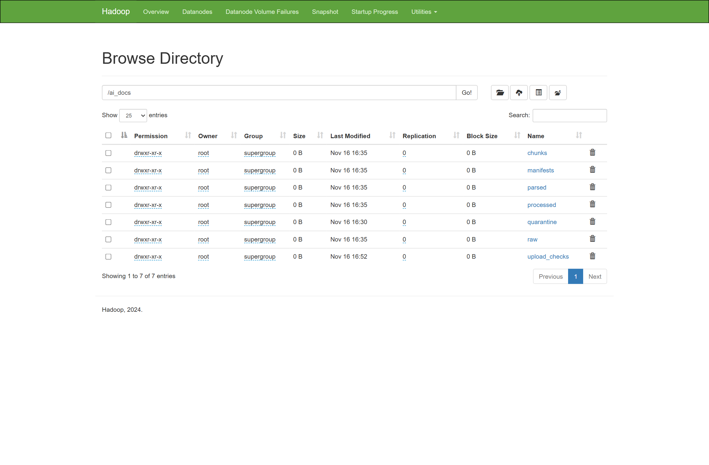

*Hình 3.10. Các vùng Raw, Parsed, Processed, Chunks và Manifests trên HDFS.*

Trên màn hình thư mục, các cột Size, Replication và Block Size có thể cùng bằng 0 vì hàng đang biểu diễn một `DIRECTORY`. WebHDFS định nghĩa length của thư mục bằng 0 và trả metadata block/replication như vậy [2]; đây không phải tổng dung lượng các tệp con. Muốn xem dung lượng cộng dồn cần `GETCONTENTSUMMARY` hoặc `hdfs dfs -du`, còn muốn xem replication phải mở từng tệp.

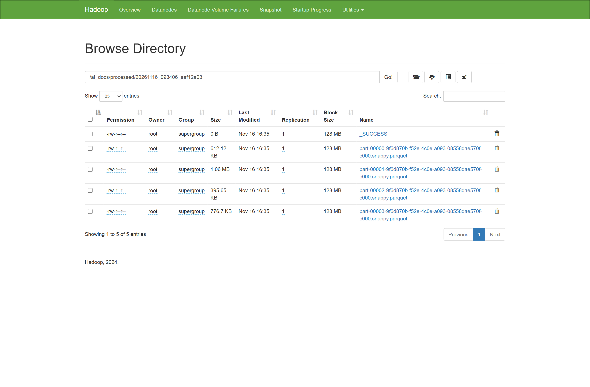

*Hình 3.30. Mở thư mục Processed của snapshot để xem các tệp Parquet có dung lượng, replication và block size thật.*

Đã kiểm tra riêng một tệp Parquet có 626.810 byte và PDF gốc có 502.586 byte: cả hai có replication 1, block size cấu hình 134.217.728 byte (128 MiB). Đọc lại tệp từ HDFS cho checksum trùng bản gốc. Block size là kích thước chia block được cấu hình, không yêu cầu mỗi tệp nhỏ phải có đủ 128 MiB dữ liệu. Tệp marker như `_SUCCESS` có thể cố ý rỗng; không dùng nó để kết luận toàn bộ Parquet rỗng. [hdfs_file_verification.json](evidence/hdfs_file_verification.json) lưu kết quả đối chiếu.

Kiểm tra `hdfs fsck /ai_docs` báo **HEALTHY**, 216 block được kiểm tra, không có missing block, corrupt block hoặc under-replicated block. Chi tiết ở [hdfs_fsck.log](evidence/hdfs_fsck.log). Tính khỏe mạnh này được đánh giá theo replication 1 của máy demo, chưa cung cấp khả năng chịu mất một DataNode.

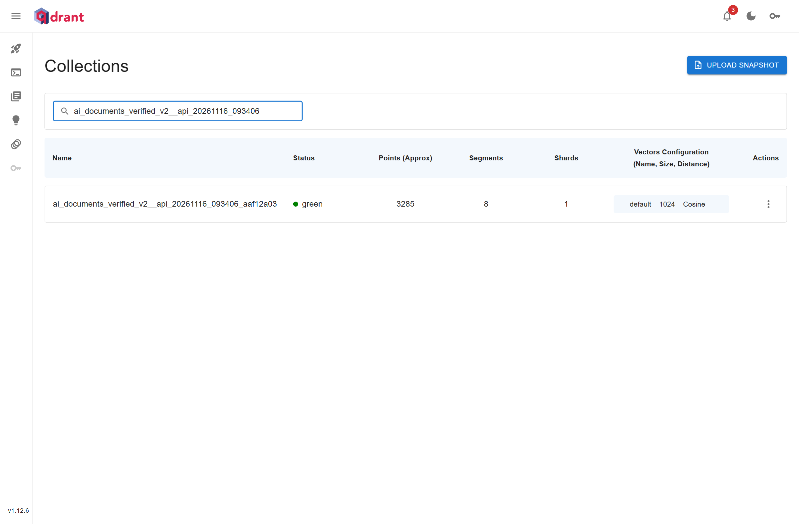

*Hình 3.11. Dashboard Qdrant; số liệu index chính được đối chiếu bằng API exact count.*

Các ảnh được tạo bằng Chrome headless trong một phiên trình duyệt mới, chỉ truy cập localhost, không dựng bằng ảnh minh họa AI. Playwright dùng để điều khiển thao tác và chụp màn hình [15]. [screenshot_manifest.json](evidence/screenshot_manifest.json) ghi URL, thời điểm và tên ảnh. Sơ đồ thiết kế được vẽ riêng bằng Graphviz; biểu đồ thống kê xuất bằng Matplotlib từ CSV/JSON, vì vậy hai nhóm đó không được gọi là ảnh chụp màn hình.

## 3.10. Thử nghiệm trợ lý giọng nói và người thuyết trình

### 3.10.1. Kịch bản và ảnh giao diện thật

Người thuyết trình được kiểm tra như một chức năng riêng của sản phẩm. Kịch bản bắt đầu tại **Khám phá trợ lý giọng nói**, bấm **Nghe thử giọng đọc**, sau đó phát, tạm dừng, đổi tốc độ và đọc lại. Không cần gọi LLM cho đoạn chào mẫu nên có thể tách lỗi bộ phát khỏi lỗi sinh câu trả lời.

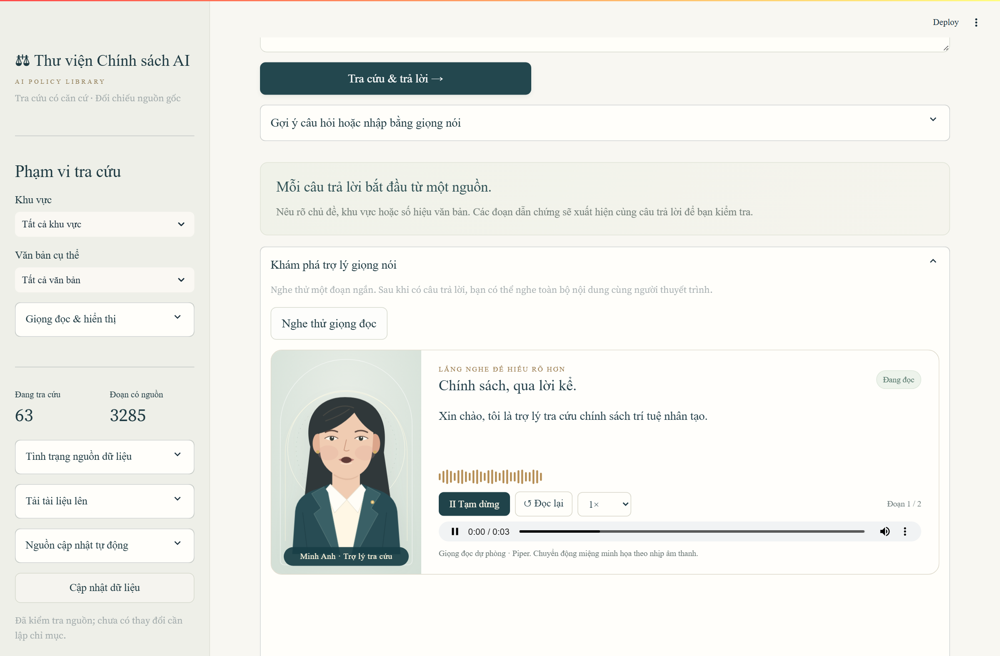

*Hình 3.27. Người thuyết trình nữ trong ứng dụng đang chạy, kèm phụ đề và điều khiển nghe.*

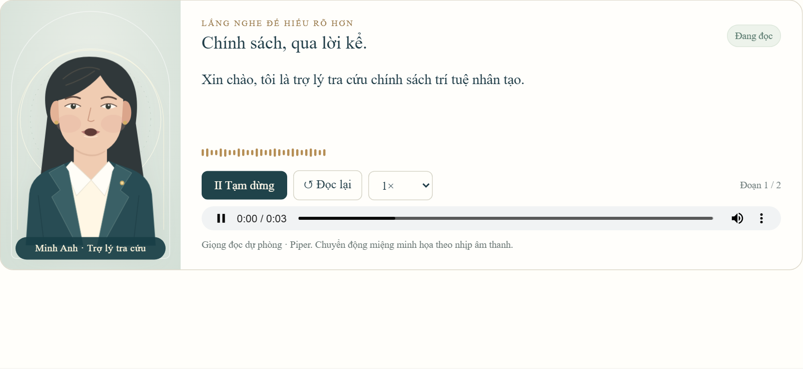

*Hình 3.28. Ảnh chụp thật khung người nói khi audio đang phát; nhãn ghi đúng provider Piper dự phòng của phiên đo.*

Giao diện giữ một lựa chọn giọng nữ theo cấu hình hiện tại. Trong phiên chụp, âm thanh thực tế do **Piper dự phòng** tạo ra; báo cáo không coi đây là mẫu Hoài My đã đáp ứng. Nhân vật nữ là hình minh họa của giao diện, còn provider là nguồn tạo âm thanh. Cách ghi này vừa giữ được điểm nhấn trình bày vừa có thể kiểm chứng trạng thái thực tế.

### 3.10.2. Kết quả bộ phát, phụ đề và hoạt ảnh

**Bảng 3.13. Nghiệm thu người thuyết trình trên trình duyệt thật**

| Kiểm tra | Kết quả/bằng chứng |
|---|---|
| Có audio thật | 2 đoạn WAV được trích từ chính playlist đã phát |
| Audio chạy theo thời gian | `currentTime` tăng quá 0,2 giây; `paused=false` |
| Nhân vật chuyển động theo âm | Năm mẫu bán kính miệng khác nhau trong lúc phát; ảnh có sóng âm |
| Tạm dừng | Trạng thái chuyển thành “Tạm dừng” |
| Đổi tốc độ | Chọn 1,15×, `audio.playbackRate=1.15` |
| Đọc lại | Trở về đầu và phát lại |
| Phụ đề | Chuyển từ Đoạn 1/2 sang Đoạn 2/2 theo sự kiện kết thúc audio |
| Kết thúc | Trạng thái “Đã đọc xong” |

Nguồn: [presenter_browser_check.json](evidence/presenter_browser_check.json). Mẫu hoạt ảnh cho thấy thuộc tính SVG thay đổi, chưa phải đánh giá mức khớp môi với âm vị. Các ca logic JavaScript còn kiểm tra phát WAV, pause/resume, tốc độ, phụ đề, kết thúc, đọc lại và xử lý thiếu giọng Việt; lần chạy lại báo PASS trong [presenter_player_tests.log](evidence/presenter_player_tests.log). Test Python kiểm tra khóa cache khi đổi tốc độ và escape nội dung trong script đã nằm trong bộ 86 ca.

### 3.10.3. Dữ liệu âm thanh và vai trò trong tiểu luận

**Bảng 3.14. Hai đoạn âm thanh thật được đính kèm**

| Đoạn | Thời lượng | Tần số lấy mẫu | Kênh / độ sâu mẫu | Byte |
|---|---:|---:|---|---:|
| Đoạn chào | 3,396 giây | 22.050 Hz | Mono / PCM 16-bit | 149.806 |
| Đoạn hướng dẫn đối chiếu | 3,686 giây | 22.050 Hz | Mono / PCM 16-bit | 162.606 |

Mẫu [đoạn 1](am_thanh/nguoi_thuyet_trinh_doan_01.wav) và [đoạn 2](am_thanh/nguoi_thuyet_trinh_doan_02.wav) được giữ cùng checksum trong JSON bằng chứng. Tổng thời lượng khoảng 7,08 giây ở tốc độ cơ sở; đây là thời lượng audio, không phải thời gian xử lý tổng hợp tiếng nói.

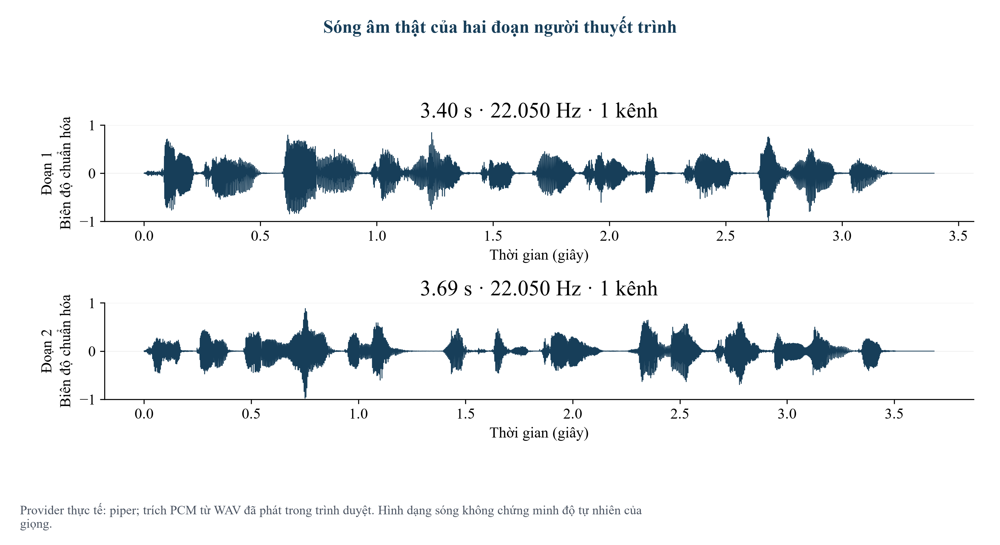

*Hình 3.29. Dạng sóng PCM từ hai tệp đã phát. Biểu đồ dùng kiểm tra sự tồn tại và cấu trúc tín hiệu, không suy ra độ tự nhiên của giọng.*

Phần người nói là điểm nhấn ứng dụng của tiểu luận: sản phẩm dữ liệu từ Data Lake/RAG được chuyển thành trải nghiệm đa phương thức có thể đọc, nghe và đối chiếu nguồn. Pipeline TTS xử lý văn bản theo cụm, giữ thứ tự, metadata provider và trạng thái phát; giao diện trình bày đồng bộ đoạn âm thanh với nhân vật. Chưa có thử nghiệm người dùng, điểm MOS hoặc phép đo nhận dạng giọng nói WER, nên báo cáo chỉ kết luận chức năng hoạt động theo những kiểm tra trên. Nhập câu hỏi bằng giọng nói được mô tả trong thiết kế nhưng chưa được tính là một phép thử micro người thật trong bộ nghiệm thu này.

## 3.11. Thảo luận và định hướng phát triển

Kết quả thể hiện hệ thống đã hình thành một vòng đời dữ liệu: nhận nguồn mới/tệp, chuẩn hóa bằng Spark, giữ dữ liệu theo lớp, phát hành chỉ mục có phiên bản và khai thác qua RAG. Phần phù hợp với học phần Dữ liệu lớn và định hướng Data Engineer nằm ở hợp đồng nguồn, schema, chất lượng, provenance, khử trùng, kho dữ liệu, điều phối và quan sát pipeline.

**Bảng 3.15. Đối chiếu kết quả với kỹ năng Data Engineering**

| Năng lực | Minh chứng trong dự án | Giới hạn cần phát triển |
|---|---|---|
| Data ingestion | Adapter API danh mục/toàn văn; nhiều định dạng; upload | Thêm nguồn ổn định, quản lý quota và hợp đồng schema |
| Incremental processing | Cửa sổ thời gian, checkpoint, checksum, no_changes | Phát hiện sửa đổi văn bản cũ; lịch chạy tự động |
| Batch ETL | Spark DataFrame, Window khử trùng, báo cáo | Chuyển I/O và tác vụ lên cụm thực |
| Data storage | Raw/Parsed/Parquet/Chunks, HDFS, snapshot | Replication, retention, backup/restore đã kiểm thử |
| Data governance | Nguồn, phiên bản, loại tài liệu, trạng thái hiệu lực | Chuẩn hóa ngày và thẩm định hiệu lực/phạm vi sử dụng |
| Serving | Qdrant alias, manifest phiên bản, RAG | Hybrid retrieval, rerank, kiểm soát nhiều người dùng |
| Observability và QA | Trạng thái job, log, 86 test, CSV/JSON và đồ thị | Theo dõi tài nguyên theo thời gian, cảnh báo và SLO |

Những giới hạn chính gồm corpus nhỏ, chỉ một máy và một DataNode; chưa có đo tải đồng thời; dữ liệu lặp không thay thế dữ liệu độc lập quy mô lớn; bộ truy vấn chọn thủ công thiên về tên tài liệu; còn thiếu metadata ngày/hiệu lực; chưa hỗ trợ OCR; công bố xuyên Qdrant/manifest/HDFS chưa là giao dịch chung. Chức năng giọng và giao diện hỗ trợ trình diễn nhưng không được coi là bằng chứng mở rộng dữ liệu.

Thứ tự phát triển hợp lý là hoàn thiện metadata và bộ đánh giá có thẩm định, bổ sung hybrid/reranker, thiết lập scheduler/quan sát, sau đó chuyển xử lý và lưu trữ sang cụm có chính sách sao lưu, retention và phân quyền. Mọi công nghệ bổ sung cần có phép đo trước/sau và tiêu chí chấp nhận cụ thể, thay vì chỉ tăng số thành phần trong sơ đồ.


# TÀI LIỆU THAM KHẢO

Các tài liệu công nghệ dưới đây là công bố nghiên cứu, tài liệu của dự án hoặc tài liệu từ cơ quan/nhà phát triển. Ngày truy cập/đối chiếu: **16/11/2026**. Số trong ngoặc vuông được dùng thống nhất trong hai chương. Nội dung thiết kế và số đo riêng của nhóm lấy từ mã nguồn và thư mục [evidence](evidence/), không gán cho các tài liệu bên ngoài.

[1] Apache Software Foundation, *HDFS Architecture*, Apache Hadoop 3.4.1, 2024. [Tài liệu chính thức](https://hadoop.apache.org/docs/r3.4.1/hadoop-project-dist/hadoop-hdfs/HdfsDesign.html). Dùng cho vai trò NameNode/DataNode, block và replication.

[2] Apache Software Foundation, *WebHDFS REST API*, Apache Hadoop 3.4.1, 2024. [Tài liệu chính thức](https://hadoop.apache.org/docs/r3.4.1/hadoop-project-dist/hadoop-hdfs/WebHDFS.html). Dùng cho CREATE/redirect, GETFILESTATUS, LISTSTATUS, OPEN và GETCONTENTSUMMARY; phân biệt metadata thư mục và tệp.

[3] M. Zaharia và cộng sự, “Resilient Distributed Datasets: A Fault-Tolerant Abstraction for In-Memory Cluster Computing,” *USENIX NSDI*, 2012. [Bài nghiên cứu và thông tin hội nghị](https://www.usenix.org/conference/nsdi12/technical-sessions/presentation/zaharia). Cơ sở công nghệ Spark; không dùng bài này để khẳng định demo đã chạy trên nhiều máy.

[4] Apache Software Foundation, *Parquet Files — Spark SQL, DataFrames and Datasets Guide*, Apache Spark 3.5.3. [Bản tài liệu theo phiên bản](https://dist.apache.org/repos/dist/release/spark/docs/3.5.3/sql-data-sources-parquet.html). Cơ sở đọc/ghi Parquet và tùy chọn liên quan.

[5] Databricks, *What is the medallion lakehouse architecture?* [Tài liệu kiến trúc](https://docs.databricks.com/aws/en/lakehouse/medallion). Tham khảo mẫu phân lớp Bronze/Silver/Gold; hệ thống hiện tại không sử dụng Databricks hoặc Delta Lake.

[6] Apache Parquet, *Overview*. [Tài liệu định dạng](https://parquet.apache.org/docs/overview/). Cơ sở lựa chọn định dạng cột cho lớp Processed.

[7] P. Lewis và cộng sự, “Retrieval-Augmented Generation for Knowledge-Intensive NLP Tasks,” 2020, arXiv:2005.11401. [Bài nghiên cứu](https://arxiv.org/abs/2005.11401). Cơ sở kết hợp nguồn truy xuất với mô hình sinh.

[8] J. Chen và cộng sự, “BGE M3-Embedding: Multi-Lingual, Multi-Functionality, Multi-Granularity Text Embeddings Through Self-Knowledge Distillation,” 2024, arXiv:2402.03216. [Bài nghiên cứu](https://arxiv.org/abs/2402.03216). Dự án hiện chỉ khai thác dense embedding.

[9] Qdrant, *Collections*, mục collection aliases. [Tài liệu chính thức](https://qdrant.tech/documentation/manage-data/collections/). Cơ sở dùng alias và thay đổi alias nguyên tử trong Qdrant; không suy rộng thành giao dịch chung với HDFS/tệp manifest.

[10] A. Yang và cộng sự, “Qwen3 Technical Report,” 2025, arXiv:2505.09388. [Báo cáo kỹ thuật](https://arxiv.org/abs/2505.09388). Cơ sở lựa chọn họ mô hình Qwen3; tag triển khai cụ thể đối chiếu thêm ở [11].

[11] Ollama, *qwen3:4b-instruct-2507-q4_K_M*. [Model card của đúng tag](https://ollama.com/library/qwen3:4b-instruct-2507-q4_K_M). Dùng nhận diện bản Instruct, quy mô và lượng tử hóa; context ứng dụng do nhóm cấu hình là 6.144 token.

[12] P. Groth và L. Moreau (biên tập), *PROV-Overview: An Overview of the PROV Family of Documents*, W3C Working Group Note, 30/04/2013. [Tài liệu W3C](https://www.w3.org/TR/prov-overview/). Tham khảo ý tưởng truy nguyên entity/activity; không tuyên bố schema của dự án tuân thủ đầy đủ PROV-O.

[13] Docker, *How Compose works*. [Tài liệu chính thức](https://docs.docker.com/compose/intro/compose-application-model/). Cơ sở mô hình services, networks, volumes trong triển khai nhiều container.

[14] Streamlit, *st.file_uploader*, tài liệu phiên bản 1.41.0. [API reference](https://docs.streamlit.io/1.41.0/develop/api-reference/widgets/st.file_uploader). Tham khảo chức năng nhận nhiều tệp; giới hạn 10 tệp/50 MiB/100 MiB là quy tắc của dự án, không phải mặc định của Streamlit.

[15] Microsoft/Playwright, *Screenshots — Python*. [Tài liệu chính thức](https://playwright.dev/python/docs/screenshots). Dùng cho phương pháp lấy ảnh bằng chứng trong báo cáo, không phải thành phần runtime của pipeline RAG.

[16] MDN Web Docs, *AnalyserNode — Web Audio API*. [Tài liệu API](https://developer.mozilla.org/en-US/docs/Web/API/AnalyserNode). Cơ sở lấy mẫu âm thanh miền thời gian cho hoạt ảnh người nói; không phải tài liệu chứng minh lip-sync âm vị.

[17] rany2 và cộng tác viên, *edge-tts*. [Kho mã nguồn và hướng dẫn của tác giả](https://github.com/rany2/edge-tts). Thư viện truy cập dịch vụ đọc trực tuyến của Microsoft Edge; cần phân biệt với Azure Speech API có tài khoản thương mại.

[18] OHF-Voice, *Piper: fast and local neural text-to-speech engine*. [Kho mã nguồn](https://github.com/OHF-Voice/piper1-gpl). Backend TTS dự phòng; thông tin giấy phép và attribution của bản cài xem thêm [VOICE_ATTRIBUTION.md](../VOICE_ATTRIBUTION.md).

[19] rhasspy/piper-voices, *vi_VN-vais1000-medium — MODEL_CARD*, revision `3d796cc2f2c884b3517c527507e084f7bb245aea`. [Model card cố định phiên bản](https://huggingface.co/rhasspy/piper-voices/blob/3d796cc2f2c884b3517c527507e084f7bb245aea/vi/vi_VN/vais1000/medium/MODEL_CARD). Dùng cho nhận diện giọng tiếng Việt dự phòng; mẫu WAV trong báo cáo được đo lại từ playlist thực tế.

[20] Bộ Tư pháp, *Cơ sở dữ liệu quốc gia về pháp luật — nguồn công khai*. [Cổng dữ liệu](https://vbpl.vn/), endpoint danh mục `https://vbpl-bientap-gateway.moj.gov.vn/api/qtdc/public/doc/all` và endpoint toàn văn `/api/qtdc/public/doc/{id}`. Hợp đồng payload/response trong báo cáo được xác minh bằng ứng dụng gọi HTTP thật, không phải trích một đặc tả API có cam kết ổn định. Xem [cấu hình nguồn](../../data/api_sources.json), [bằng chứng API](evidence/previous_api_verification.json) và [lượt giao diện](evidence/capture_update_status.json).

## Nguồn dữ liệu cụ thể của corpus

Để tránh nhập nhằng tài liệu công nghệ với văn bản đem đi tra cứu, danh mục dữ liệu được tách thành [PHU_LUC_DANH_MUC_DU_LIEU.md](PHU_LUC_DANH_MUC_DU_LIEU.md) và [CSV danh mục](evidence/dataset_catalog.csv). Phụ lục liệt kê toàn bộ 63 tài liệu đang hoạt động với URL, loại, ngôn ngữ, khu vực và provenance, đối chiếu theo snapshot của báo cáo. Đây là danh mục nguồn của bản dữ liệu đã thu thập, không khẳng định tất cả URL hiện còn truy cập được hoặc mọi văn bản còn hiệu lực.


# PHỤ LỤC VÀ BẰNG CHỨNG

Danh mục toàn bộ 63 tài liệu và 15 câu hỏi nằm trong [phụ lục dữ liệu](PHU_LUC_DANH_MUC_DU_LIEU.md). Số liệu từng tài liệu/đoạn nằm trong [document_statistics.csv](evidence/document_statistics.csv) và [chunk_statistics.csv](evidence/chunk_statistics.csv). [Danh mục hình](DANH_MUC_HINH.md) cung cấp ảnh, SVG và nguồn tương ứng.
