# BỘ BIỂU ĐỒ THỐNG KÊ DỮ LIỆU VÀ THỰC NGHIỆM

16 biểu đồ từ dữ liệu thật, mỗi hình có PNG 300 dpi và SVG. Phông Times New Roman; màu xanh đậm, vàng và xanh lá thống nhất với báo cáo. [Về bản nháp](02_BAN_NHAP_CHUONG_2_3.md).

## Phân bố 63 văn bản theo nhãn khu vực

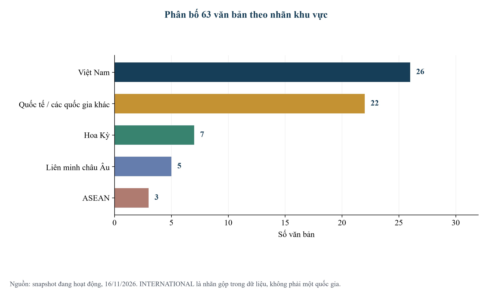

Nguồn: snapshot đang hoạt động, 16/11/2026. INTERNATIONAL là nhãn gộp trong dữ liệu, không phải một quốc gia.

[PNG](hinh_anh/hinh_3_12_khu_vuc.png) · [SVG](hinh_anh/hinh_3_12_khu_vuc.svg) · Nguồn: `evidence/document_statistics.csv`.

## Hai ngôn ngữ trong corpus hiện tại

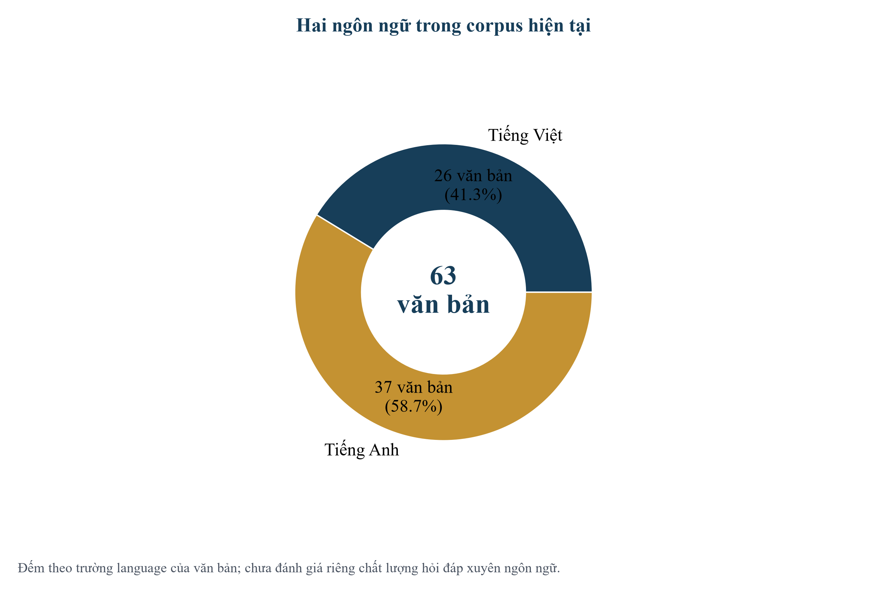

Đếm theo trường language của văn bản; chưa đánh giá riêng chất lượng hỏi đáp xuyên ngôn ngữ.

[PNG](hinh_anh/hinh_3_13_ngon_ngu.png) · [SVG](hinh_anh/hinh_3_13_ngon_ngu.svg) · Nguồn: `evidence/document_statistics.csv`.

## Cơ cấu loại tài liệu

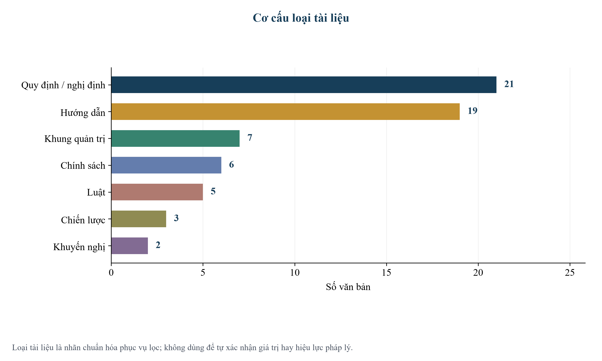

Loại tài liệu là nhãn chuẩn hóa phục vụ lọc; không dùng để tự xác nhận giá trị hay hiệu lực pháp lý.

[PNG](hinh_anh/hinh_3_14_loai_van_ban.png) · [SVG](hinh_anh/hinh_3_14_loai_van_ban.svg) · Nguồn: `evidence/document_statistics.csv`.

## Nguồn thu thập và đóng góp vào chỉ mục

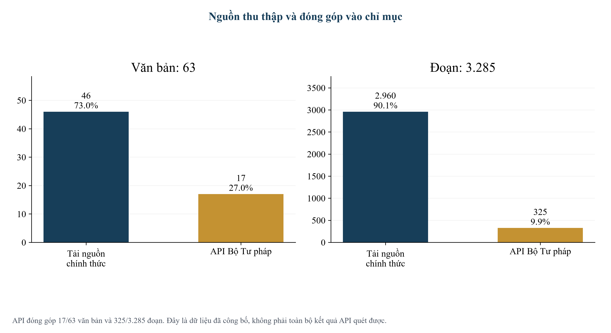

API đóng góp 17/63 văn bản và 325/3.285 đoạn. Đây là dữ liệu đã công bố, không phải toàn bộ kết quả API quét được.

[PNG](hinh_anh/hinh_3_15_nguon_thu_thap.png) · [SVG](hinh_anh/hinh_3_15_nguon_thu_thap.svg) · Nguồn: `evidence/system_facts.json`.

## Năm ban hành theo metadata hiện có

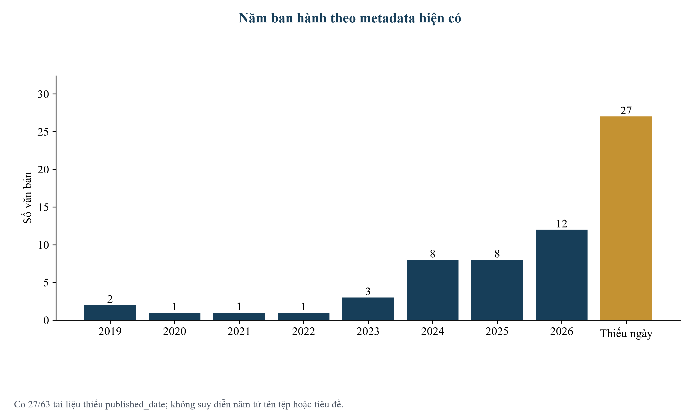

Có 27/63 tài liệu thiếu published_date; không suy diễn năm từ tên tệp hoặc tiêu đề.

[PNG](hinh_anh/hinh_3_16_nam_ban_hanh.png) · [SVG](hinh_anh/hinh_3_16_nam_ban_hanh.svg) · Nguồn: `evidence/document_statistics.csv`.

## Độ dài văn bản không đồng đều

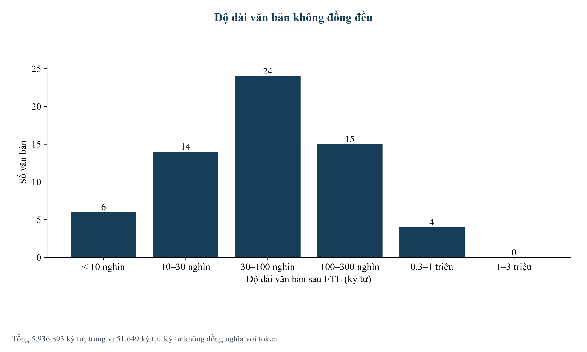

Tổng 5.936.893 ký tự; trung vị 51.649 ký tự. Ký tự không đồng nghĩa với token.

[PNG](hinh_anh/hinh_3_17_do_dai_van_ban.png) · [SVG](hinh_anh/hinh_3_17_do_dai_van_ban.svg) · Nguồn: `evidence/document_statistics.csv`.

## Phân bố độ dài 3.285 đoạn

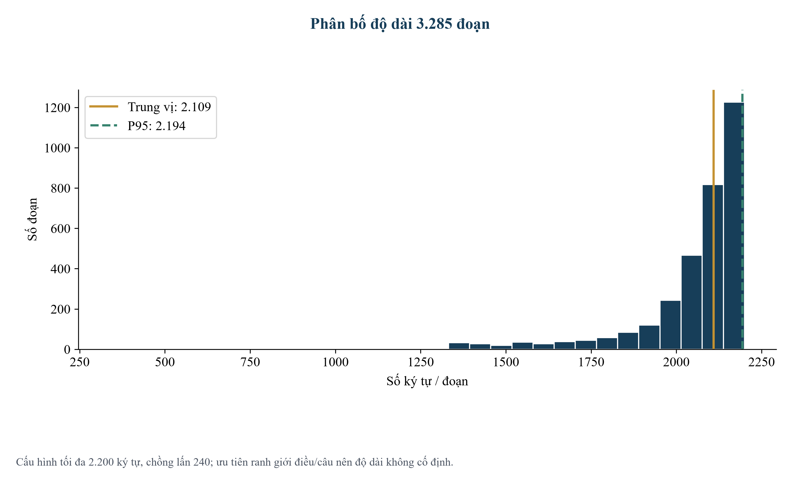

Cấu hình tối đa 2.200 ký tự, chồng lấn 240; ưu tiên ranh giới điều/câu nên độ dài không cố định.

[PNG](hinh_anh/hinh_3_18_do_dai_chunk.png) · [SVG](hinh_anh/hinh_3_18_do_dai_chunk.svg) · Nguồn: `evidence/chunk_statistics.csv`.

## Mười tài liệu đóng góp nhiều đoạn nhất

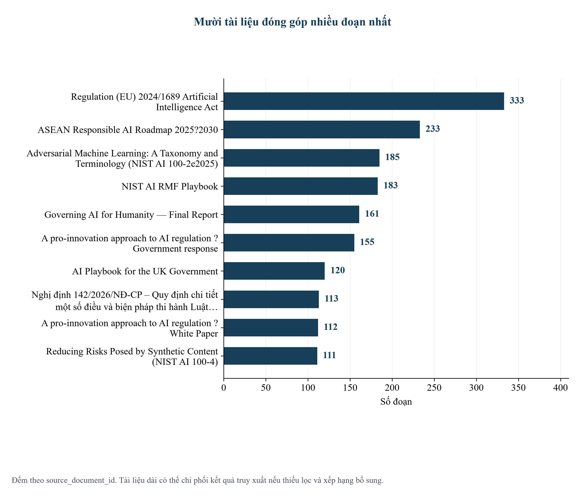

Đếm theo source_document_id. Tài liệu dài có thể chi phối kết quả truy xuất nếu thiếu lọc và xếp hạng bổ sung.

[PNG](hinh_anh/hinh_3_19_top_tai_lieu.png) · [SVG](hinh_anh/hinh_3_19_top_tai_lieu.svg) · Nguồn: `evidence/document_statistics.csv`.

## Kiểm tra độ đầy đủ và định danh

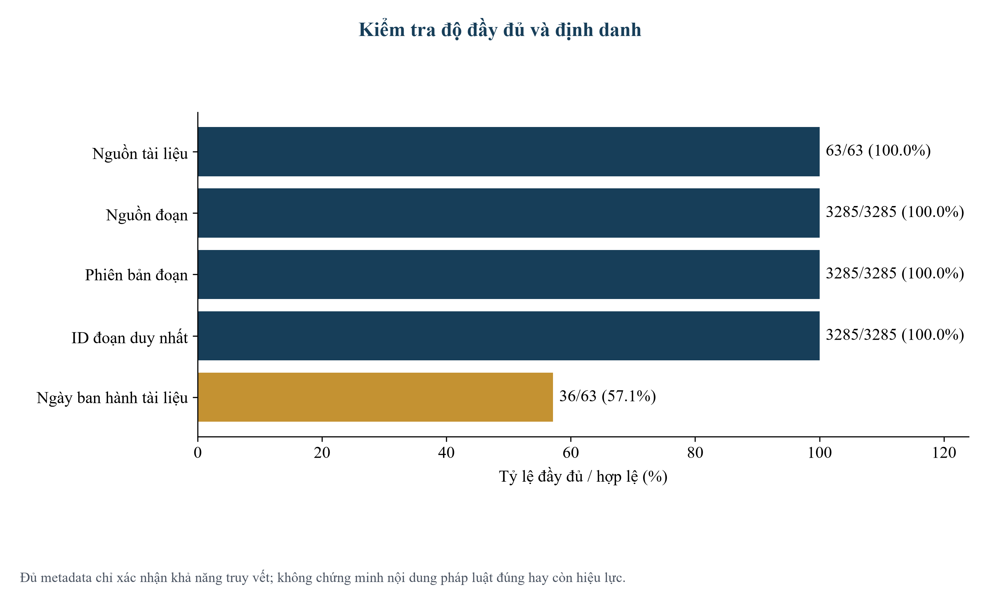

Đủ metadata chỉ xác nhận khả năng truy vết; không chứng minh nội dung pháp luật đúng hay còn hiệu lực.

[PNG](hinh_anh/hinh_3_20_chat_luong_metadata.png) · [SVG](hinh_anh/hinh_3_20_chat_luong_metadata.svg) · Nguồn: `evidence/system_facts.json; document_statistics.csv`.

## Danh mục nguồn và tài liệu đang tra cứu

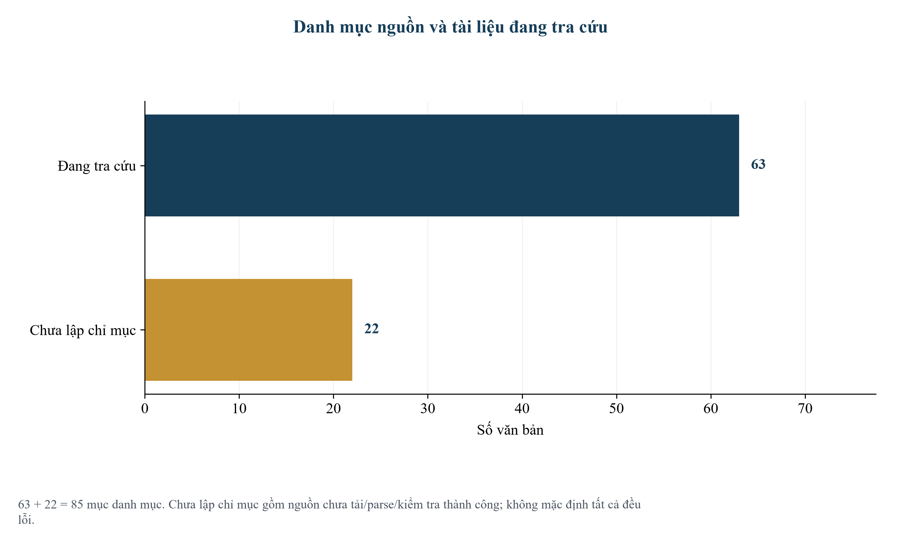

63 + 22 = 85 mục danh mục. Chưa lập chỉ mục gồm nguồn chưa tải/parse/kiểm tra thành công; không mặc định tất cả đều lỗi.

[PNG](hinh_anh/hinh_3_21_trang_thai_danh_muc.png) · [SVG](hinh_anh/hinh_3_21_trang_thai_danh_muc.svg) · Nguồn: `evidence/document_statistics.csv`.

## ETL với dữ liệu lặp: 3 lần đo / mức

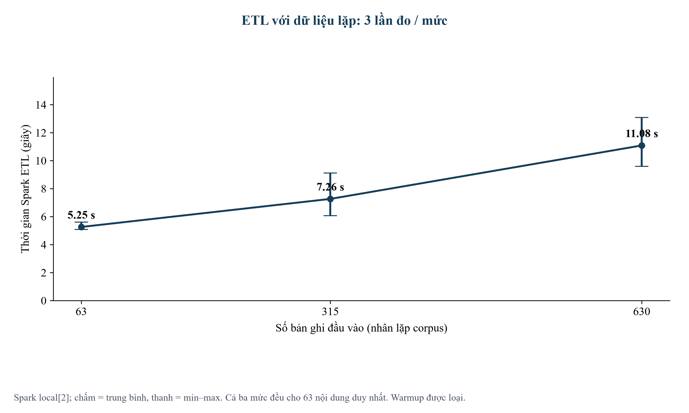

Spark local[2]; chấm = trung bình, thanh = min–max. Cả ba mức đều cho 63 nội dung duy nhất. Warmup được loại.

[PNG](hinh_anh/hinh_3_22_etl_quy_mo.png) · [SVG](hinh_anh/hinh_3_22_etl_quy_mo.svg) · Nguồn: `evidence/etl_scaling_results.json`.

## Kết quả truy xuất trên 15 câu hỏi chọn thủ công

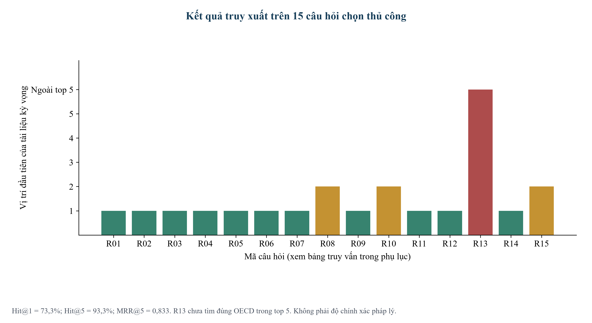

Hit@1 = 73,3%; Hit@5 = 93,3%; MRR@5 = 0,833. R13 chưa tìm đúng OECD trong top 5. Không phải độ chính xác pháp lý.

[PNG](hinh_anh/hinh_3_23_xep_hang.png) · [SVG](hinh_anh/hinh_3_23_xep_hang.svg) · Nguồn: `evidence/retrieval_results.json`.

## Ba ca kiểm tra chức năng đầu cuối

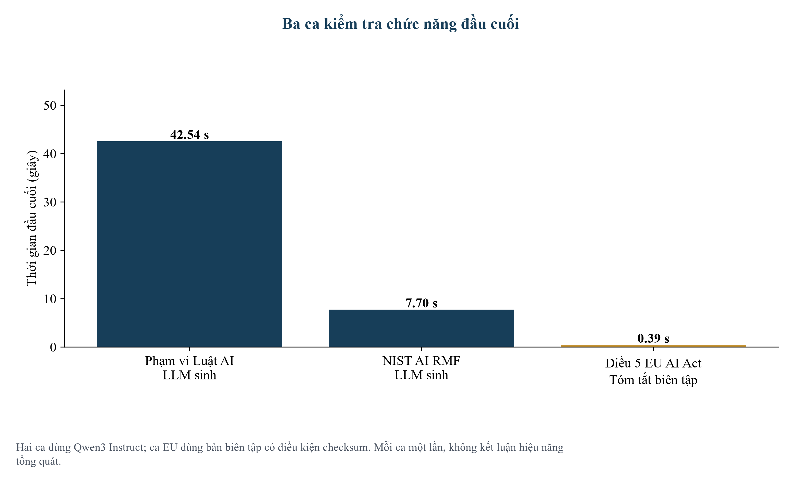

Hai ca dùng Qwen3 Instruct; ca EU dùng bản biên tập có điều kiện checksum. Mỗi ca một lần, không kết luận hiệu năng tổng quát.

[PNG](hinh_anh/hinh_3_24_thoi_gian_hoi_dap.png) · [SVG](hinh_anh/hinh_3_24_thoi_gian_hoi_dap.svg) · Nguồn: `evidence/llm_smoke.json`.

## Dung lượng các lớp trong lượt đồng bộ gần nhất

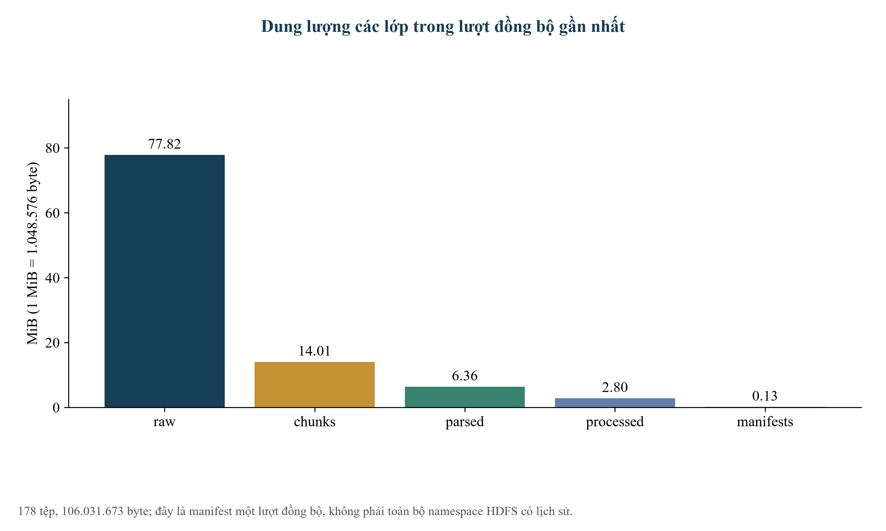

178 tệp, 106.031.673 byte; đây là manifest một lượt đồng bộ, không phải toàn bộ namespace HDFS có lịch sử.

[PNG](hinh_anh/hinh_3_25_cac_lop_data_lake.png) · [SVG](hinh_anh/hinh_3_25_cac_lop_data_lake.svg) · Nguồn: `evidence/system_facts.json → latest_sync`.

## Trạng thái pháp lý theo metadata đã lưu

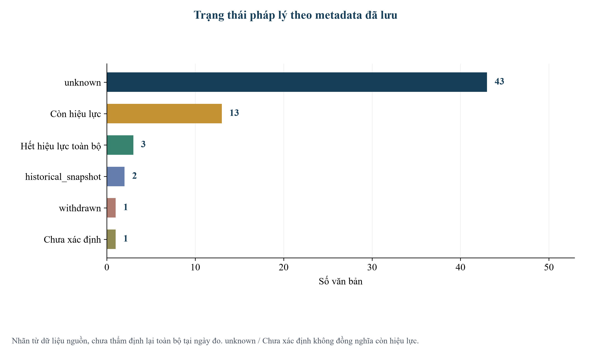

Nhãn từ dữ liệu nguồn, chưa thẩm định lại toàn bộ tại ngày đo. unknown / Chưa xác định không đồng nghĩa còn hiệu lực.

[PNG](hinh_anh/hinh_3_26_trang_thai_phap_ly.png) · [SVG](hinh_anh/hinh_3_26_trang_thai_phap_ly.svg) · Nguồn: `evidence/document_statistics.csv`.

## Sóng âm thật của hai đoạn người thuyết trình

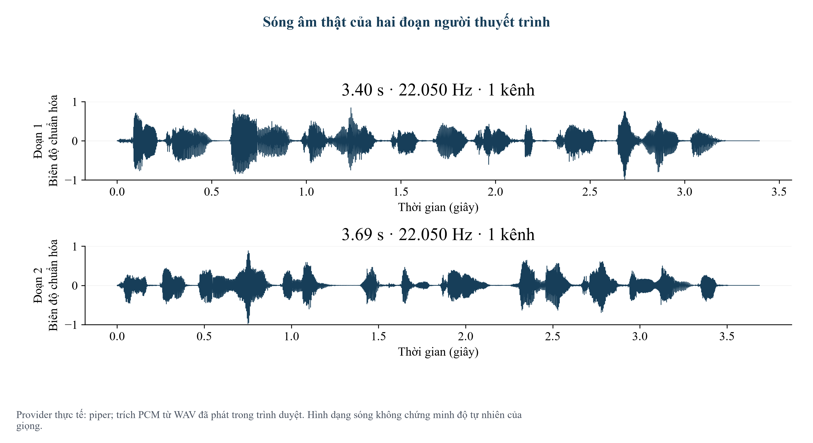

Provider thực tế: piper; trích PCM từ WAV đã phát trong trình duyệt. Hình dạng sóng không chứng minh độ tự nhiên của giọng.

[PNG](hinh_anh/hinh_3_29_song_am.png) · [SVG](hinh_anh/hinh_3_29_song_am.svg) · Nguồn: `evidence/presenter_browser_check.json; am_thanh/*.wav`.
