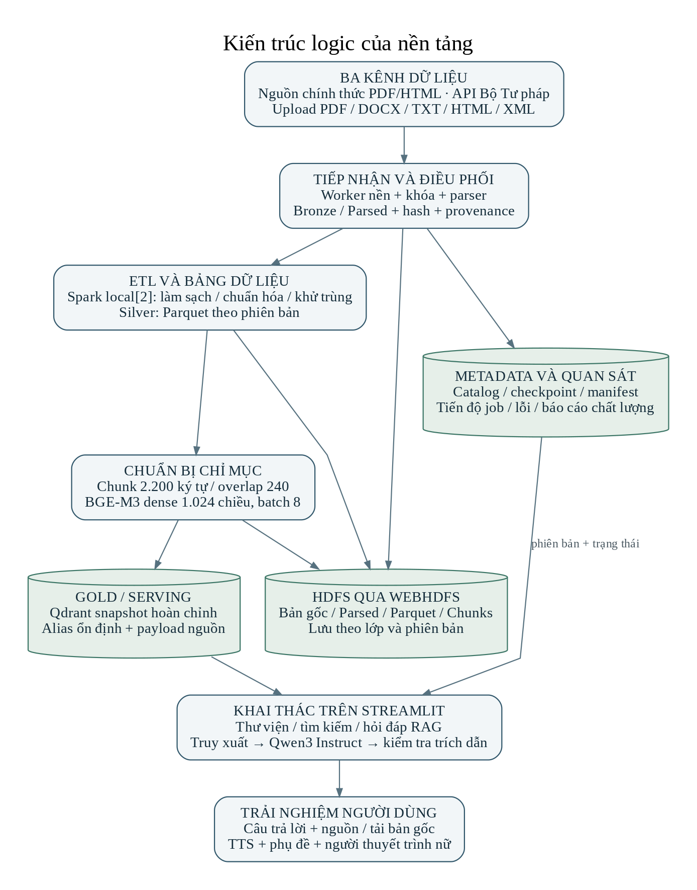
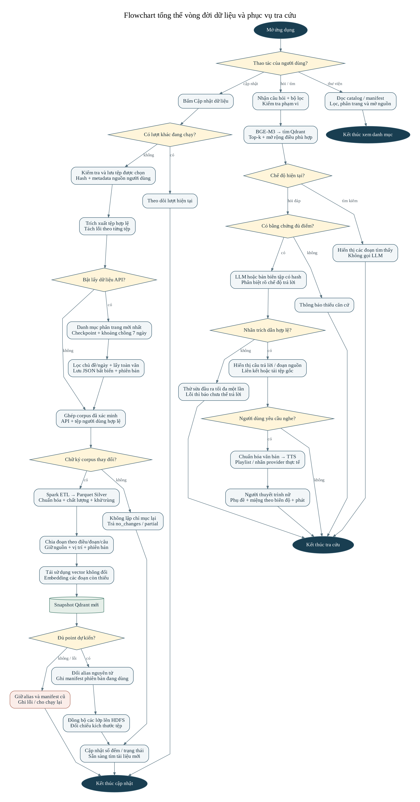
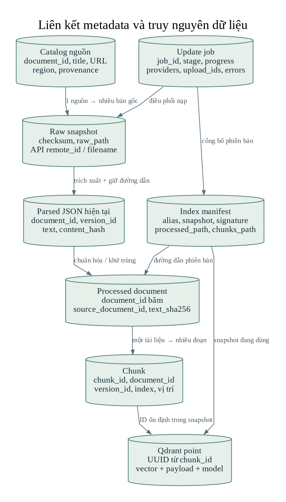
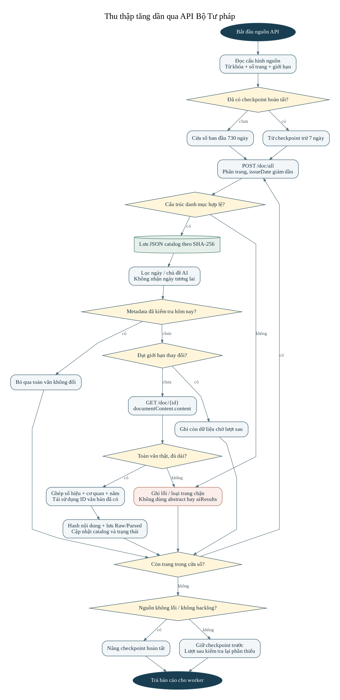
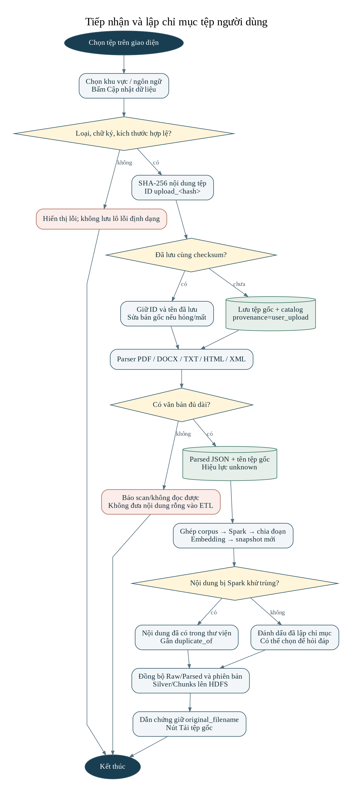
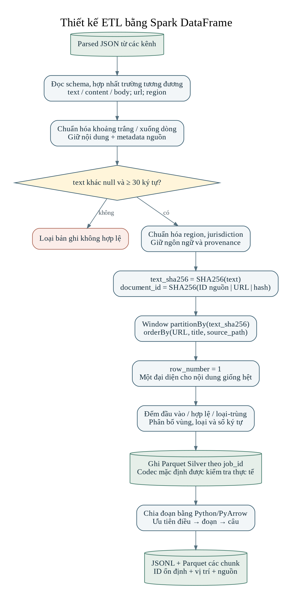
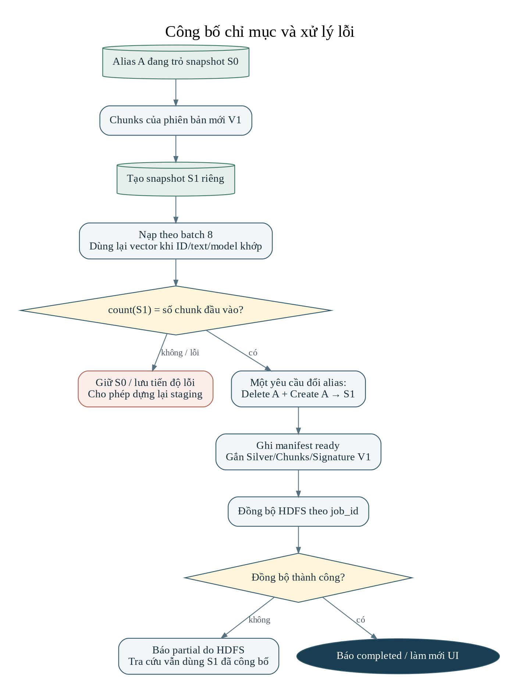
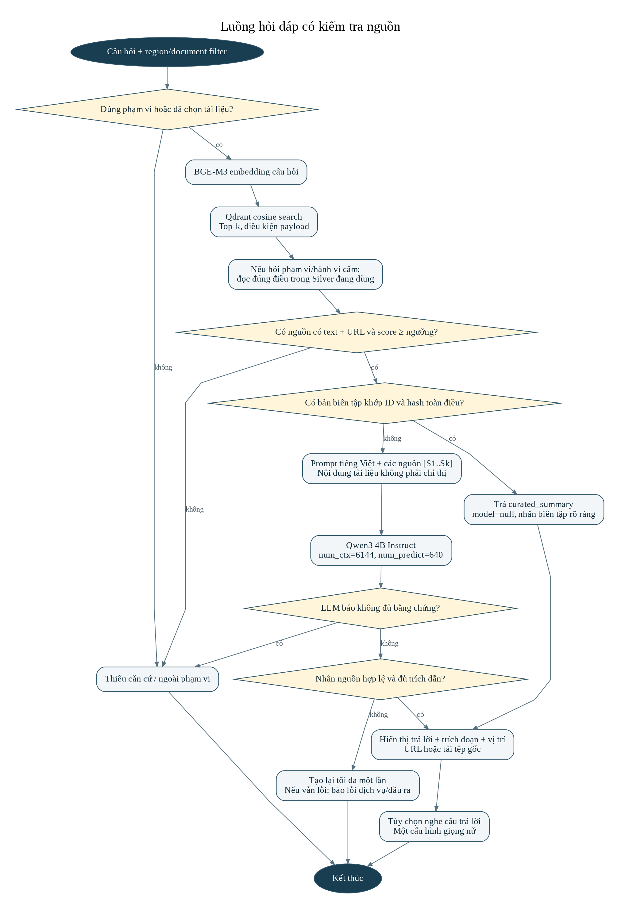
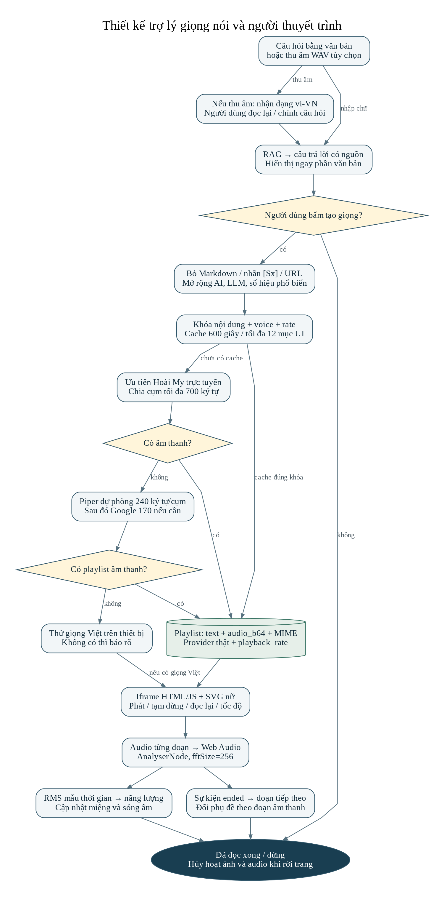
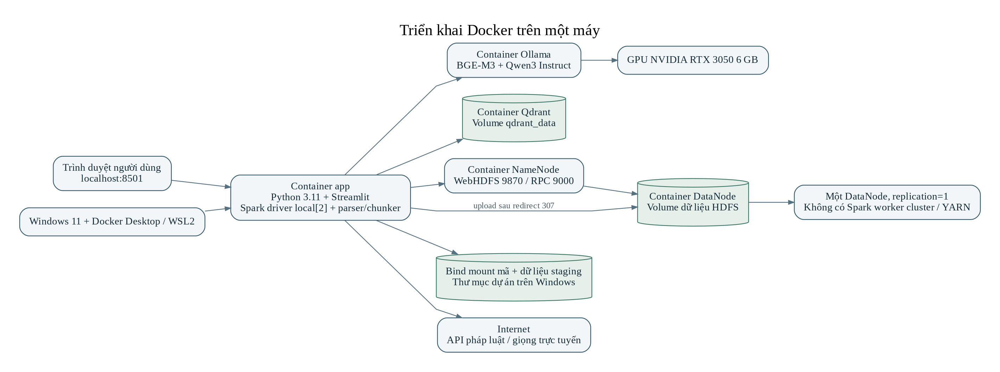

# CHƯƠNG 2. PHÂN TÍCH VÀ THIẾT KẾ HỆ THỐNG

## 2.1. Bài toán và yêu cầu

Đề tài hướng tới một thư viện có khả năng tiếp nhận, lưu trữ và khai thác văn bản về quản trị trí tuệ nhân tạo. Đối tượng dữ liệu gồm văn bản pháp luật Việt Nam, quy định quốc tế, khung quản trị rủi ro, chiến lược và hướng dẫn thực hành AI. Người dùng cần tìm đúng tài liệu, đọc các đoạn liên quan và đặt câu hỏi bằng tiếng Việt, đồng thời có thể mở nguồn để kiểm tra câu trả lời.

Khó khăn của bài toán nằm ở vòng đời dữ liệu. Nguồn nằm ở nhiều website, có PDF và HTML, cách biểu diễn ngày ban hành và khu vực khác nhau, một nội dung có thể xuất hiện qua nhiều kênh. Dữ liệu mới phải đi qua quá trình kiểm tra, làm sạch và lập chỉ mục trước khi sử dụng. Vì vậy, thành phần trung tâm của đề tài là đường ống dữ liệu từ nguồn đến lớp phục vụ; chatbot là một ứng dụng khai thác lớp dữ liệu này.

**Bảng 2.1. Yêu cầu và tiêu chí kiểm tra**

| Mã | Yêu cầu | Cách hiện thực và kiểm tra |
|---|---|---|
| FR01 | Thu thập nhiều dạng tài liệu chính thức | Catalog URL, bộ tải và parser; lưu bản gốc trước khi xử lý |
| FR02 | Lấy văn bản mới qua API | Nút Cập nhật dữ liệu gọi worker; phân trang danh mục và lấy toàn văn JSON/HTML |
| FR03 | Người dùng bổ sung tệp | Upload PDF, DOCX, TXT, HTML, XML; xử lý cùng pipeline |
| FR04 | Chuẩn hóa và loại nội dung trùng | Spark DataFrame, SHA-256 và Window theo nội dung |
| FR05 | Lưu dữ liệu theo lớp và có thể truy vết | Raw, Parsed, Processed, Chunks, manifests; bản sao trên HDFS |
| FR06 | Tìm đoạn phù hợp | BGE-M3, Qdrant, lọc khu vực/tài liệu, top-k |
| FR07 | Hỏi đáp có dẫn chứng | Ngữ cảnh có ID nguồn, Qwen3 Instruct, kiểm tra nhãn trích dẫn |
| FR08 | Số đếm giao diện nhất quán | Tài liệu đang tra cứu được tính từ manifest của chỉ mục đang dùng |
| FR09 | Cập nhật có trạng thái và không công bố chỉ mục dở | Worker nền, khóa, snapshot mới, kiểm tra số point rồi đổi alias |
| FR10 | Có bằng chứng thực nghiệm | JSON/CSV, kiểm thử, thống kê dữ liệu, ảnh ứng dụng và hạ tầng đang chạy |
| FR11 | Nghe câu trả lời cùng người thuyết trình | TTS tiếng Việt, nhân vật nữ, phụ đề, phát/tạm dừng/đọc lại và tốc độ |

Yêu cầu phi chức năng gồm khả năng lặp lại pipeline, thông báo rõ lỗi theo nguồn, giữ provenance của tệp người dùng và tách trạng thái kỹ thuật khỏi trạng thái pháp lý. Ví dụ, `legal_status=unknown` có nghĩa là chưa xác minh được hiệu lực; việc có một vector trong Qdrant không làm văn bản trở thành văn bản còn hiệu lực.

Phạm vi hiện thực là bản mẫu chạy trên một máy bằng Docker Desktop/WSL2. Spark chạy `local[2]`, HDFS có một DataNode và hệ số nhân bản 1. Hệ thống thể hiện những thành phần của một nền tảng Data Lake và có đường nâng cấp về sau; kết quả thực nghiệm không được diễn giải thành năng lực của cụm Spark nhiều máy.

## 2.2. Cơ sở lựa chọn kiến trúc và công nghệ

Chương 1 đã trình bày lý thuyết; ở đây các tài liệu được dùng để giải thích quyết định thiết kế. Hệ thống tổ chức dữ liệu thành các lớp để tách bản gốc, nội dung đã chuẩn hóa và sản phẩm phục vụ truy vấn. Cách phân lớp tham khảo mẫu Bronze/Silver/Gold [5], nhưng hiện thực hiện tại sử dụng thư mục, JSON và Parquet, không có bảng Delta Lake hay giao dịch ACID của một lakehouse hoàn chỉnh.

**Bảng 2.2. Quyết định thiết kế và cơ sở tham khảo**

| Quyết định | Lý do trong dự án | Cơ sở |
|---|---|---|
| HDFS và WebHDFS | Minh họa lưu trữ phân lớp, tách metadata và block; thao tác từ Python qua HTTP | Kiến trúc HDFS và giao thức WebHDFS [1], [2] |
| Spark DataFrame | Chuẩn hóa nhiều trường, lọc, băm và khử trùng bằng phép biến đổi dữ liệu | Spark/RDD và tài liệu Spark SQL [3], [4] |
| Parquet nén Snappy | Lưu bảng có schema, đọc theo cột; thuận tiện trao đổi giữa Spark và PyArrow | Tài liệu Apache Parquet và Spark [4], [6] |
| BGE-M3 dense | Cùng không gian vector cho nội dung Việt/Anh; phù hợp tìm kiếm ngữ nghĩa | Công bố BGE-M3 [8] |
| Qdrant với alias | Tách tên truy vấn ổn định khỏi collection phiên bản | Tài liệu collection và alias của Qdrant [9] |
| RAG và Qwen3 Instruct | Đưa đoạn nguồn vào prompt thay vì chỉ dùng kiến thức có sẵn trong LLM | Lewis và cộng sự [7]; Qwen3 và model card thực dùng [10], [11] |
| Metadata provenance xuyên pipeline | Đối chiếu nguồn, phiên bản và hoạt động xử lý khi câu trả lời có sai lệch | Tham khảo khái niệm entity/activity của PROV [12] |
| Docker Compose và Streamlit | Triển khai được nhiều dịch vụ trên máy học tập; có giao diện upload và tra cứu | Tài liệu Docker và Streamlit [13], [14] |

Nghiên cứu BGE-M3 mô tả nhiều kiểu truy xuất; dự án hiện chỉ dùng **dense embedding 1.024 chiều**. Hệ thống chưa triển khai sparse retrieval, multi-vector hay cross-encoder reranker. Tương tự, metadata được thiết kế để truy nguyên nhưng chưa được xuất theo đầy đủ mô hình RDF/PROV-O. Việc nêu rõ mức sử dụng giúp đánh giá đúng phần công nghệ nhóm đã thực hiện.

## 2.3. Kiến trúc và flowchart toàn hệ thống



*Hình 2.1. Kiến trúc tổng thể, dựng từ các mô-đun và dịch vụ trong mã nguồn.*

Hệ thống có hai luồng chính. Luồng nạp dữ liệu tiếp nhận nguồn chính thức và tệp người dùng, tạo bản gốc, trích xuất nội dung, chạy Spark ETL, chia đoạn và tạo vector. Luồng khai thác tiếp nhận truy vấn, tìm các đoạn trong Qdrant và trả kết quả tìm kiếm hoặc sinh câu trả lời có nguồn. HDFS lưu các lớp và manifest phục vụ kiểm tra, khôi phục và nghiên cứu; Qdrant phục vụ truy xuất vector, không thay thế kho dữ liệu gốc.



*Hình 2.2. Flowchart toàn hệ thống, gồm cập nhật, upload, ETL, công bố chỉ mục, tìm kiếm và hỏi đáp. [Mở SVG để phóng to](hinh_anh/hinh_2_02_flowchart_toan_bo.svg).*

Trong nhánh cập nhật, hệ thống kiểm tra khóa để tránh hai worker cùng ghi dữ liệu. Các đầu vào mới được lưu và ghép với corpus đã kiểm tra; nếu chữ ký corpus không đổi, lượt chạy kết thúc với `no_changes`. Khi dữ liệu thay đổi, worker tạo Processed/Chunks riêng cho job, xây collection mới và chỉ công bố sau kiểm tra số point. Nếu HDFS đồng bộ lỗi sau công bố, hệ thống báo trạng thái một phần vì lớp phục vụ đã cập nhật còn bản sao trên lake cần xử lý tiếp.

Trong nhánh khai thác, tìm kiếm chỉ trả các đoạn và đường dẫn nguồn. Hỏi đáp bổ sung kiểm tra phạm vi, bằng chứng và đầu ra LLM. Hai chức năng dùng chung kho vector nhưng có điều kiện hoàn tất khác nhau; không phải mọi thao tác tìm kiếm đều gọi LLM. Thư viện tài liệu đọc catalog kết hợp manifest để lọc, phân trang và chỉ rõ trạng thái lập chỉ mục.

**Bảng 2.3. Phân rã mã nguồn theo trách nhiệm**

| Thành phần | Mã nguồn chính | Trách nhiệm |
|---|---|---|
| Giao diện | [app.py](../../app.py) | Bộ lọc, tìm kiếm, hỏi đáp, upload, trạng thái cập nhật |
| Nguồn động | [dynamic_api.py](../../src/ingestion/dynamic_api.py) | Danh mục API, toàn văn, checkpoint, nguồn và phiên bản |
| Xử lý văn bản | [parser.py](../../src/ingestion/parser.py) | Trích xuất và kiểm tra nội dung đầu vào |
| ETL | [spark_etl.py](../../src/processing/spark_etl.py) | Làm sạch, chuẩn hóa, khử trùng và Parquet |
| Chia đoạn | [chunker.py](../../src/processing/chunker.py) | Ranh giới đoạn, chồng lấn và metadata vị trí |
| Chỉ mục | [indexer.py](../../src/rag/indexer.py) | Embedding, point ID, snapshot và alias |
| Truy xuất và trả lời | [retriever.py](../../src/rag/retriever.py), [answerer.py](../../src/rag/answerer.py) | Tìm vector, ngữ cảnh điều khoản, sinh và kiểm tra nguồn |
| Điều phối | [update_data.py](../../scripts/update_data.py) | Job nền, ghép dữ liệu, công bố và đồng bộ |
| Thống kê thư viện | [catalog.py](../../src/catalog.py) | Cùng một định nghĩa số tài liệu đang hoạt động |

## 2.4. Thiết kế dữ liệu

### 2.4.1. Phạm vi và tiêu chí chọn nguồn

Nguồn được ưu tiên theo cơ quan ban hành hoặc tổ chức xuất bản: Cơ sở dữ liệu quốc gia về pháp luật/Bộ Tư pháp, Công báo, EUR-Lex, NIST, OECD, UNESCO, ASEAN và cơ quan quản lý tại một số quốc gia. Dữ liệu phục vụ nghiên cứu chính sách AI gồm cả văn bản quy phạm pháp luật lẫn tài liệu hướng dẫn; hai nhóm có giá trị sử dụng khác nhau và cần giữ loại tài liệu trong metadata.

Các tiêu chí tiếp nhận gồm xác định được nguồn, lấy được nội dung thật, nội dung đủ dài và phù hợp chủ đề. Một trang HTTP 200 vẫn có thể là trang chặn truy cập; chỉ có metadata hay abstract cũng chưa đủ làm toàn văn hỏi đáp. Với nguồn API Việt Nam, bộ lọc còn kiểm tra ngày ban hành, tiêu đề/tóm tắt liên quan AI và không nhận ngày tương lai. Các tài liệu ngữ cảnh như bảo vệ dữ liệu, an ninh hoặc công nghiệp công nghệ số được lưu khi có ý nghĩa đối với quản trị AI; corpus không được tuyên bố bao phủ toàn bộ hệ thống pháp luật.

Tại thời điểm thực nghiệm, catalog có 85 mục, 63 tài liệu đang tra cứu và 22 mục chưa lập chỉ mục. Số này thay đổi khi cập nhật. Danh mục là tập ứng viên; tập đang tra cứu là tập ID được công bố trong manifest. Phân biệt này giải quyết tình trạng trước đây giao diện so sánh số tài liệu đã lập chỉ mục với tổng số dòng nguồn.

### 2.4.2. Các lớp dữ liệu và đường dẫn

**Bảng 2.4. Thiết kế các lớp Data Lake**

| Lớp logic | Nội dung và định dạng | Staging trong dự án | Đích HDFS |
|---|---|---|---|
| Bronze — Raw | PDF/HTML gốc, phản hồi JSON danh mục và toàn văn API, tệp upload | `data/verified_raw`, `data/dynamic/raw`, `data/uploads` | `/ai_docs/raw`, nhánh `api`, `uploads` |
| Parsed | Nội dung văn bản + nguồn + thông tin phiên bản | `data/verified_parsed`, `data/dynamic/parsed`, parsed của upload | `/ai_docs/parsed` và các nhánh tương ứng |
| Silver — Processed | Bảng tài liệu sạch, khử trùng, Parquet | `data/updates/{job_id}/processed` | `/ai_docs/processed/{job_id}` |
| Gold — Chunks | JSONL và Parquet các đoạn, metadata vị trí | `data/updates/{job_id}/chunks` | `/ai_docs/chunks/{job_id}` |
| Lớp phục vụ vector | Vector 1.024 chiều và payload từng đoạn | Collection Qdrant theo snapshot | Volume Qdrant; không phải tệp HDFS |
| Điều khiển và kiểm toán | Catalog, checkpoint, báo cáo ETL, manifest chỉ mục/lake, trạng thái job | `data/manifests`, `data/updates/{job_id}` | `/ai_docs/manifests` cùng phần được đồng bộ |

Các phép xử lý hiện diễn ra trên thư mục staging được bind mount vào container. Sau đó Python gửi các tệp lên HDFS qua WebHDFS. Spark ở phiên bản này **không trực tiếp chạy một tác vụ phân tán đọc/ghi trên HDFS**. Sự phân tách này phù hợp máy demo và phải được thể hiện đúng trong sơ đồ triển khai.

### 2.4.3. Schema, định danh và truy nguyên



*Hình 2.9. Liên kết giữa catalog, bản gốc, tài liệu chuẩn hóa, đoạn, vector và job. Đây là quan hệ logic; các lớp được lưu trong JSON/Parquet, không có cơ sở dữ liệu quan hệ áp khóa ngoại.*

**Bảng 2.5. Từ điển dữ liệu quan trọng**

| Trường | Lớp | Ý nghĩa và quy tắc |
|---|---|---|
| `source_document_id` | Silver, chunk | ID ổn định của mục nguồn; dùng đếm tài liệu đang hoạt động |
| `document_id` | Silver | SHA-256 của ID nguồn, URL và hash nội dung sạch |
| `text`, `text_sha256` | Silver | Toàn văn chuẩn hóa và dấu vân tay nội dung |
| `source_url`, `source_org` | Xuyên lớp | URL/cơ quan nguồn để đối chiếu; upload dùng thông tin nguồn nội bộ |
| `region`, `jurisdiction`, `language` | Silver, chunk | Bộ lọc; `INTERNATIONAL` là nhãn gộp cho nhiều tổ chức/quốc gia |
| `published_date`, `effective_date`, `legal_status` | Silver, chunk | Metadata pháp lý từ nguồn; có thể thiếu hoặc chưa xác định |
| `provenance` | Xuyên lớp | `official_download`, `official_api`, `user_upload` |
| `version_id`, `content_hash`, `raw_path` | Xuyên lớp | Liên kết phiên bản nội dung tới bản gốc đã nhận |
| `original_filename` | Upload, chunk | Tên gốc phục vụ tải lại và nhãn nguồn |
| `chunk_id`, `chunk_index` | Gold | Hash ổn định và thứ tự đoạn trong tài liệu |
| `char_start`, `char_end` | Gold | Vị trí ký tự, phục vụ kiểm tra đoạn và mở rộng ngữ cảnh |
| `article`, `section`, `page_start/end` | Gold | Vị trí pháp lý/trang nếu parser nhận diện được |
| `snapshot`, `processed_path`, `chunks_path` | Manifest | Phiên bản collection và các tệp được RAG đọc cùng phiên bản |
| `job_id`, `stage`, `progress`, `errors` | Điều phối | Theo dõi hoạt động tạo ra sản phẩm dữ liệu |

Ba loại hash có nhiệm vụ khác nhau: checksum tệp để phát hiện cùng byte upload; hash toàn văn sau ETL để loại nội dung trùng dù tệp khác nhau; hash đoạn để tạo ID ổn định cho index. Chúng không phải chữ ký số xác thực của cơ quan ban hành. Metadata `legal_status` cũng không được suy ra từ hash.

Chuỗi truy vết bắt đầu từ câu trả lời → nhãn nguồn → payload đoạn → ID tài liệu/phiên bản → Processed → đường dẫn bản gốc. Thiết kế này lấy cảm hứng từ truy nguyên dữ liệu [12], giúp tìm vị trí phát sinh sai lệch: do nguồn, trích xuất, chia đoạn, truy xuất hay LLM.

## 2.5. Thiết kế nguồn API động

### 2.5.1. Hợp đồng và cấu hình

Adapter đang bật sử dụng endpoint công khai của Bộ Tư pháp [20] được kiểm tra bằng yêu cầu HTTP thật trong quá trình phát triển. Đây là hợp đồng thực tế quan sát được, không phải cam kết SLA của nhà cung cấp. Cấu hình tập trung tại [api_sources.json](../../data/api_sources.json), cho phép thay đổi giới hạn mà không sửa toàn bộ pipeline.

**Bảng 2.6. Hợp đồng nguồn API đang dùng**

| Thuộc tính | Giá trị/cách xử lý |
|---|---|
| Danh mục | `POST https://vbpl-bientap-gateway.moj.gov.vn/api/qtdc/public/doc/all` |
| Payload danh mục | `pageNumber`, `pageSize`, `keyword`, `sortBy=issueDate`, `sortDirection=DESC` |
| Kết quả danh mục | Kiểm tra `success=true`; đọc `data.items` và `data.total` |
| Toàn văn | `GET https://vbpl-bientap-gateway.moj.gov.vn/api/qtdc/public/doc/{id}` |
| Nội dung dùng cho RAG | HTML trong `data.documentContent.content`, sau kiểm tra và loại thẻ |
| Từ khóa | Cụm có dấu ngoặc kép `"trí tuệ nhân tạo"` |
| Giới hạn mặc định | 50 mục/trang, tối đa 10 trang; tối đa 20 tài liệu thay đổi/lượt cập nhật |
| Cửa sổ thời gian | Ban đầu 730 ngày; khi có checkpoint lấy chồng lấn 7 ngày và không vượt quá cửa sổ ban đầu |
| HTTP | Timeout kết nối/đọc 8/25 giây; retry tối đa 2 với một số mã lỗi tạm thời |

Ví dụ payload danh mục:

```json
{
  "pageNumber": 1,
  "pageSize": 50,
  "keyword": "\"trí tuệ nhân tạo\"",
  "sortBy": "issueDate",
  "sortDirection": "DESC"
}
```

Hệ thống lấy toàn văn trực tiếp qua JSON/HTML, do đó không yêu cầu người dùng tải từng PDF. Tuy nhiên, nội dung vẫn cần được lưu thành snapshot Raw để có bằng chứng và tái xử lý. “Nguồn động” có nghĩa là mỗi lượt kiểm tra có thể phát hiện dữ liệu mới; không có nghĩa là bỏ hoàn toàn việc lưu bản dữ liệu đã nhận.

### 2.5.2. Phân trang, checkpoint và phát hiện thay đổi



*Hình 2.3. Lưu đồ thu thập tăng dần và quản lý checkpoint.*

Adapter đọc danh mục theo ngày ban hành giảm dần, lưu JSON Raw theo digest và loại các mục không phù hợp. Metadata và nội dung được so sánh với trạng thái đã lưu; các mục đã kiểm tra cùng ngày có thể được bỏ qua để giảm yêu cầu mạng. Vì vậy, thay đổi ngay trong cùng ngày ở một mục có metadata không đổi có thể chưa được phát hiện tức thì. Cửa sổ chồng lấn giúp kiểm tra lại nhưng không bảo đảm phát hiện mọi sửa đổi toàn văn của văn bản rất cũ.

Checkpoint chỉ tiến khi nguồn kết thúc đầy đủ, không có lỗi hoặc backlog khiến việc quét bị thiếu. Khi đạt giới hạn thay đổi hoặc giới hạn trang, trạng thái được giữ để lượt sau còn cơ hội tiếp tục. Bộ ghép định danh dùng số hiệu, cơ quan và năm nhằm tránh biến cùng văn bản qua hai kênh thành hai ID nguồn. Sau đó Spark còn loại trùng theo nội dung sạch.

Lượt cập nhật tạo báo cáo riêng cho từng provider với số trang, số mục quét, thay đổi, lỗi và backlog. `scanned` là số mục đọc từ API, `changed` là số mục có dữ liệu cần xử lý, còn `active_documents` là số tài liệu duy nhất thực sự có trong chỉ mục. Ba số này không được dùng thay cho nhau.

### 2.5.3. Khả năng cập nhật và giới hạn

Nút trên giao diện kích hoạt một worker nền; chưa có lịch chạy định kỳ tự động bằng Airflow hay cron. Người vận hành có thể gọi cùng luồng qua CLI. Vì thế, mô tả chính xác là **cập nhật tự động toàn pipeline sau khi người dùng kích hoạt**, không phải nguồn streaming liên tục. Giới hạn cửa sổ ngày, số trang và từ khóa cũng có nghĩa là không thể khẳng định đã lấy tất cả văn bản AI mới trên Internet.

Adapter Federal Register đã có trong mã nguồn nhưng đang tắt vì URL toàn văn gặp trang yêu cầu truy cập. Dữ liệu metadata từ một API truy cập được không được dùng để che việc thiếu toàn văn. Đây là quyết định chất lượng dữ liệu, đồng thời là ví dụ về cách quản lý một nguồn chưa đáp ứng hợp đồng.

## 2.6. Thiết kế tải tệp lên và ETL tự động



*Hình 2.4. Luồng từ tệp upload đến tài liệu có thể hỏi đáp và tải lại.*

Người dùng chọn tệp, khu vực và ngôn ngữ, sau đó bấm **Cập nhật dữ liệu**. Giao diện Streamlit dùng chức năng nhận nhiều tệp [14]; các giới hạn của dự án được kiểm tra thêm trong backend. Nếu chỉ xử lý tệp, người dùng bỏ chọn lấy thêm API. Khi có tệp hợp lệ mà API lỗi, pipeline có thể tiếp tục với tệp và ghi lỗi nguồn API riêng.

**Bảng 2.7. Quy tắc nhận tệp**

| Điều kiện | Hành vi |
|---|---|
| Định dạng | PDF, DOCX, TXT, HTML, XML; kiểm tra kiểu/đặc trưng tệp |
| Giới hạn lô | Tối đa 10 tệp; 50 MiB/tệp; tổng 100 MiB |
| PDF có văn bản | Trích xuất nội dung; giữ thông tin trang khi có |
| PDF scan ảnh | Báo cần OCR; phiên bản hiện tại chưa có OCR tự động |
| DOCX/TXT/HTML/XML | Đọc nội dung phù hợp, làm sạch thẻ/khoảng trắng |
| Cùng byte đã tải | Tái sử dụng ID `upload_` + SHA-256 đầy đủ; không tạo mục mới |
| Khác tệp nhưng cùng nội dung | Spark giữ một bản nội dung; upload có thể nhận `duplicate_of` |
| Nguồn và hiệu lực | `provenance=user_upload`, giữ tên gốc; không tự xác nhận là nguồn chính thức |

Sau khi parse thành công, tệp đi qua Spark, Parquet, chunking, embedding và snapshot giống dữ liệu API. Bản gốc được giữ để tải lại từ thư viện hoặc dẫn chứng. Một lô tệp được nhận không có nghĩa là mọi tệp đã được lập chỉ mục: cần xem kết quả parse, chống trùng và trạng thái công bố. Cách tách trạng thái này giúp người dùng hiểu trường hợp tệp đã lưu nhưng chưa đủ điều kiện hỏi đáp.

## 2.7. Thiết kế Spark ETL



*Hình 2.5. Các phép biến đổi DataFrame và sản phẩm dữ liệu sau ETL.*

Spark nhận JSONL, JSON hoặc Parquet theo đơn vị một bản ghi/tài liệu. Những trường tương đương như `text/content/body/full_text` và `source_url/url/link` được hợp nhất trước khi biến đổi. Việc này cho phép các adapter tạo dữ liệu từ nhiều nguồn nhưng cùng đi vào một schema chuẩn.

**Bảng 2.8. Các quy tắc ETL đã hiện thực**

| Bước | Phép xử lý | Ý nghĩa |
|---|---|---|
| Chuẩn hóa schema | Coalesce trường tương đương; cast string | Giảm khác biệt đầu vào |
| Làm sạch | Thay tab/khoảng trắng đặc biệt, chuẩn hóa xuống dòng | Tạo nội dung ổn định trước băm và chia đoạn |
| Lọc kỹ thuật | Bỏ `text=null` hoặc dưới 30 ký tự | Không lập chỉ mục dữ liệu rỗng/quá ngắn; chưa phải bộ phân loại pháp lý |
| Chuẩn hóa khu vực | Quy về VN, EU, ASEAN, US, INTERNATIONAL; thiếu thành UNKNOWN | Bộ lọc có giá trị nhất quán |
| Tạo hash | `text_sha256=SHA256(text)` | Phát hiện trùng nội dung sau làm sạch |
| Khử trùng | Window partition theo hash, chọn một dòng theo thứ tự URL/tiêu đề/đường dẫn | Kết quả lựa chọn ổn định giữa các lần chạy |
| Tạo document ID | Hash ID nguồn + URL + hash text | Gắn danh tính sản phẩm xử lý với nội dung |
| Kiểm tra và thống kê | Đếm đầu vào/đầu ra, phân bố khu vực/loại, tổng ký tự | Có báo cáo ETL để quan sát chất lượng |
| Ghi Silver | Parquet, thực tế Snappy | Tái sử dụng cho chunking và phân tích thống kê |

Đầu ra hiện tại gồm bốn tệp Parquet; số tệp là đặc điểm lần chạy, không phải cam kết luôn chia thành bốn vùng nghiệp vụ. Cấu hình Spark có bốn shuffle partition và driver memory 512 MiB. Pipeline dùng `local[2]`, trong đó các tác vụ chạy trên hai luồng xử lý của một môi trường Spark. DataFrame và phép Window cho thấy kỹ thuật ETL có thể chuyển sang cụm; việc chuyển master riêng lẻ vẫn chưa đủ, vì cần thay cơ chế staging, quản lý tài nguyên và kiểm tra lỗi phân tán.

Ở bản demo, một số thao tác sau Spark đọc bảng về Python và giữ danh sách chunk trong bộ nhớ. Đây là giới hạn cần xử lý khi corpus lớn; không nên chỉ dựa vào việc sử dụng Spark để tuyên bố toàn pipeline đã mở rộng tuyến tính.

## 2.8. Chia đoạn, embedding và công bố chỉ mục

### 2.8.1. Thiết kế đoạn và vector

Chunker đọc Parquet bằng PyArrow và xử lý bằng Python. Kích thước tối đa là 2.200 **ký tự**, chồng lấn 240 ký tự. Nó ưu tiên ranh giới điều, mục, chương, đoạn và câu để giảm cắt ngang ngữ nghĩa. Marker `Điều/Article/Section`, `Chương/Chapter` và trang giúp bổ sung vị trí; không phải mọi tài liệu đều có đầy đủ marker.

ID đoạn được băm từ ID tài liệu, phiên bản, thứ tự và nội dung. Metadata nguồn, provenance và vị trí được sao chép vào payload. BGE-M3 tạo dense vector 1.024 chiều, gửi theo batch 8 vào Qdrant; collection dùng khoảng cách Cosine. Batch size được chọn theo tài nguyên máy, chưa có khảo sát tối ưu trên nhiều cấu hình.

**Bảng 2.9. Tham số lớp phục vụ**

| Tham số | Giá trị thực nghiệm |
|---|---|
| Chunk size / overlap | 2.200 / 240 ký tự |
| Embedding | `bge-m3`, dense, 1.024 chiều |
| Batch embedding | 8 đoạn |
| Qdrant distance | Cosine |
| Alias truy vấn | `ai_documents_verified_v2` |
| Top-k / ngưỡng điểm | 5 / 0,42 |
| LLM | `qwen3:4b-instruct-2507-q4_K_M` |
| Context LLM / sinh tối đa | 6.144 / 640 token |
| Temperature | 0 |

### 2.8.2. Snapshot và tính nhất quán



*Hình 2.7. Dựng phiên bản mới và chuyển alias sau kiểm tra.*

Mỗi job tạo collection riêng, nạp đủ vector và đối chiếu point count. Sau đó Qdrant đổi alias bằng thao tác alias hỗ trợ nguyên tử [9]. Tên truy vấn giữ nguyên, còn dữ liệu bên dưới chuyển sang snapshot mới. Manifest ghi cùng tên snapshot, chữ ký corpus và đường dẫn Processed/Chunks tương ứng để mở rộng điều khoản đúng phiên bản.

Tính nguyên tử ở đây áp dụng cho thao tác đổi alias trong Qdrant. Toàn bộ Qdrant, tệp manifest và HDFS không nằm trong một giao dịch phân tán chung. Nếu tiến trình dừng đúng giữa đổi alias và ghi manifest, cần kiểm tra và đối soát; nếu HDFS lỗi sau công bố thì trạng thái là `partial`. Thiết kế hiện tại cải thiện việc tránh phục vụ collection nạp dở, nhưng chưa bảo đảm exactly-once xuyên mọi thành phần.

## 2.9. Thiết kế luồng RAG và kiểm soát dẫn chứng



*Hình 2.6. Truy vấn, truy xuất, bổ sung ngữ cảnh và sinh đầu ra có nguồn.*

Truy vấn được kiểm tra phạm vi và có thể mở rộng một số cụm Việt–Anh trong retriever. Vector truy vấn được tìm trong Qdrant cùng bộ lọc khu vực hoặc tài liệu nếu người dùng chọn. Các hit vượt ngưỡng được đưa vào ngữ cảnh với nhãn `[S1]`, `[S2]`…; ngưỡng Cosine 0,42 là tham số kỹ thuật, không phải xác suất câu trả lời đúng.

Đối với một số câu hỏi khớp tiêu đề và chủ đề như phạm vi điều chỉnh hoặc hành vi bị cấm, retriever lấy toàn điều tương ứng từ Processed cùng phiên bản thay vì chỉ đưa một mảnh ngắn. Kết quả có `context_kind=article` và `anchor_chunk_id`. Điều này giúp giữ các mệnh đề ngoại lệ, giới hạn và phủ định thường quan trọng khi đọc văn bản pháp luật. Tuy nhiên, heuristic mở rộng không bao phủ mọi kiểu cấu trúc pháp lý.

Answerer yêu cầu LLM trả lời theo ngữ cảnh và gắn nhãn nguồn. Sau sinh, chương trình kiểm tra nhãn trích dẫn có tồn tại và có được sử dụng hợp lệ. Nhãn sai có thể kích hoạt một lần sửa đầu ra; nếu vẫn lỗi, kết quả báo không thể trả lời phù hợp. Kiểm tra này chặn lỗi kỹ thuật về ID nguồn, chưa đủ chứng minh mỗi mệnh đề được dẫn chứng hỗ trợ đúng về nghĩa.

Một số nội dung đã biên tập đối chiếu nguồn nằm trong `curated_summaries.json`. Chúng chỉ được sử dụng khi checksum của toàn điều khớp đúng và đầu ra được ghi `curated_summary`. Báo cáo tách các ca này khỏi ca LLM sinh trực tiếp, tránh dùng tốc độ của bản biên tập làm tốc độ suy luận LLM.

**Bảng 2.10. Trạng thái trả lời và cách diễn giải**

| Trường hợp | Đầu ra mong đợi |
|---|---|
| Ngoài phạm vi hoặc không đủ bằng chứng | `insufficient_evidence`, giải thích ngắn |
| Nguồn/dịch vụ truy xuất lỗi | Báo lỗi kết nối, không âm thầm thay bằng kiến thức tự do |
| LLM trả hợp lệ | Câu trả lời, nhãn nguồn đã dùng, đoạn đối chiếu và URL/tệp gốc |
| Nhãn trích dẫn không hợp lệ | Thử sửa có giới hạn hoặc báo lỗi đầu ra |
| Bản biên tập có checksum khớp | Hiển thị rõ chế độ biên tập, không gắn là LLM vừa sinh |

## 2.10. Thiết kế giao diện và trợ lý giọng nói

### 2.10.1. Giao diện phục vụ tra cứu

Giao diện có ba chức năng chính: hỏi đáp có dẫn chứng, tìm văn bản và thư viện tài liệu. Thanh bên chứa lọc khu vực, tài liệu cụ thể, cập nhật nguồn và upload. Phần nội dung sử dụng nền ngà, màu xanh đậm và điểm nhấn vàng, kiểu chữ Times New Roman. Các đoạn nguồn được thu gọn để ưu tiên câu trả lời, nhưng người dùng vẫn mở được nội dung đối chiếu và nguồn gốc.

Giao diện chỉ trình bày một lựa chọn giọng nữ Hoài My theo yêu cầu. Bộ phát có hình người thuyết trình minh họa; chuyển động dựa trên âm thanh. Tính năng đọc hỗ trợ tiếp cận nội dung, không tham gia ETL hay đánh giá độ đúng RAG. LLM và vector chạy local; các chức năng giọng trực tuyến có sử dụng dịch vụ ngoài và phải ghi đúng nhà cung cấp thực tế nếu có dự phòng.

### 2.10.2. Điểm nhấn: trợ lý giọng nói và người thuyết trình

Người thuyết trình đưa kết quả RAG tới người dùng bằng cả văn bản và âm thanh. Thay vì chỉ đặt một thanh phát tệp, giao diện cung cấp một nhân vật nữ trong trang phục công sở, vùng phụ đề và bộ điều khiển nghe. Người dùng có thể nghe thử mà chưa cần gọi LLM, hoặc tạo giọng sau khi đã có câu trả lời. Nhờ tạo âm thanh theo yêu cầu, thời gian chờ TTS không cộng vào bước nhận câu trả lời văn bản.



*Hình 2.10. Luồng chuẩn hóa nội dung, tổng hợp tiếng nói, phát playlist, phụ đề và điều khiển nhân vật.*

**Bảng 2.11. Thành phần của chức năng người nói**

| Thành phần | Thiết kế thực tế |
|---|---|
| Nội dung đưa đi đọc | Bỏ Markdown, URL và nhãn Sx; mở rộng một số từ AI, LLM và số hiệu phổ biến; giữ câu trả lời có nguồn trên giao diện |
| Giọng yêu cầu trên UI | Một giọng nữ Hoài My; không còn menu chọn nam hoặc lựa chọn “Việt cục bộ” |
| TTS | Ưu tiên `vi-VN-HoaiMyNeural` qua `edge-tts`; khi chưa đáp ứng có provider dự phòng, được ghi đúng nhãn |
| Playlist | Mỗi phần tử có `text`, `audio_b64`, MIME; WAV/MP3 được phát riêng theo thứ tự |
| Cache/phiên | Khóa theo nội dung + voice + rate; cache UI TTL 600 giây, tối đa 12 mục; đổi tốc độ cấu hình thì không dùng lại bản âm thanh cũ |
| Nhân vật | SVG minh họa nữ, bố cục responsive; chớp mắt, nhịp thở và chuyển động miệng |
| Đồng bộ hình | Web Audio AnalyserNode → năng lượng RMS → độ mở miệng và chiều cao sóng âm |
| Phụ đề | Đổi theo đoạn âm thanh thực tế qua sự kiện kết thúc, có chỉ báo Đoạn i/n |
| Điều khiển | Phát, tạm dừng/tiếp tục, đọc lại, tua trong đoạn và tốc độ 0,85×–1,30× |
| Nhập giọng nói tùy chọn | Nhận âm thanh WAV, nhận dạng tiếng Việt qua Google Speech Recognition; người dùng xem lại câu hỏi trước khi tra cứu |

Mã [tts.py](../../src/rag/tts.py) chuẩn hóa câu trả lời và tạo playlist. Với dịch vụ Edge, cụm đọc được giới hạn 700 ký tự; nhánh Piper dùng 240, nhánh Google dự phòng dùng 170. Các độ dài này phục vụ TTS, **khác với chunk 2.200 ký tự dùng cho RAG**. `edge-tts` là thư viện truy cập dịch vụ đọc trực tuyến của Edge [17], không phải một Azure Speech API thương mại do nhóm triển khai. Piper và model tiếng Việt được sử dụng ở nhánh dự phòng [18], [19]. Hình và nhãn nguồn âm thanh phải phản ánh provider thực tế, không gắn tên Hoài My cho mọi âm thanh dự phòng.

[avatar_component.py](../../src/rag/avatar_component.py) đóng gói dữ liệu vào [presenter.html](../../src/rag/presenter.html). Văn bản được JSON-encode và escape các ký tự có thể đóng thẻ script để nội dung câu trả lời được xử lý như dữ liệu. Trình duyệt dùng HTML audio phát từng đoạn, không ghép nối byte nhiều MP3 — cách ghép đó dễ làm sai thời lượng và thao tác tua. Tốc độ tổng hợp và tốc độ phát cũng được tách để tránh nhân tốc độ hai lần.

Nhân vật dùng SVG, không tải ảnh người thật từ nguồn ngoài. `AnalyserNode` cung cấp mẫu âm thanh theo miền thời gian [16]; chương trình chuẩn hóa mẫu, tính RMS và ánh xạ vào bán kính miệng. Với đường phát audio, thay đổi hình dựa trên tín hiệu đang phát; khi không có audio mà dùng giọng trình duyệt, chuyển động chỉ mang tính minh họa. Đây là **hoạt ảnh theo nhịp âm thanh**, chưa phải mô hình lip-sync theo âm vị hoặc video người thật. Phụ đề đồng bộ ở cấp đoạn, chưa có timestamp từng từ.

Điểm đóng góp của chức năng là tăng khả năng tiếp cận kết quả, giúp người xem theo dõi nội dung trong buổi trình bày và tạo trải nghiệm hỏi–đọc–nghe có cùng nguồn dữ liệu. Nhân vật không tạo lập hoặc xác thực kết luận pháp lý; câu trả lời văn bản và nguồn gốc vẫn là căn cứ đối chiếu. Phần thử nghiệm ở mục 3.10 tách kiểm tra bộ phát, âm thanh và hoạt ảnh khỏi đánh giá chất lượng RAG.

## 2.11. Thiết kế triển khai và vận hành

### 2.11.1. Triển khai Docker và HDFS



*Hình 2.8. Mô hình triển khai thật trên Docker Desktop/WSL2.*

**Bảng 2.12. Dịch vụ và dữ liệu bền vững**

| Dịch vụ | Vai trò | Cổng localhost | Dữ liệu giữ lại |
|---|---|---|---|
| app | Streamlit, điều phối, parser, Spark local và chunker | 8501 | Bind mount mã nguồn và thư mục dữ liệu |
| Qdrant 1.12.6 | Chỉ mục vector/payload | 6333 | `qdrant_data` |
| Ollama | BGE-M3 và Qwen3 Instruct, dùng GPU | 11434 | `ollama_models` |
| NameNode Hadoop 3.4.1 | Namespace, metadata HDFS, WebHDFS | 9870 | `namenode_data` |
| DataNode Hadoop 3.4.1 | Block dữ liệu HDFS | Nội bộ Docker | `datanode_data` |

Docker Compose quản lý dịch vụ, mạng và volume theo khai báo [13]. Ứng dụng gọi các container bằng tên dịch vụ; WebHDFS có thể chuyển hướng ghi tới DataNode. Bộ đồng bộ ghi manifest đường dẫn, kích thước và SHA-256 phía nguồn; kiểm tra kích thước tệp phía HDFS giúp phát hiện bản sao thiếu. Kiểm tra này chưa tương đương đối chiếu lại toàn bộ checksum nội dung từ HDFS.

### 2.11.2. Trạng thái, lỗi và hướng mở rộng

**Bảng 2.13. Thiết kế xử lý tình huống lỗi**

| Tình huống | Xử lý hiện tại |
|---|---|
| Một worker đang cập nhật | Từ chối tạo job chồng; hiển thị tiến độ job đang có |
| API timeout/429/5xx | Retry có giới hạn; ghi lỗi; không nâng checkpoint thiếu |
| API đổi schema/trả trang chặn | Báo lỗi nguồn; không dùng trang chặn làm toàn văn |
| Upload sai định dạng/scan | Báo lỗi tệp; không đưa nội dung rỗng vào index |
| Spark/embedding lỗi trước công bố | Giữ chỉ mục trước; lưu job lỗi để xử lý lại |
| Không có thay đổi | `no_changes`; giữ nguyên snapshot |
| HDFS lỗi sau công bố | `partial`; cần đồng bộ lại, không coi mọi lớp đã hoàn tất |
| Văn bản chưa rõ hiệu lực | Giữ metadata chưa xác định; yêu cầu đối chiếu nguồn khi sử dụng |

Ở góc độ Data Engineering, sản phẩm chính là pipeline có hợp đồng đầu vào, schema chuẩn, khử trùng, metadata xuyên lớp, kho lưu trữ và bản công bố có phiên bản. Khi mở rộng, cần chuyển Spark sang cụm và I/O HDFS/S3 trực tiếp, chia đoạn/embedding theo partition, có hàng đợi và scheduler, theo dõi tài nguyên liên tục và cơ chế khôi phục công bố. Kafka, Airflow, Delta/Iceberg, xác thực nhiều người dùng và OCR là hướng phát triển; chúng chưa được tính là công nghệ đã triển khai trong bản báo cáo này.
