# CHƯƠNG 3. TRIỂN KHAI, THỬ NGHIỆM VÀ ĐÁNH GIÁ

## 3.1. Mục tiêu và phương pháp thực nghiệm

Thực nghiệm được thực hiện trên hệ thống đang chạy ngày **16/11/2026**, nhằm kiểm tra cả đường ống dữ liệu lẫn ứng dụng khai thác. Các nhóm thử nghiệm gồm kiểm thử tự động, cập nhật qua API, upload xuyên suốt pipeline, thống kê chất lượng corpus, đo Spark ETL, đánh giá truy xuất và kiểm tra hỏi đáp đầu cuối. Bằng chứng được lưu dưới dạng JSON, CSV, JUnit và ảnh chụp trình duyệt thật tại [evidence](evidence/).

Số liệu được cố định theo snapshot `ai_documents_verified_v2__api_20261116_093406_aaf12a03`, công bố lúc 09:35 UTC ngày 16/11/2026, tương ứng 16:35 giờ Việt Nam. Snapshot gồm 63 tài liệu và 3.285 đoạn. Phần thu thập cấu hình được đọc lại lúc 10:21 UTC, còn từng ảnh/ca chạy có timestamp trong manifest hoặc log tương ứng. Các nguồn và số đếm trên môi trường vận hành có thể thay đổi sau thời điểm báo cáo.

Các thí nghiệm không cùng đo một khái niệm: kiểm thử xác nhận hành vi chương trình; Hit@k xác nhận tìm được ID tài liệu kỳ vọng; kiểm tra trích dẫn xác nhận định danh nguồn; đánh giá độ chính xác pháp lý cần thêm người thẩm định và bộ câu hỏi có đáp án được đối chiếu. Báo cáo giữ riêng các kết quả này để tránh kết luận quá mức.

**Bảng 3.1. Ma trận thực nghiệm**

| Nhóm | Đầu vào | Đầu ra/tiêu chí |
|---|---|---|
| Hồi quy Python | 86 ca kiểm thử trong dự án | Tất cả pass; lưu JUnit và log |
| API thực tế | Nguồn Bộ Tư pháp, từ khóa AI | Có tài liệu API trong index; lượt lặp không đổi snapshot |
| Upload đầu cuối | Một PDF thật trong bộ thử tách biệt | Parse → Spark → chunk → vector → HDFS → tìm và tải bản gốc |
| Chất lượng dữ liệu | 63 tài liệu, 3.285 đoạn | Hash duy nhất, nguồn, phiên bản, phân bố dữ liệu |
| Spark ETL | 63/315/630 bản ghi lặp, mỗi mức 3 lần | Thời gian và tập 63 nội dung duy nhất sau khử trùng |
| Truy xuất | 15 câu hỏi chọn thủ công, lặp 3 lần | Hit@1, Hit@5, MRR@5 và thời gian truy xuất |
| Hỏi đáp | 2 ca LLM, 1 ca biên tập; 10 câu ngoài phạm vi | Trạng thái, nguồn và thời gian chức năng |

## 3.2. Yêu cầu tài nguyên và cấu hình thực nghiệm

### 3.2.1. Yêu cầu triển khai

Hệ thống cần Docker Desktop với Linux containers/WSL2 hoặc môi trường Docker Linux tương đương, quyền ghi vào thư mục dữ liệu và kết nối Internet để lấy nguồn/mô hình. Cấu hình Compose mặc định yêu cầu NVIDIA GPU cho Ollama; dự án có cấu hình CPU riêng. Phương án CPU được hỗ trợ về cấu hình nhưng chưa được đo trong loạt thử nghiệm này.

**Bảng 3.2. Cấu hình tham chiếu để tái lập demo**

| Tài nguyên | Mức đề xuất cho bản demo | Cơ sở và phạm vi |
|---|---|---|
| CPU | CPU hiện đại, ít nhất 4 luồng có thể cấp cho Docker | Spark thực nghiệm local[2]; cần phần tài nguyên cho các dịch vụ khác |
| RAM máy | Khoảng 16 GiB hoặc cao hơn | Cấu hình đã chạy thành công; chưa đo ngưỡng tối thiểu |
| RAM Docker/WSL | Khoảng 8 GiB | Môi trường đo cấp 7,62 GiB |
| GPU | NVIDIA VRAM 6 GiB cho chế độ GPU đã thử | BGE-M3 và Qwen3 4B quantized cùng được dùng; cần dự phòng cho context |
| Lưu trữ trống | Nên dành ít nhất 30 GiB cho môi trường demo | Dự phòng image, model, staging, snapshot; là ước lượng vận hành, không phải ngưỡng đã benchmark |
| Mạng | Tải model lần đầu và truy cập nguồn API/website | Hỏi đáp sau nạp model có thể dùng các dịch vụ local |

Không nên ghi cấu hình này là “cấu hình tối thiểu chính thức”: chưa có thử nghiệm giảm dần RAM, VRAM và ổ đĩa. Khi tăng corpus hoặc số snapshot, dung lượng cần tính theo chính sách lưu lịch sử; khi tăng người dùng đồng thời, cần đo lại độ trễ và hàng đợi.

### 3.2.2. Máy và phần mềm đã sử dụng

**Bảng 3.3. Phần cứng và hệ điều hành quan sát được**

| Thành phần | Cấu hình thực tế |
|---|---|
| CPU | Intel Core i5-13420H thế hệ 13, 8 nhân, 12 luồng logic |
| RAM vật lý | 16.890.519.552 byte, khoảng 15,73 GiB |
| GPU | NVIDIA GeForce RTX 3050 Laptop, 6.144 MiB VRAM |
| Driver NVIDIA | 595.97 |
| Windows | Windows 11 Home, version 10.0.26200, build 26200 |
| Docker Engine | 27.2.0; Linux x86_64 trên Docker Desktop |
| Tài nguyên Docker thấy được | 12 CPU logic; 8.185.978.880 byte RAM, khoảng 7,62 GiB |
| WSL kernel | 6.18.58.1-microsoft-standard-WSL2 |
| Dung lượng trống ổ C khi chụp | 49.530.503.168 byte, khoảng 46,13 GiB; chỉ là giá trị tại thời điểm đo |

Nguồn: [host_resources.json](evidence/host_resources.json) và [docker_resources.json](evidence/docker_resources.json). Thống kê container một thời điểm nằm trong [docker_stats_idle.jsonl](evidence/docker_stats_idle.jsonl); không dùng bản chụp này như mức sử dụng RAM/CPU cực đại.

**Bảng 3.4. Phiên bản phần mềm trong môi trường chạy ứng dụng**

| Thành phần | Phiên bản/đặc điểm |
|---|---|
| Python | 3.11.18 trong container app |
| Apache Spark/PySpark | 3.5.3, master `local[2]` |
| Java | 17 |
| Hadoop/HDFS | 3.4.1, một NameNode và một DataNode, replication 1 |
| PyArrow | 18.0.0 |
| Streamlit | 1.41.1 |
| Qdrant server / Python client | 1.12.6 / 1.12.1 |
| PyMuPDF / python-docx | 1.24.14 / 1.1.2 |
| requests / pytest | 2.32.3 / 8.3.4 |
| BGE-M3 qua Ollama | Dense 1.024 chiều; model tag khoảng 1,16 GB |
| Qwen3 Instruct qua Ollama | `qwen3:4b-instruct-2507-q4_K_M`, model tag khoảng 2,50 GB |

Model card và tên tag là căn cứ nhận diện mô hình [8], [10], [11]. Kích thước tệp model khác dung lượng bộ nhớ trong lúc chạy; số đo tài nguyên phụ thuộc context và thời điểm. Tham số thực nghiệm dùng top-k 5, ngưỡng điểm 0,42, chunk tối đa 2.200 ký tự, overlap 240, embedding batch 8, LLM context 6.144 token, sinh tối đa 640 token và temperature 0. Chưa khảo sát hệ thống các cấu hình để kết luận đây là bộ tham số tối ưu.

## 3.3. Bộ dữ liệu và các biểu đồ thống kê

### 3.3.1. Đối chiếu catalog, tài liệu và đoạn

**Bảng 3.5. Quy mô và tính nhất quán của snapshot**

| Chỉ tiêu | Kết quả | Nguồn kiểm tra |
|---|---:|---|
| Mục nguồn trong catalog | 85 | Catalog kết hợp nguồn cố định/API/upload |
| Tài liệu đang tra cứu | 63 | `source_document_ids` trong index manifest |
| Mục chưa lập chỉ mục | 22 | Catalog trừ tập ID hoạt động |
| Bản ghi Processed | 63 | Đọc Parquet |
| Nội dung sạch duy nhất | 63 | `text_sha256` |
| Đoạn trong JSONL | 3.285 | Tệp Chunks đúng snapshot |
| Point Qdrant chính xác | 3.285 | Qdrant count `exact=true` |
| Vector/point | 1.024 chiều, Cosine | Cấu hình collection |

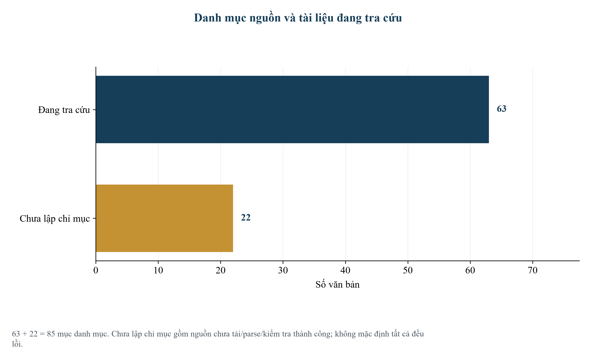

*Hình 3.21. Phân biệt danh mục 85 mục với 63 văn bản thực sự đang tra cứu.*

Kết quả xác nhận số đếm phải được tính theo đúng đối tượng. Catalog là tập nguồn có thể khai thác, còn index là sản phẩm đã được công bố. 22 mục chưa lập chỉ mục có thể chưa tải được, thiếu toàn văn hoặc chưa hoàn tất kiểm tra; không thể chỉ từ số đếm kết luận cả 22 mục đều là lỗi parser. Hai vị trí số liệu trên giao diện dùng cùng manifest để không tạo ra cặp số gây hiểu nhầm như trước đây.

### 3.3.2. Khu vực, ngôn ngữ và loại văn bản

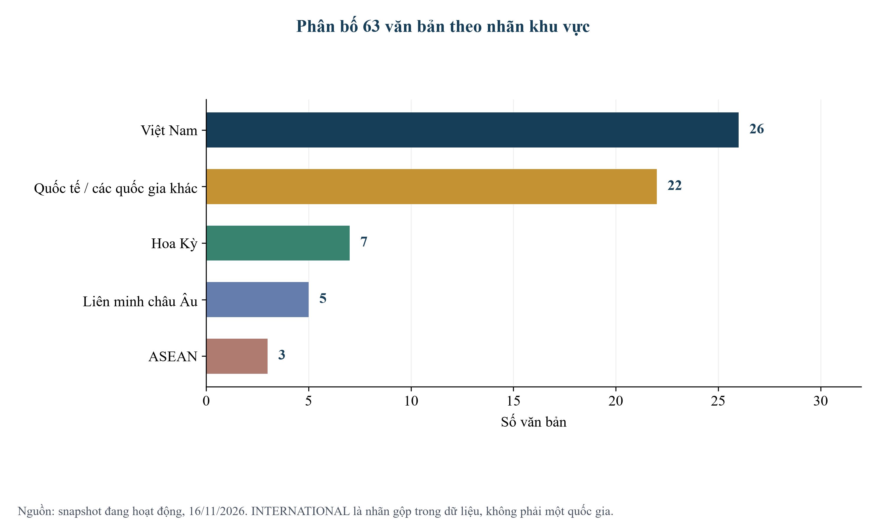

*Hình 3.12. Phân bố theo nhãn khu vực của 63 tài liệu.*

Việt Nam có 26 tài liệu; nhóm INTERNATIONAL có 22; Hoa Kỳ có 7; EU có 5; ASEAN có 3. INTERNATIONAL gộp nhiều nguồn như tổ chức quốc tế, Anh, Singapore, Úc và Canada theo metadata hiện tại. Vì vậy, biểu đồ phản ánh cách tổ chức dữ liệu trong hệ thống, không phải một bảng thống kê số quốc gia. Khi cần phân tích chi tiết hơn, schema nên bổ sung quốc gia và cơ quan thành các chiều riêng.

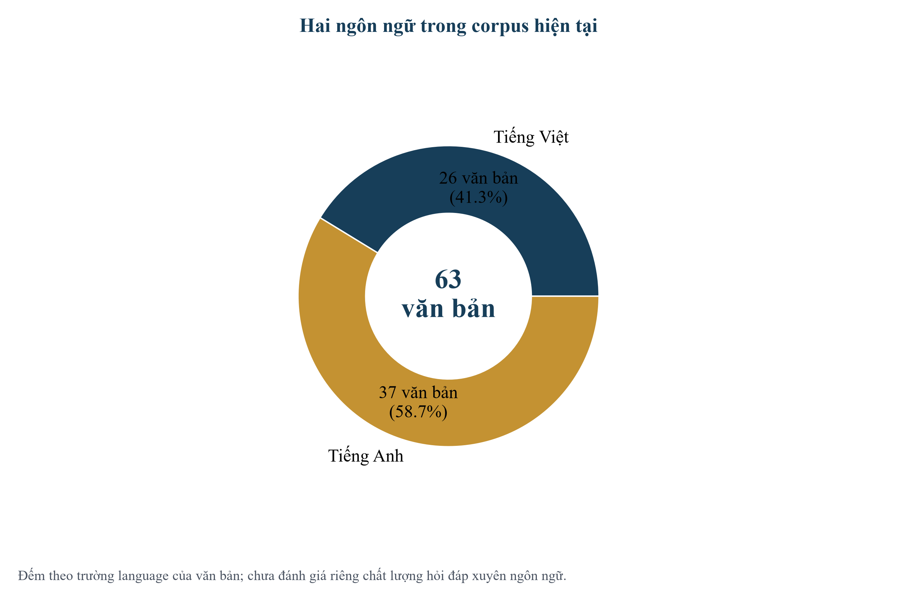

*Hình 3.13. Corpus gồm 26 văn bản tiếng Việt và 37 văn bản tiếng Anh.*

Tài liệu tiếng Anh chiếm khoảng 58,7%. Đây là lý do cần embedding đa ngôn ngữ và cơ chế truy vấn có thể tiếp cận tài liệu quốc tế từ câu hỏi tiếng Việt. Tỷ lệ này chỉ mô tả dữ liệu; chưa chứng minh chất lượng truy xuất xuyên ngôn ngữ ngang với truy xuất cùng ngôn ngữ.

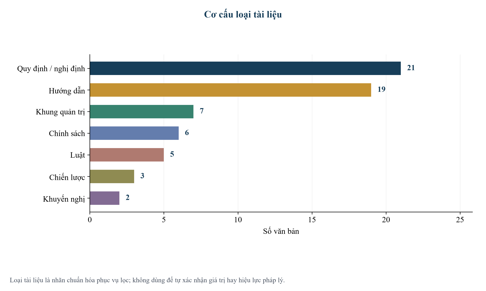

*Hình 3.14. Cơ cấu loại tài liệu sau chuẩn hóa.*

Corpus có 21 mục regulation, 19 guideline, 7 framework, 6 policy, 5 law, 3 strategy và 2 recommendation. Nhóm hướng dẫn và khung quản trị chiếm phần đáng kể, phản ánh phạm vi chính sách AI rộng hơn văn bản quy phạm. Khi hỏi về nghĩa vụ bắt buộc, người dùng cần đối chiếu loại tài liệu, cơ quan và hiệu lực thay vì mặc định mọi nội dung đều có tính ràng buộc pháp luật.

### 3.3.3. Nguồn thu thập và thời gian ban hành

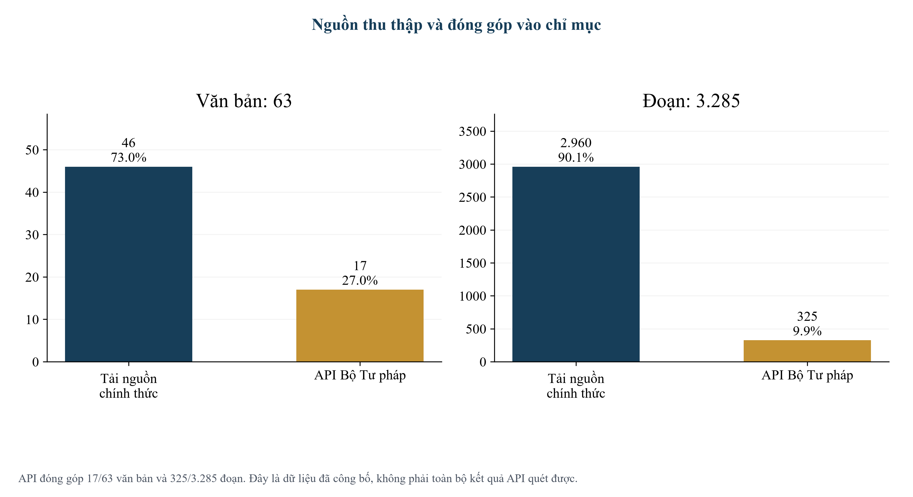

*Hình 3.15. Đóng góp của nguồn tải chính thức và nguồn API vào tập tài liệu/đoạn đang hoạt động.*

Nguồn tải chính thức đóng góp 46 tài liệu và 2.960 đoạn; nguồn API đóng góp 17 tài liệu và 325 đoạn. Tỷ lệ theo văn bản và tỷ lệ theo đoạn khác nhau vì độ dài tài liệu khác nhau. Một lượt API có thể cập nhật tài liệu đã có ID, sau đó Spark khử trùng; số mục API nhận được không cộng thẳng vào số tài liệu đang hoạt động. Corpus sản xuất hiện không có `user_upload`; phép thử upload dùng bộ dữ liệu tách biệt để không đưa tài liệu kiểm thử vào thư viện chính.

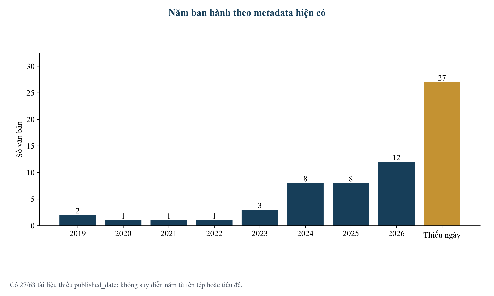

*Hình 3.16. Phân bố năm theo trường published_date; mục thiếu được giữ riêng.*

Có 36/63 tài liệu có năm nhận diện được trong metadata và 27 mục thiếu ngày. Trong nhóm có ngày, năm 2026 có 12 tài liệu, 2025 và 2024 mỗi năm có 8, 2023 có 3; các năm còn lại có ít hơn. Biểu đồ không suy diễn năm từ tên tệp hoặc tiêu đề. Đây là hạn chế metadata cần ưu tiên khi mở rộng bộ lọc thời gian và theo dõi văn bản mới.

## 3.4. Độ dài, chất lượng dữ liệu và lưu trữ

### 3.4.1. Độ dài tài liệu và phân bố đoạn

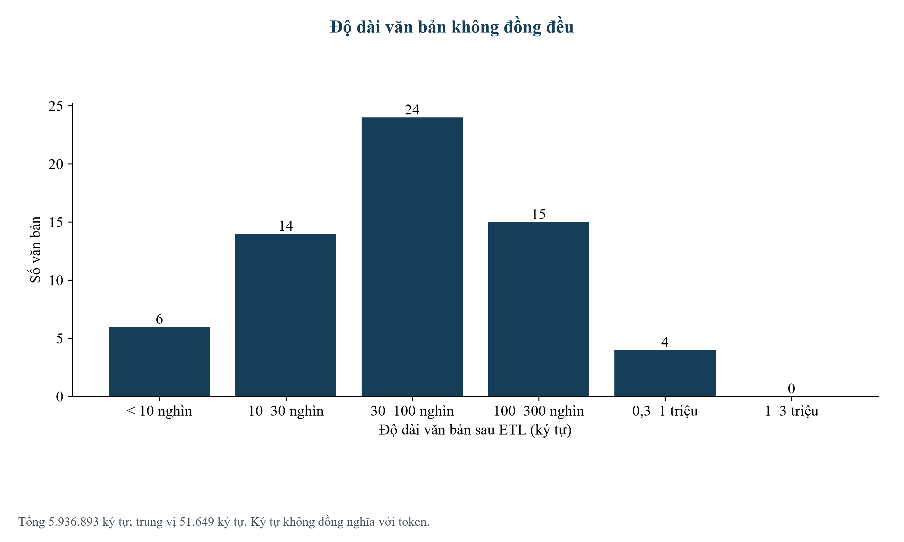

*Hình 3.17. Độ dài văn bản sau ETL theo khoảng ký tự.*

Tổng corpus có 5.936.893 ký tự, trung vị 51.649 ký tự/tài liệu; tài liệu ngắn nhất 2.992 và dài nhất 585.247 ký tự. Chênh lệch này ảnh hưởng tới số chunk, thời gian embedding và khả năng một nguồn dài xuất hiện nhiều lần trong kết quả tìm kiếm. Đơn vị ký tự được tách khỏi token của mô hình; không quy đổi cố định giữa hai đơn vị.

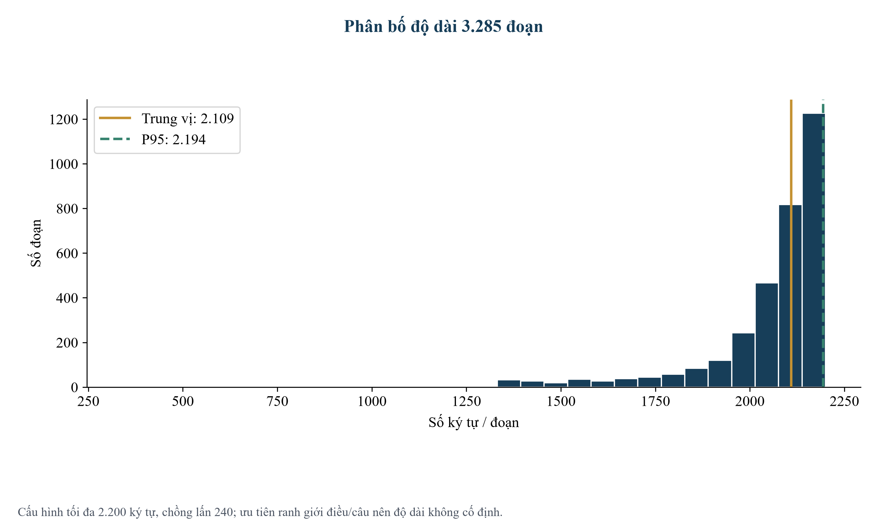

*Hình 3.18. Histogram độ dài 3.285 đoạn trong snapshot.*

Độ dài đoạn nhỏ nhất 339, trung vị 2.109, P95 là 2.194 và lớn nhất 2.200 ký tự. Nhiều đoạn gần giới hạn trên phù hợp cấu hình chunking, nhưng số lượng không tập trung chính xác tại một độ dài vì thuật toán ưu tiên ranh giới văn bản. Chồng lấn làm tổng ký tự các chunk lớn hơn tổng ký tự toàn văn; đó không phải phát sinh thêm văn bản nguồn.

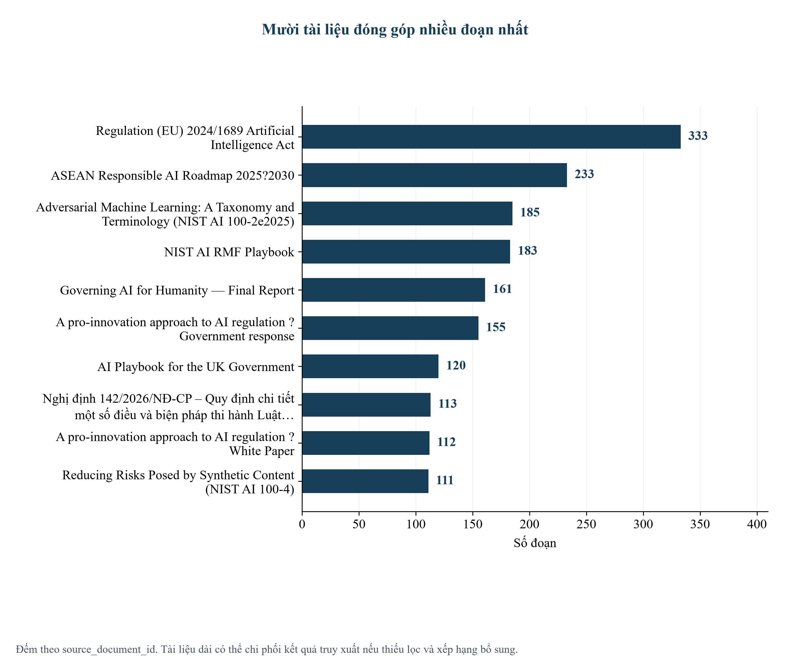

*Hình 3.19. Mười tài liệu có nhiều đoạn nhất; tên đầy đủ và URL nằm trong phụ lục dữ liệu.*

EU AI Act có 333 đoạn, ASEAN Responsible AI Roadmap có 233, tài liệu NIST Adversarial Machine Learning có 185 và NIST AI RMF Playbook có 183. Chỉ bốn tài liệu này đã tạo ra 934/3.285 đoạn, khoảng 28,4%. Vì vậy, một bộ đo chỉ xét số chunk tìm được có thể bị ảnh hưởng bởi tài liệu dài; đánh giá ở mục 3.7 chọn ID tài liệu kỳ vọng thay vì đếm mọi đoạn là các tài liệu độc lập.

### 3.4.2. Kiểm tra chất lượng metadata

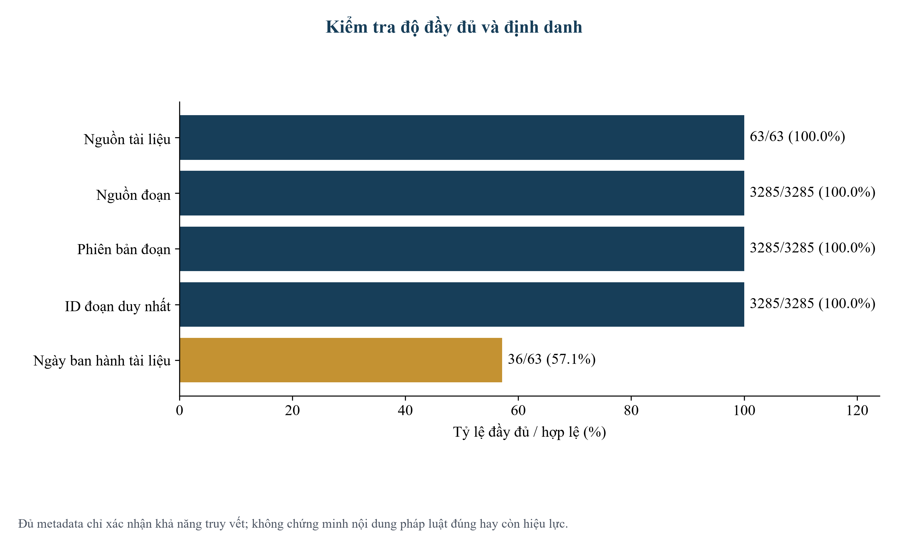

*Hình 3.20. Độ đầy đủ nguồn, phiên bản và tính duy nhất định danh.*

**Bảng 3.6. Kết quả kiểm tra chất lượng kỹ thuật**

| Kiểm tra | Kết quả |
|---|---:|
| Tài liệu thiếu thông tin nguồn | 0/63 |
| Chunk thiếu thông tin nguồn | 0/3.285 |
| Chunk thiếu version_id | 0/3.285 |
| ID chunk bị trùng | 0 |
| Hash toàn văn duy nhất | 63/63 |
| Tài liệu thiếu published_date | 27/63 |

Các chỉ tiêu tốt về nguồn và ID cho thấy pipeline giữ được khả năng truy vết. Chúng không kiểm tra mọi lỗi OCR, lỗi mất bảng biểu hay sự phù hợp pháp lý của câu trả lời. Ngày thiếu và `legal_status` chưa xác minh vẫn là những khoảng trống quan trọng. Trong metadata hiện có, 43 tài liệu mang `unknown`, một mang “Chưa xác định”, 13 mang “Còn hiệu lực”, ba mang “Hết hiệu lực toàn bộ”, một `withdrawn` và hai `historical_snapshot`. Các nhãn này được báo cáo theo dữ liệu đã lưu, chưa phải kết luận thẩm định hiệu lực lại tất cả nguồn vào ngày thực nghiệm.

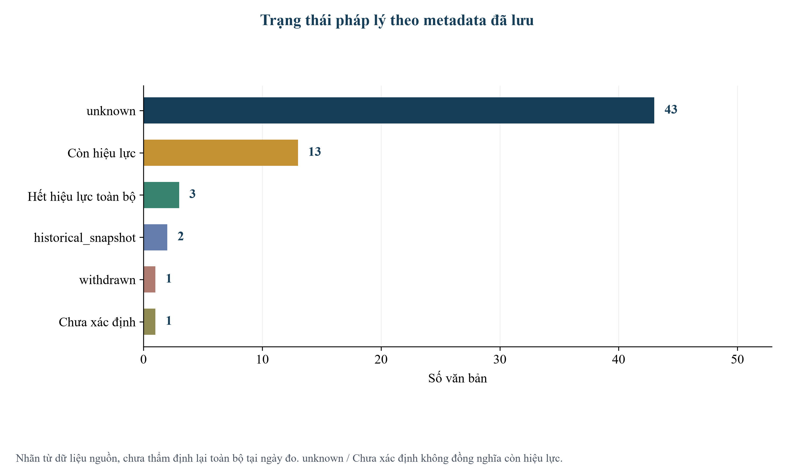

*Hình 3.26. Phân bố nhãn trạng thái pháp lý trong metadata; không thay việc xác minh hiệu lực tại nguồn.*

### 3.4.3. Dung lượng các lớp

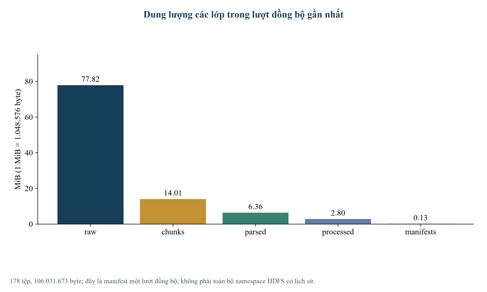

*Hình 3.25. Dung lượng theo lớp của lượt đồng bộ gần nhất, lấy từ lake manifest.*

**Bảng 3.7. Dung lượng trong manifest đồng bộ**

| Lớp | Byte | MiB xấp xỉ |
|---|---:|---:|
| Raw | 81.602.387 | 77,82 |
| Parsed | 6.667.397 | 6,36 |
| Processed | 2.934.181 | 2,80 |
| Chunks | 14.691.944 | 14,01 |
| Manifests | 135.764 | 0,13 |
| **Tổng của lượt đồng bộ** | **106.031.673** | **101,12** |

Lượt đồng bộ gồm 178 tệp. Toàn bộ namespace `/ai_docs` khi kiểm tra chứa 221 tệp và 157.987.547 byte vì còn có lịch sử phiên bản và dữ liệu kiểm toán/thử nghiệm. Hai tổng này có phạm vi khác nhau. Hệ số nhân bản 1 không tạo ra ba bản sao như nhiều sơ đồ HDFS minh họa phổ biến.

Processed hiện có bốn tệp Parquet với 15, 14, 13 và 21 dòng, nén Snappy. Không được dùng trực tiếp tỷ lệ JSONL/Parquet để kết luận tỷ lệ nén thuần túy, vì schema, cách biểu diễn, metadata và quá trình khử trùng có thể khác nhau.

## 3.5. Kiểm thử chức năng, API và upload

### 3.5.1. Kiểm thử tự động

Bộ kiểm thử Python được chạy lại trong container: **86 passed**, năm cảnh báo, thời gian 28,38 giây. Bằng chứng: [python_tests.log](evidence/python_tests.log) và [python_tests.xml](evidence/python_tests.xml). Các ca bao phủ Spark ETL, chunking, API tăng dần, catalog, worker, snapshot, upload và các ràng buộc grounding. Thành công của bộ test có nghĩa là các điều kiện đã mã hóa được thỏa mãn; không suy rộng thành mọi kiểu tệp hoặc mọi câu hỏi đều đã kiểm tra.

**Bảng 3.8. Một số tình huống nghiệm thu**

| Tình huống | Kết quả quan sát |
|---|---|
| Đối chiếu Processed/Chunks/Qdrant | 63 tài liệu; 3.285 chunk và 3.285 point khớp |
| API bổ sung toàn văn AI | Có 17 tài liệu provenance API trong snapshot |
| Cập nhật lại không có thay đổi | `no_changes`, không xây lại collection |
| Tệp upload có văn bản | Hoàn tất toàn pipeline trong tập thử tách biệt |
| Upload lại cùng tệp | Không tạo tài liệu mới |
| Nội dung trùng nguồn có sẵn | Được kiểm tra trong test hồi quy và gắn quan hệ trùng |
| Câu hỏi ngoài phạm vi mẫu | 10/10 bị từ chối theo gate |
| Nhãn nguồn không hợp lệ | Được kiểm tra bằng test, không coi là nguồn hợp lệ |

### 3.5.2. Nguồn API động và cập nhật lặp

Bằng chứng lần nạp thực tế trong [previous_api_verification.json](evidence/previous_api_verification.json) xác nhận snapshot kết hợp có 63 tài liệu và 325 chunk từ API. Một ví dụ tài liệu mới là Thông tư 53/2026/TT-NHNN về an toàn và quản lý rủi ro ứng dụng AI trong ngân hàng; kết quả tìm kiếm giữ URL nguồn và provider `vbpl`. Đây là kiểm tra hoạt động của pipeline, không thay thế đối chiếu nội dung pháp lý với bản gốc.

*Hình 3.7. Ảnh chụp thật lượt cập nhật API được kích hoạt từ giao diện.*

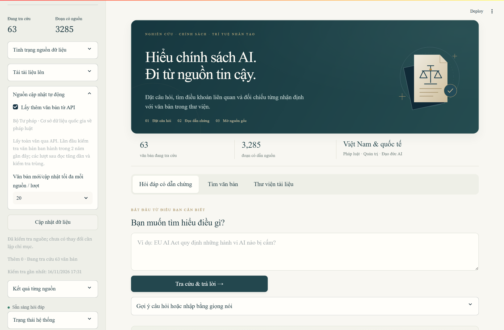

*Hình 3.8. Kết quả lượt kiểm tra lại; số liệu chi tiết trong trạng thái job và manifest ảnh.*

Lượt kiểm tra lặp được lưu trước khi viết báo cáo quét hai trang, 100 mục danh mục, không có thay đổi cần lập chỉ mục và trả `no_changes`. Đây là kết quả đúng khi nguồn không có toàn văn mới phù hợp trong cửa sổ kiểm tra. Nút cập nhật không phải thao tác làm tăng số văn bản bằng mọi giá. Lượt giao diện được chụp bổ sung có trạng thái riêng trong [capture_update_status.json](evidence/capture_update_status.json).

### 3.5.3. Upload và xử lý xuyên suốt

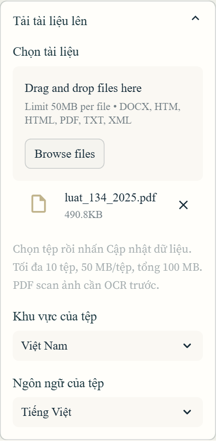

*Hình 3.6. Giao diện chọn PDF trước khi bấm cập nhật. Hình này minh họa nhận tệp, không dùng riêng nó làm bằng chứng đã chạy ETL.*

Kiểm tra tích hợp dùng PDF thật “Luật Trí tuệ nhân tạo 134-2025.pdf” trong bộ dữ liệu tách biệt, kết quả lưu ở [upload_verification.json](evidence/upload_verification.json). Các giai đoạn parse, Spark ETL, chunking, embedding, Qdrant, HDFS, truy xuất và tải bản gốc đều hoàn tất. Tập thử có một tài liệu, 30 đoạn và provenance `user_upload`. HDFS của bộ thử đồng bộ 13 tệp, 784.274 byte.

Tải lại cùng tệp trả `no_changes`. Manifest chỉ mục chính không thay đổi; do đó 63 văn bản sản xuất không bị cộng thêm bản thử nghiệm. Cách tách biệt này cho phép trình bày bằng chứng upload đầy đủ mà không làm sai các biểu đồ corpus. PDF scan chưa có OCR tự động; các test kiểm tra từ chối/báo lỗi không đồng nghĩa đã hỗ trợ OCR.

## 3.6. Thực nghiệm Spark ETL theo mức dữ liệu lặp

### 3.6.1. Thiết kế phép đo

Để kiểm tra tác động của lượng bản ghi và tính đúng của chống trùng, corpus sạch 63 tài liệu được phát lại 1, 5 và 10 lần, tạo 63, 315 và 630 bản ghi. Đây là **dữ liệu lặp có kiểm soát**, không phải 630 văn bản pháp luật khác nhau. Đầu vào tăng theo số lần lặp, còn tập nội dung duy nhất kỳ vọng giữ nguyên 63 tài liệu.

Mỗi mức chạy ba lần trên Spark `local[2]`, cùng schema và logic ETL. Có một lượt warmup riêng không tính vào kết quả; cache hệ điều hành và trạng thái môi trường không được đưa về lạnh giữa các lần chạy. Đồng hồ đo bao quanh hàm ETL, gồm khởi tạo/thực thi, đọc, biến đổi, thống kê, ghi Parquet và dừng Spark. Đọc đối chiếu hash đầu ra được thực hiện sau khoảng đo. Không đo mạng nguồn, chunking, embedding hoặc LLM trong phép đo này.

### 3.6.2. Kết quả

**Bảng 3.9. Kết quả Spark ETL, đơn vị giây**

| Mức | Bản ghi vào | Dung lượng JSONL (byte) | Lần 1 | Lần 2 | Lần 3 | Trung bình | Duy nhất sau ETL | Trùng loại bỏ |
|---|---:|---:|---:|---:|---:|---:|---:|---:|
| 1× | 63 | 6.586.007 | 5,598 | 5,087 | 5,079 | 5,255 | 63 | 0 |
| 5× | 315 | 32.930.035 | 9,115 | 6,599 | 6,066 | 7,260 | 63 | 252 |
| 10× | 630 | 65.860.070 | 9,586 | 10,576 | 13,074 | 11,079 | 63 | 567 |

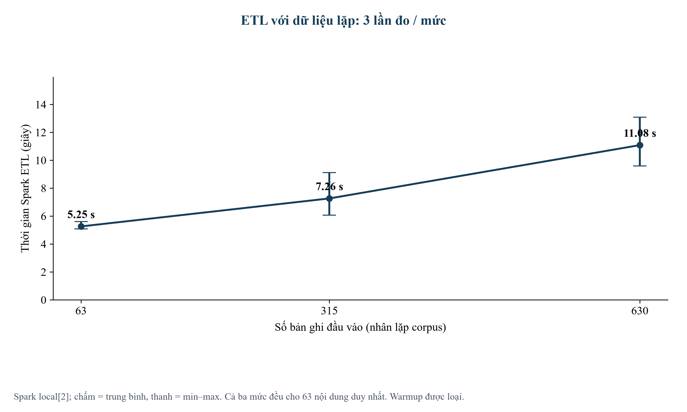

*Hình 3.22. Trung bình và khoảng min–max của ba lần đo; kết quả đầy đủ ở [etl_scaling.csv](evidence/etl_scaling.csv).*

Đầu vào tăng 10 lần nhưng thời gian trung bình tăng khoảng 2,11 lần trong thí nghiệm nhỏ này. Chi phí cố định của Spark, cache và việc đầu ra vẫn chỉ có 63 nội dung góp phần vào kết quả. Không thể suy ra hệ thống sẽ xử lý gấp 10 lần tài liệu độc lập với cùng hệ số tăng thời gian. Để đánh giá mở rộng cần nhiều nội dung duy nhất, dữ liệu lớn hơn, số executor khác nhau và đo trên cụm thực.

Cả chín lần đều cho cùng tập `(source_document_id, text_sha256)` với corpus chuẩn. Đầu ra Parquet thử nghiệm khoảng 2.935.134 byte mỗi lần; chênh lệch nhỏ với snapshot chính 2.934.181 byte không được diễn giải là nội dung mới, vì kiểm tra hash đã xác nhận cùng nội dung. Chỉ mục chính giữ nguyên trong suốt phép thử.

## 3.7. Đánh giá truy xuất

### 3.7.1. Bộ câu hỏi và cách tính

Bộ đo gồm 15 câu hỏi chọn thủ công, mỗi câu gắn một ID tài liệu kỳ vọng đã tồn tại trong snapshot. Các câu thường chứa tên/số hiệu tài liệu, phù hợp kiểm tra định danh tài liệu nhưng dễ hơn nhiều câu hỏi pháp lý mở. Cho phép lọc khu vực ở các ca được khai báo; **không truyền bộ lọc document_id** vì như vậy sẽ tiết lộ đáp án cho retriever. Bộ câu hỏi nằm trong [retrieval_cases.csv](evidence/retrieval_cases.csv).

Với mỗi câu, xác định vị trí xuất hiện đầu tiên của ID tài liệu kỳ vọng trong danh sách hit trả về. Hit@1 bằng tỷ lệ câu có tài liệu đó ở vị trí đầu; Hit@5 bằng tỷ lệ xuất hiện trong năm vị trí đầu. MRR@5 là trung bình nghịch đảo vị trí, bằng 0 nếu không có trong top 5. Đây là các vị trí **hit/đoạn trả về**, chưa có bước gộp mọi hit về một danh sách tài liệu duy nhất trước khi chấm. Một số ca mở rộng điều khoản chỉ trả một ngữ cảnh.

Mỗi câu chạy ba lần để đo độ trễ, tạo 45 lượt gọi. Có 15 câu độc lập, không phải 45 câu mới. Lượt warmup 16,92 giây được loại khỏi thống kê; chưa có phép đo cold start được kiểm soát. Không gọi LLM trong khoảng đo truy xuất.

### 3.7.2. Kết quả và phân tích lỗi

**Bảng 3.10. Chỉ số truy xuất**

| Chỉ số | Kết quả |
|---|---:|
| Số câu / số lượt gọi | 15 / 45 |
| Hit@1 | 73,33% — 11/15 câu |
| Hit@5 | 93,33% — 14/15 câu |
| MRR@5 | 0,8333 |
| Thời gian trung bình | 0,1347 giây |
| Trung vị | 0,0870 giây |
| P95 mẫu | 0,1863 giây |

P95 được lấy theo phần tử thứ `int(0,95 × (n−1))` của dãy 45 thời gian đã sắp xếp; bộ đo nhỏ nên không dùng để cam kết SLA. Độ trễ bao gồm embedding truy vấn, yêu cầu Qdrant và xử lý ngữ cảnh của retriever, không phải thời gian toàn bộ giao diện trả lời.

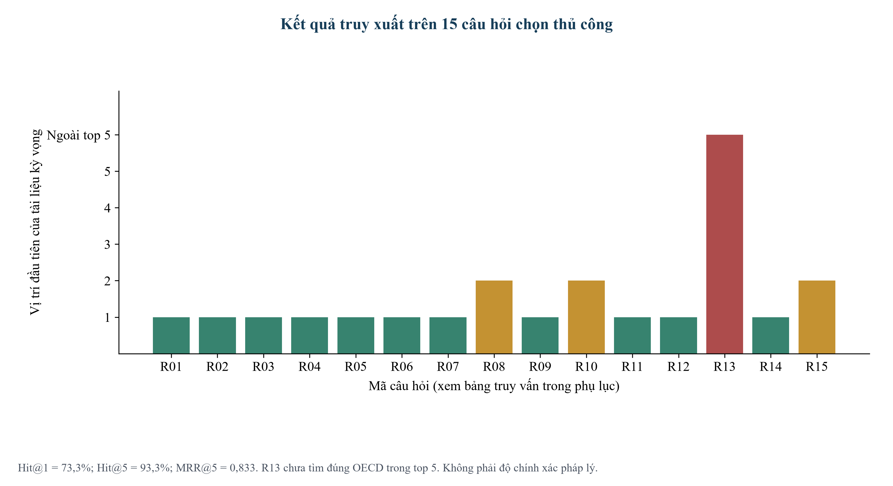

*Hình 3.23. Vị trí đầu tiên của tài liệu kỳ vọng; ba lượt cho cùng kết quả thứ hạng trên các ca này.*

**Bảng 3.11. Kết quả theo câu hỏi**

| Mã | Tài liệu/chủ đề kỳ vọng | Vị trí |
|---|---|---:|
| R01 | Luật AI 134/2025 — phạm vi | 1 |
| R02 | Quyết định 127 — chiến lược AI | 1 |
| R03 | Quyết định 1671/2026 | 1 |
| R04 | Nghị định 142/2026 | 1 |
| R05 | Quyết định 102/2026 Hà Nội | 1 |
| R06 | Thông tư 53/2026 ngân hàng | 1 |
| R07 | EU AI Act — rủi ro cao | 1 |
| R08 | Hướng dẫn EU AI literacy | 2 |
| R09 | NIST AI RMF | 1 |
| R10 | NIST Generative AI Profile | 2 |
| R11 | NIST SP 800-218A | 1 |
| R12 | UNESCO — đạo đức AI | 1 |
| R13 | OECD AI Principles | Không có trong top 5 |
| R14 | ASEAN Governance and Ethics | 1 |
| R15 | Singapore Model AI Governance | 2 |

R13 trả các nội dung gần chủ đề từ Singapore, Úc, UNESCO và Anh nhưng không tìm đúng OECD trong top 5. Corpus có tài liệu OECD nên đây là lỗi truy xuất/xếp hạng, không phải thiếu tài liệu trong index. R08 đặt EU AI Act trước hướng dẫn AI literacy; R10 đặt ASEAN Roadmap trước NIST GenAI Profile. Các trường hợp cho thấy dense similarity có thể ưu tiên nội dung gần nghĩa thay vì đúng cơ quan hoặc tên tài liệu. Hướng cải thiện là kết hợp từ khóa/số hiệu, metadata và reranker, sau đó đánh giá trên một bộ kiểm thử độc lập; chưa áp dụng các bước đó chỉ để nâng điểm của bộ 15 câu này.

Kết quả 93,33% không được viết thành “LLM trả lời đúng pháp luật 93,33%”. Bộ đo chưa chấm tính đầy đủ, mâu thuẫn, thời điểm hiệu lực, phủ định hay mức hỗ trợ của từng nhận định. Thêm 10 câu ngoài phạm vi đều bị từ chối, nhưng chỉ phản ánh hoạt động gate trên những mẫu đã chọn, chưa đo false refusal trên câu AI hợp lệ khó.

## 3.8. Kiểm tra hỏi đáp đầu cuối và dẫn chứng

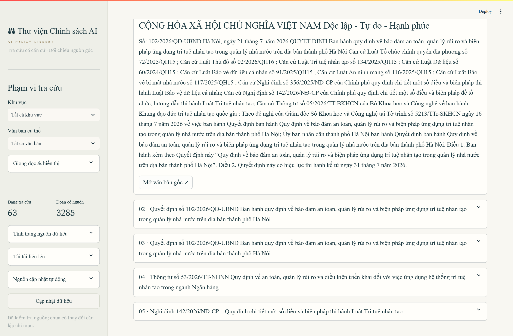

*Hình 3.3. Tìm kiếm văn bản và đoạn nguồn trên ứng dụng thật.*

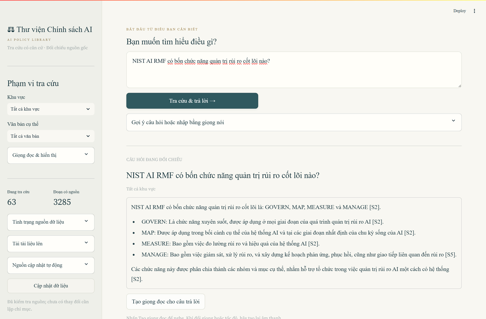

*Hình 3.4. Câu trả lời có nhãn nguồn từ giao diện đang chạy; đây là ca giao diện riêng, không thay số đo benchmark.*

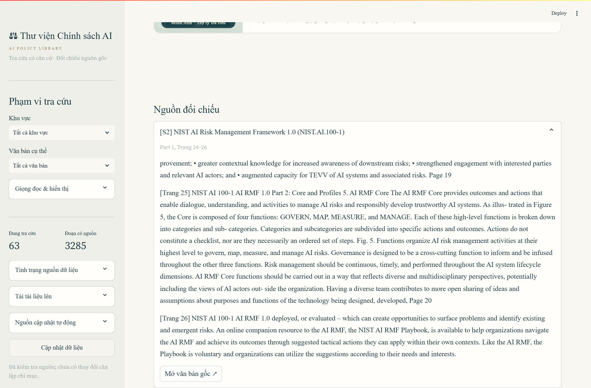

*Hình 3.5. Mở đoạn đối chiếu và liên kết nguồn.*

Loạt smoke test gọi ba câu hỏi chức năng và lưu toàn bộ kết quả ở [llm_smoke.json](evidence/llm_smoke.json). Hai câu dùng LLM sinh trực tiếp; câu EU dùng bản tóm tắt biên tập với điều kiện checksum. Kết quả được trình bày riêng trong bảng sau.

**Bảng 3.12. Ca hỏi đáp và thời gian quan sát**

| Ca | Chế độ | Kết quả cần quan sát | Thời gian |
|---|---|---|---:|
| Phạm vi Luật Trí tuệ nhân tạo | LLM, Qwen3 Instruct | Có nguồn S1; giữ mệnh đề loại trừ quốc phòng/an ninh/cơ yếu | 42,54 giây |
| Bốn chức năng NIST AI RMF | LLM, Qwen3 Instruct | Trả lời có nhãn S2/S4 và nguồn đối chiếu | 7,70 giây |
| Hành vi bị cấm theo EU AI Act | `curated_summary`, model null | Tám nhóm từ bản biên tập đúng checksum | 0,39 giây |

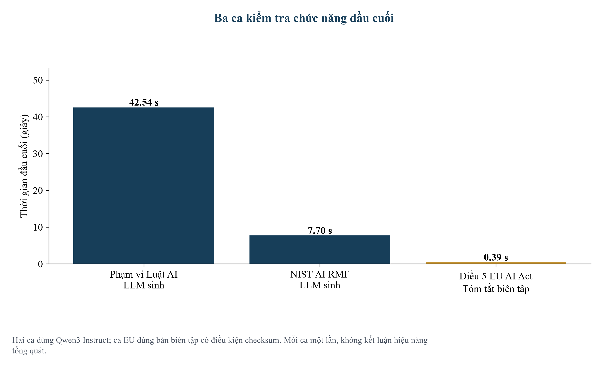

*Hình 3.24. So sánh mô tả ba ca chức năng; màu khác để phân biệt bản biên tập với LLM.*

Ở ca Luật AI, đầu ra giữ nội dung loại trừ hoạt động chỉ phục vụ quốc phòng, an ninh, cơ yếu, cho thấy lợi ích của lấy đủ điều thay vì một mảnh thiếu ngoại lệ. Đây là quan sát trên một ca và nguồn cụ thể; chưa đủ để kết luận mô hình luôn xử lý đúng các phủ định. Chênh lệch 42,54 và 7,70 giây có thể chịu ảnh hưởng trạng thái model, ngữ cảnh và độ dài sinh; mỗi ca chỉ chạy một lần nên không tách được tác động từng yếu tố. Thời gian 0,39 giây của bản biên tập không được tính vào trung bình suy luận LLM.

Việc có S1 hoặc S2 không tự bảo đảm nguồn hỗ trợ đúng câu. Bước đánh giá tiếp theo cần người đọc đối chiếu từng nhận định với nguyên văn và đánh dấu hỗ trợ đầy đủ/một phần/không hỗ trợ, đặc biệt với thời hạn, ngoại lệ và hiệu lực. Báo cáo hiện tại cung cấp đường truy vết và ví dụ, chưa có một bộ điểm chất lượng pháp lý được thẩm định độc lập.

## 3.9. Minh chứng ứng dụng và hạ tầng

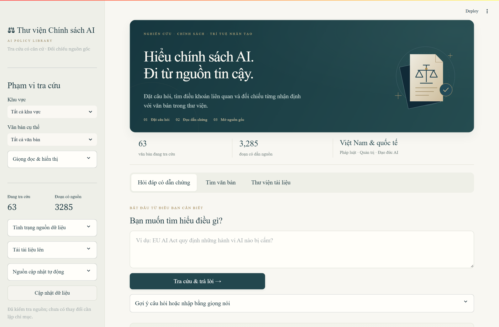

*Hình 3.1. Giao diện chính và số tài liệu đang hoạt động.*

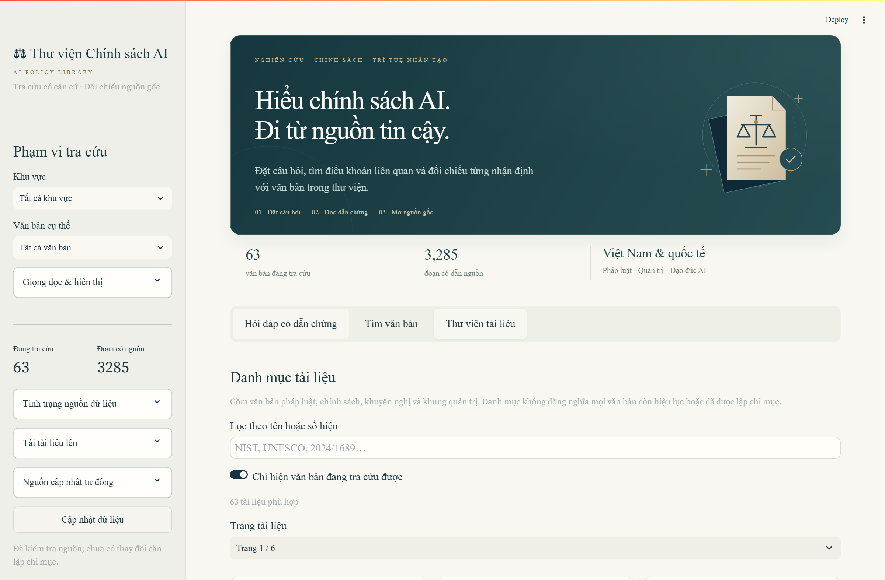

*Hình 3.2. Thư viện tài liệu có trạng thái và điều khiển lọc/phân trang.*

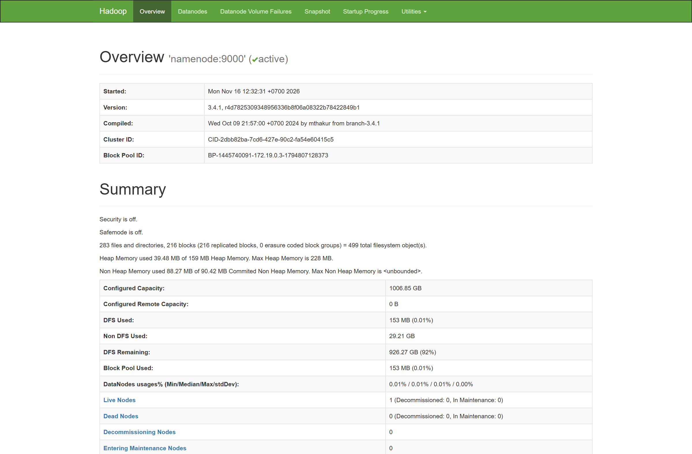

*Hình 3.9. NameNode UI thật; cần đọc dung lượng theo phạm vi namespace của giao diện.*

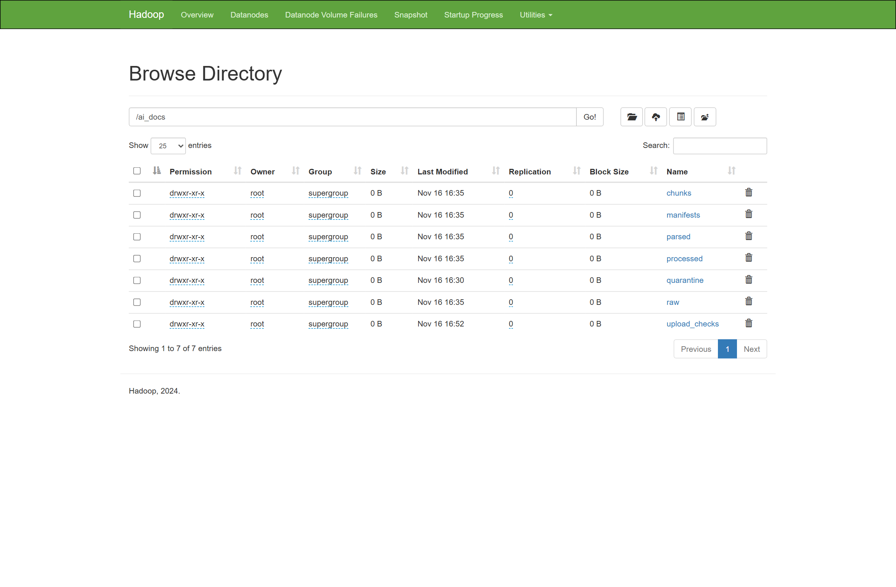

*Hình 3.10. Các vùng Raw, Parsed, Processed, Chunks và Manifests trên HDFS.*

Trên màn hình thư mục, các cột Size, Replication và Block Size có thể cùng bằng 0 vì hàng đang biểu diễn một `DIRECTORY`. WebHDFS định nghĩa length của thư mục bằng 0 và trả metadata block/replication như vậy [2]; đây không phải tổng dung lượng các tệp con. Muốn xem dung lượng cộng dồn cần `GETCONTENTSUMMARY` hoặc `hdfs dfs -du`, còn muốn xem replication phải mở từng tệp.

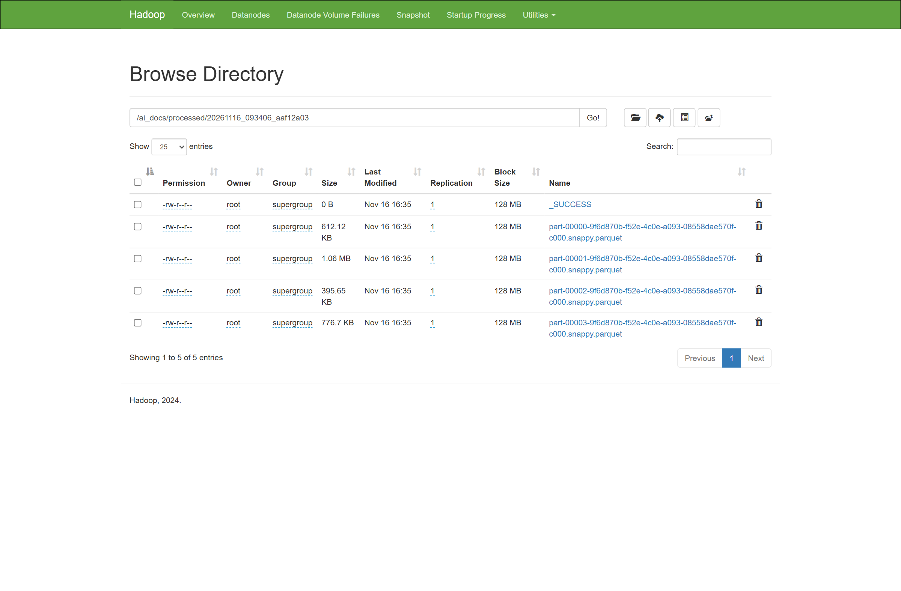

*Hình 3.30. Mở thư mục Processed của snapshot để xem các tệp Parquet có dung lượng, replication và block size thật.*

Đã kiểm tra riêng một tệp Parquet có 626.810 byte và PDF gốc có 502.586 byte: cả hai có replication 1, block size cấu hình 134.217.728 byte (128 MiB). Đọc lại tệp từ HDFS cho checksum trùng bản gốc. Block size là kích thước chia block được cấu hình, không yêu cầu mỗi tệp nhỏ phải có đủ 128 MiB dữ liệu. Tệp marker như `_SUCCESS` có thể cố ý rỗng; không dùng nó để kết luận toàn bộ Parquet rỗng. [hdfs_file_verification.json](evidence/hdfs_file_verification.json) lưu kết quả đối chiếu.

Kiểm tra `hdfs fsck /ai_docs` báo **HEALTHY**, 216 block được kiểm tra, không có missing block, corrupt block hoặc under-replicated block. Chi tiết ở [hdfs_fsck.log](evidence/hdfs_fsck.log). Tính khỏe mạnh này được đánh giá theo replication 1 của máy demo, chưa cung cấp khả năng chịu mất một DataNode.

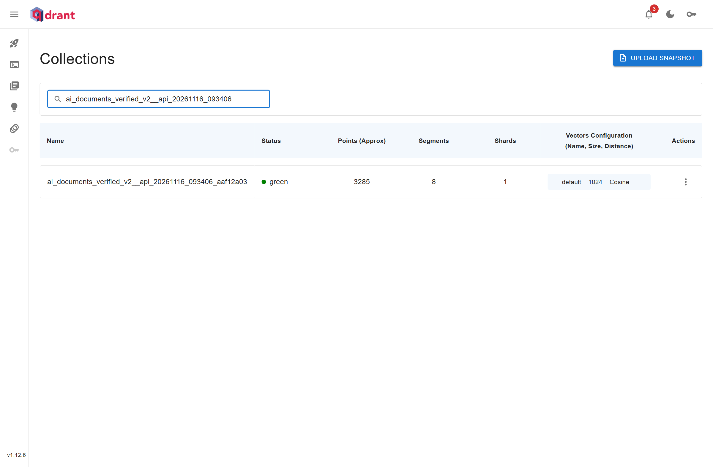

*Hình 3.11. Dashboard Qdrant; số liệu index chính được đối chiếu bằng API exact count.*

Các ảnh được tạo bằng Chrome headless trong một phiên trình duyệt mới, chỉ truy cập localhost, không dựng bằng ảnh minh họa AI. Playwright dùng để điều khiển thao tác và chụp màn hình [15]. [screenshot_manifest.json](evidence/screenshot_manifest.json) ghi URL, thời điểm và tên ảnh. Sơ đồ thiết kế được vẽ riêng bằng Graphviz; biểu đồ thống kê xuất bằng Matplotlib từ CSV/JSON, vì vậy hai nhóm đó không được gọi là ảnh chụp màn hình.

## 3.10. Thử nghiệm trợ lý giọng nói và người thuyết trình

### 3.10.1. Kịch bản và ảnh giao diện thật

Người thuyết trình được kiểm tra như một chức năng riêng của sản phẩm. Kịch bản bắt đầu tại **Khám phá trợ lý giọng nói**, bấm **Nghe thử giọng đọc**, sau đó phát, tạm dừng, đổi tốc độ và đọc lại. Không cần gọi LLM cho đoạn chào mẫu nên có thể tách lỗi bộ phát khỏi lỗi sinh câu trả lời.

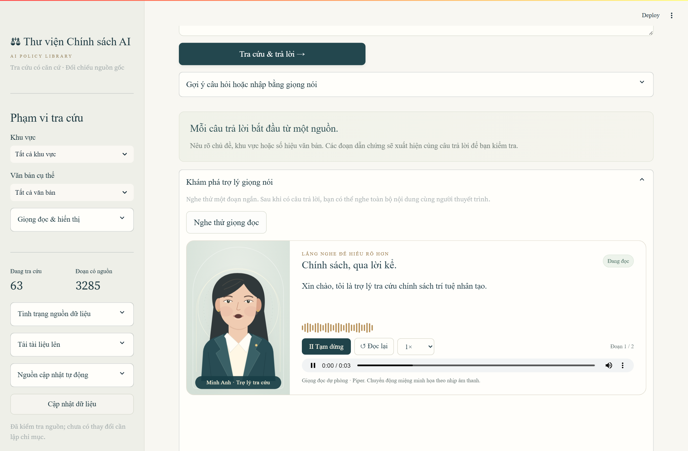

*Hình 3.27. Người thuyết trình nữ trong ứng dụng đang chạy, kèm phụ đề và điều khiển nghe.*

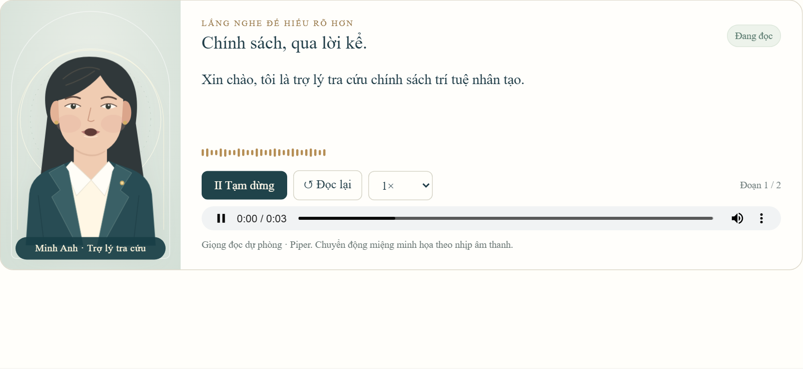

*Hình 3.28. Ảnh chụp thật khung người nói khi audio đang phát; nhãn ghi đúng provider Piper dự phòng của phiên đo.*

Giao diện giữ một lựa chọn giọng nữ theo cấu hình hiện tại. Trong phiên chụp, âm thanh thực tế do **Piper dự phòng** tạo ra; báo cáo không coi đây là mẫu Hoài My đã đáp ứng. Nhân vật nữ là hình minh họa của giao diện, còn provider là nguồn tạo âm thanh. Cách ghi này vừa giữ được điểm nhấn trình bày vừa có thể kiểm chứng trạng thái thực tế.

### 3.10.2. Kết quả bộ phát, phụ đề và hoạt ảnh

**Bảng 3.13. Nghiệm thu người thuyết trình trên trình duyệt thật**

| Kiểm tra | Kết quả/bằng chứng |
|---|---|
| Có audio thật | 2 đoạn WAV được trích từ chính playlist đã phát |
| Audio chạy theo thời gian | `currentTime` tăng quá 0,2 giây; `paused=false` |
| Nhân vật chuyển động theo âm | Năm mẫu bán kính miệng khác nhau trong lúc phát; ảnh có sóng âm |
| Tạm dừng | Trạng thái chuyển thành “Tạm dừng” |
| Đổi tốc độ | Chọn 1,15×, `audio.playbackRate=1.15` |
| Đọc lại | Trở về đầu và phát lại |
| Phụ đề | Chuyển từ Đoạn 1/2 sang Đoạn 2/2 theo sự kiện kết thúc audio |
| Kết thúc | Trạng thái “Đã đọc xong” |

Nguồn: [presenter_browser_check.json](evidence/presenter_browser_check.json). Mẫu hoạt ảnh cho thấy thuộc tính SVG thay đổi, chưa phải đánh giá mức khớp môi với âm vị. Các ca logic JavaScript còn kiểm tra phát WAV, pause/resume, tốc độ, phụ đề, kết thúc, đọc lại và xử lý thiếu giọng Việt; lần chạy lại báo PASS trong [presenter_player_tests.log](evidence/presenter_player_tests.log). Test Python kiểm tra khóa cache khi đổi tốc độ và escape nội dung trong script đã nằm trong bộ 86 ca.

### 3.10.3. Dữ liệu âm thanh và vai trò trong tiểu luận

**Bảng 3.14. Hai đoạn âm thanh thật được đính kèm**

| Đoạn | Thời lượng | Tần số lấy mẫu | Kênh / độ sâu mẫu | Byte |
|---|---:|---:|---|---:|
| Đoạn chào | 3,396 giây | 22.050 Hz | Mono / PCM 16-bit | 149.806 |
| Đoạn hướng dẫn đối chiếu | 3,686 giây | 22.050 Hz | Mono / PCM 16-bit | 162.606 |

Mẫu [đoạn 1](am_thanh/nguoi_thuyet_trinh_doan_01.wav) và [đoạn 2](am_thanh/nguoi_thuyet_trinh_doan_02.wav) được giữ cùng checksum trong JSON bằng chứng. Tổng thời lượng khoảng 7,08 giây ở tốc độ cơ sở; đây là thời lượng audio, không phải thời gian xử lý tổng hợp tiếng nói.

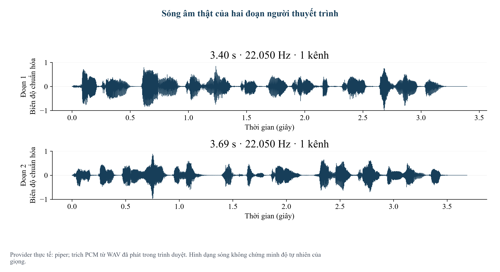

*Hình 3.29. Dạng sóng PCM từ hai tệp đã phát. Biểu đồ dùng kiểm tra sự tồn tại và cấu trúc tín hiệu, không suy ra độ tự nhiên của giọng.*

Phần người nói là điểm nhấn ứng dụng của tiểu luận: sản phẩm dữ liệu từ Data Lake/RAG được chuyển thành trải nghiệm đa phương thức có thể đọc, nghe và đối chiếu nguồn. Pipeline TTS xử lý văn bản theo cụm, giữ thứ tự, metadata provider và trạng thái phát; giao diện trình bày đồng bộ đoạn âm thanh với nhân vật. Chưa có thử nghiệm người dùng, điểm MOS hoặc phép đo nhận dạng giọng nói WER, nên báo cáo chỉ kết luận chức năng hoạt động theo những kiểm tra trên. Nhập câu hỏi bằng giọng nói được mô tả trong thiết kế nhưng chưa được tính là một phép thử micro người thật trong bộ nghiệm thu này.

## 3.11. Thảo luận và định hướng phát triển

Kết quả thể hiện hệ thống đã hình thành một vòng đời dữ liệu: nhận nguồn mới/tệp, chuẩn hóa bằng Spark, giữ dữ liệu theo lớp, phát hành chỉ mục có phiên bản và khai thác qua RAG. Phần phù hợp với học phần Dữ liệu lớn và định hướng Data Engineer nằm ở hợp đồng nguồn, schema, chất lượng, provenance, khử trùng, kho dữ liệu, điều phối và quan sát pipeline.

**Bảng 3.15. Đối chiếu kết quả với kỹ năng Data Engineering**

| Năng lực | Minh chứng trong dự án | Giới hạn cần phát triển |
|---|---|---|
| Data ingestion | Adapter API danh mục/toàn văn; nhiều định dạng; upload | Thêm nguồn ổn định, quản lý quota và hợp đồng schema |
| Incremental processing | Cửa sổ thời gian, checkpoint, checksum, no_changes | Phát hiện sửa đổi văn bản cũ; lịch chạy tự động |
| Batch ETL | Spark DataFrame, Window khử trùng, báo cáo | Chuyển I/O và tác vụ lên cụm thực |
| Data storage | Raw/Parsed/Parquet/Chunks, HDFS, snapshot | Replication, retention, backup/restore đã kiểm thử |
| Data governance | Nguồn, phiên bản, loại tài liệu, trạng thái hiệu lực | Chuẩn hóa ngày và thẩm định hiệu lực/phạm vi sử dụng |
| Serving | Qdrant alias, manifest phiên bản, RAG | Hybrid retrieval, rerank, kiểm soát nhiều người dùng |
| Observability và QA | Trạng thái job, log, 86 test, CSV/JSON và đồ thị | Theo dõi tài nguyên theo thời gian, cảnh báo và SLO |

Những giới hạn chính gồm corpus nhỏ, chỉ một máy và một DataNode; chưa có đo tải đồng thời; dữ liệu lặp không thay thế dữ liệu độc lập quy mô lớn; bộ truy vấn chọn thủ công thiên về tên tài liệu; còn thiếu metadata ngày/hiệu lực; chưa hỗ trợ OCR; công bố xuyên Qdrant/manifest/HDFS chưa là giao dịch chung. Chức năng giọng và giao diện hỗ trợ trình diễn nhưng không được coi là bằng chứng mở rộng dữ liệu.

Thứ tự phát triển hợp lý là hoàn thiện metadata và bộ đánh giá có thẩm định, bổ sung hybrid/reranker, thiết lập scheduler/quan sát, sau đó chuyển xử lý và lưu trữ sang cụm có chính sách sao lưu, retention và phân quyền. Mọi công nghệ bổ sung cần có phép đo trước/sau và tiêu chí chấp nhận cụ thể, thay vì chỉ tăng số thành phần trong sơ đồ.
